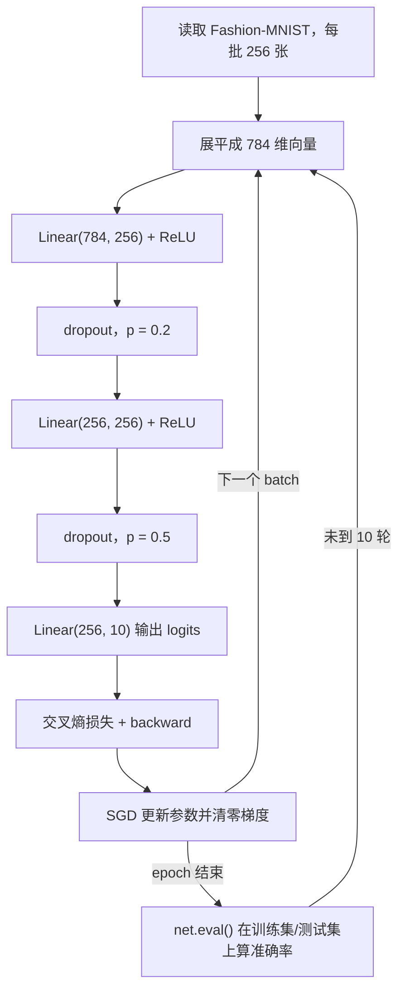
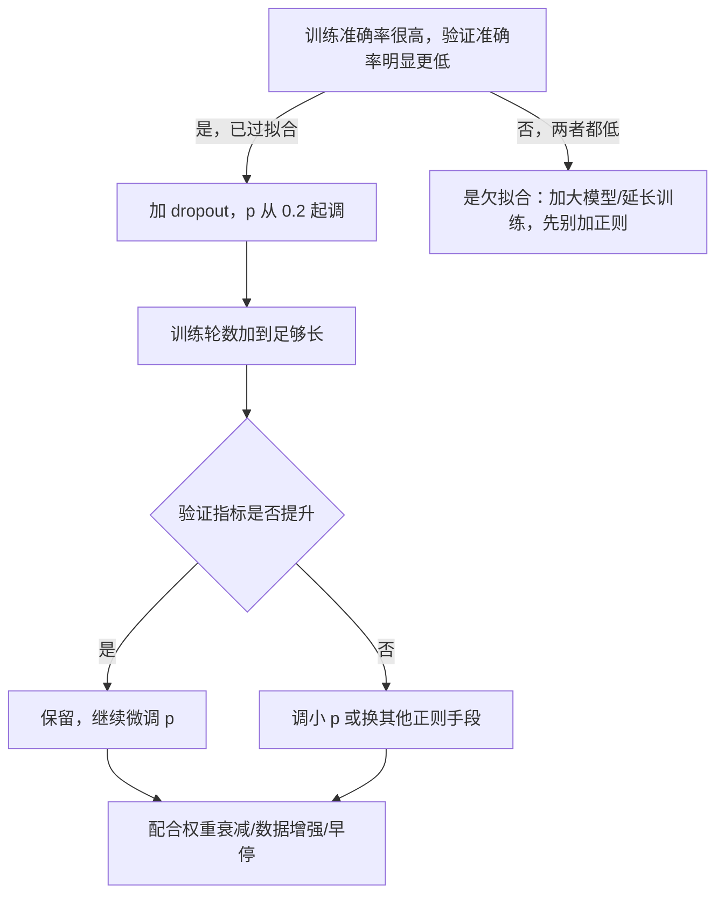

> 环境：Python 3.9 + `torch 2.8.0` + `torchvision 0.23.0`
> 数据：Fashion-MNIST（首次运行会自动下载约 30 MB 到 `./data`）
> 参考主线：《动手学深度学习》(d2l) 第 4.6 节「暂退法（dropout）」
> 前置阅读：同目录《深度学习-权重衰减》，两篇讲的是同一件事（抑制过拟合）的两种不同手段

| 章 | 内容 |
| --- | --- |
| 一、Dropout 简介与理论 | 过拟合、集成思想、dropout 的定义、inverted dropout 与期望保持、为什么有效、p 怎么选、train/eval 两种模式、局限与变体 |
| 二、代码实现 | 读数据、手写 dropout、三层感知机、准确率与训练循环、实测结果、丢弃概率对照、小样本回归实验、`nn.Dropout` 接口、常见坑 |
| 三、进阶与小结 | 什么时候值得用、与其他正则化手段对比、小结 |

文中代码按顺序复制即可运行，除了自动下载的数据集外不需要任何外部文件。

---

# 一、Dropout 简介与理论

## 1.1 过拟合：模型把训练集「背」下来了

上一篇讲权重衰减时用了一个极端例子：20 个样本、200 维特征，模型把训练损失压到 0，验证损失却高达 165。

这一篇换一个更真实的例子：Fashion-MNIST 图像分类。网络是 784 → 256 → 256 → 10 的多层感知机，参数量为

```text
784×256 + 256  =  200 960
256×256 + 256  =   65 792
256×10  + 10   =    2 570
总计           =  269 322
```

而训练集只有 60 000 张图。**参数数量是样本数的四倍多**，网络完全有能力「记住」每一张训练图——只要把与每个样本对应的那几个权重调得足够大。

这时训练准确率会一路涨高，测试准确率却在某个点之后停滞甚至下降。模型学到的不是「袖子的形状」「鞋底的花纹」这类通用特征，而是「第 13742 张图左上角那个像素偏亮」这种只对训练集有效的偶然细节。

这就是**过拟合**：训练误差很低，泛化误差很高。

上一篇的解法是**限制权重的数值大小**（权重衰减）。这一篇的解法完全不同：**在训练时随机破坏网络本身**，让它没法依赖任何一条固定的「记忆通路」。

## 1.2 集成：多个模型投票

在讲 dropout 之前，先看一个更朴素的办法。

如果训练一个模型容易过拟合，那就训练 $m$ 个独立模型，预测时把它们的输出平均。这叫做**集成（ensemble）**。由于每个模型看到的初始化和数据顺序不同，它们犯的错误不完全一样，平均之后方差变小，泛化通常能明显提升。

代价也很直接：训练时间、显存、推理时间都变成 $m$ 倍。$m=10$ 就是 10 倍，实际项目里很难接受。

dropout 的想法很巧妙：**不训练多个网络，而是在一个网络里随机「剪掉」一部分神经元**，让每次前向传播都像是在训练一个不同的子网络。

一个含 $n$ 个隐藏单元的网络，每个单元在每次前向时独立地决定保留还是丢弃，一共就有 $2^n$ 种可能的子网络，而它们**共享同一套参数**。本例两个隐藏层各有 256 个单元，$n = 512$：

```text
2^512 ≈ 1.34 × 10^154
```

这个数字比可观测宇宙的原子数还大得多。dropout 相当于在这么多子网络里随机采样训练，测试时再用一个「平均后」的网络来预测。

## 1.3 dropout 的定义

设某一隐藏层的输出向量为 $\mathbf{h} = (h_1, \dots, h_n)$，丢弃概率为 $p \in [0, 1)$。训练时对每个元素独立采样一个伯努利随机变量：

$$
m_i \sim \mathrm{Bernoulli}(1-p), \qquad
\tilde{h}_i = \frac{m_i h_i}{1-p}
$$

- $m_i = 1$ 表示保留，$m_i = 0$ 表示丢弃；
- 每个元素被保留的概率是 $1-p$，所以 $p$ 就是「丢弃比例」；
- **每次前向传播都重新采样一遍**，不是训练开始前固定一张掩码。

举个具体的例子，$p = 0.5$、$\mathbf{h} = (1, 2, 3, 4)$，某次采样得到掩码 $(1, 0, 1, 0)$：

```text
h        = (1, 2, 3, 4)
mask     = (1, 0, 1, 0)
mask * h = (1, 0, 3, 0)
除以 1-p = (2, 0, 6, 0)      <- 保留下来的元素被放大了 2 倍
```

几个约定：

| 位置 | 是否用 dropout | 说明 |
| --- | --- | --- |
| 输入层 | 一般不用（或很小，如 0.1） | 直接丢弃像素会损失大量信息 |
| 隐藏层 | 常用 0.2 ~ 0.5 | 正则化的主战场 |
| 输出层 | 不用 | 输出要给出完整的类别得分，不能被随机置零 |

## 1.4 推理时怎么办：inverted dropout

训练时随机丢弃，推理（测试）时总不能也随机丢弃——那样同一个样本每次预测结果都不一样。所以推理时必须把 dropout 关掉，用完整的网络。

问题来了：训练时平均只有 $(1-p)$ 比例的神经元在工作，推理时全部神经元都工作，**激活值的量级会突然变大**，后面的层会不适应。

解决办法是在训练时就把保留的激活值除以 $(1-p)$，让训练和推理的量级对齐。这就是上面公式里那个除以 $(1-p)$ 的来历，叫 **inverted dropout（倒置暂退）**，也是 PyTorch、TensorFlow 现在的默认做法。

它成立的关键是**期望不变**：

$$
\mathbb{E}[\tilde{h}_i] = (1-p)\cdot\frac{h_i}{1-p} + p \cdot 0 = h_i
$$

也就是说，虽然每次前向都在随机丢弃，但大量采样平均下来，输出和「不丢弃」时一样大。方差则会变大：

$$
\mathrm{Var}[\tilde{h}_i] = \frac{p}{1-p}\,h_i^2
$$

$p = 0.5$ 时标准差正好是原来的 2 倍，这就是 dropout 注入的「噪声」。用 $10^5$ 个 1 实测：

| $p$ | 保留比例 | 均值 | 标准差 | 理论标准差 $\sqrt{p/(1-p)}$ |
| --- | --- | --- | --- | --- |
| 0.2 | 0.8007 | 1.0009 | 0.4993 | 0.500 |
| 0.5 | 0.5018 | 1.0035 | 1.0000 | 1.000 |
| 0.8 | 0.1998 | 0.9990 | 1.9992 | 2.000 |

均值稳定在 1，说明缩放确实把期望补了回来；标准差随 $p$ 增大，说明丢弃越狠、噪声越大。

> 历史小插曲：原始论文（2014）的做法是训练时不缩放、测试时把所有权重乘 $(1-p)$。两种做法数学上等价，但 inverted 版把缩放放在训练时，测试路径变成纯粹的恒等映射，代码更干净，所以成了主流。

## 1.5 为什么 dropout 有效

有四个常被提到的解释，它们并不互斥：

**① 集成视角（最主流的解释）**

每次前向都在训练一个随机子网络，测试时用完整网络。由于子网络共享参数，完整网络的输出可以看成是对指数多个子网络输出的**近似平均**，而平均能降低方差——这正是集成起作用的机制。区别只是 dropout 用一套参数「免费」实现了集成。

这个「平均」有多准？拿一个 5 → 20 → 2 的小网络实测：以测试模式输出为基准，训练模式跑 20000 次随机掩码再平均，最大相对误差为

| $p$ | 20000 次掩码平均 vs 测试模式 |
| --- | --- |
| 0.2 | 1.84% |
| 0.5 | 3.98% |

对线性层这个等式是精确的；经过 ReLU 之后只是近似，但误差很小，说明「测试时用完整网络 ≈ 对子网络求平均」这个直觉站得住。

**② 打破共适应（co-adaptation）**

没有 dropout 时，神经元容易形成「小团体」：某个特征检测器只在另一个特定神经元也激活时才有用。这种依赖在训练集上工作得很好，但很脆弱。dropout 让伙伴随时可能消失，神经元被迫学习**单独也有用**的特征，相当于强制特征之间互相独立。

**③ 噪声注入 / 数据增强**

dropout 相当于在隐藏层激活上加乘性噪声。这和给输入加噪声、做数据增强是同一类思路：让模型在「被扰动」的情况下仍然预测正确，学到的决策边界自然更平滑、更鲁棒。

**④ 隐式正则**

dropout 抑制过拟合，但它**不是**在压小权重。Fashion-MNIST 训练 10 轮后，全部参数的范数：

| 配置 | $\Vert\theta\Vert$ | 测试准确率 |
| --- | --- | --- |
| 不用 dropout | 22.85 | 0.8621 |
| $p=0.2,\,0.5$ | 23.31 | 0.8676 |
| $p=0.5,\,0.5$ | 23.71 | 0.8503 |

范数几乎没有变化，甚至还略大了一点。所以 dropout 和权重衰减虽然都叫「正则化」，机制完全不同：权重衰减是**显式地把参数往 0 拉**，dropout 是**改变训练时的计算图，让模型学会不依赖特定神经元**。

一个必须接受的副作用：dropout 会让**训练损失变高、收敛变慢**。这是正常的——训练时网络本来就是残缺的，训练指标当然更差。衡量它好不好，只看验证/测试指标。

## 1.6 丢弃概率怎么选

$p$ 是超参数，只能靠验证集调。经验值：

| 场景 | 常用 $p$ |
| --- | --- |
| 输入层 | 0 ~ 0.1 |
| 全连接隐藏层 | 0.2 ~ 0.5 |
| 卷积层（用 `Dropout2d`） | 0.1 ~ 0.3 |
| 输出层 | 0（不用） |
| 网络很大、数据很少 | 可以偏大（0.5 以上） |
| 网络很小、训练轮数很少 | 可以偏小甚至不用 |

几个判断依据：

- $p$ 越大，正则越强，训练损失越高，欠拟合风险越大；
- 本例全量数据上 $p = (0.5, 0.5)$ 比 $p = (0.2, 0.5)$ 测试准确率低了约 1.7 个百分点（0.8503 vs 0.8676）；
- 但在后面的小样本回归实验里，$p = 0.5$ 反而最好——**最优 $p$ 没有通用值，必须结合任务调**；
- 和其它超参数一样，$p$ 要和训练轮数一起看：训练不充分时，dropout 只会拖慢收敛，看不出正则收益。

## 1.7 训练模式和评估模式

dropout 是少数**训练和推理计算方式不同**的层，所以框架必须知道当前处于哪种状态。PyTorch 用模块的 `training` 属性来区分：

```python
import torch
from torch import nn

net = nn.Sequential(nn.Linear(10, 2), nn.Dropout(0.5))
net.train()   # 递归地把所有子模块的 training 设为 True，dropout 生效
net.eval()    # 设为 False，dropout 变成恒等映射
```

自己写的网络里就是靠 `if self.training:` 这个判断来决定要不要调用 dropout。

**忘记切回 `eval()` 是新手最常见的 bug**。实测（训练 8 轮、$p=(0.2, 0.5)$）：

```text
net.eval()   test acc 0.8368
net.eval()   test acc 0.8368   <- 稳定，每次一样
net.train()  test acc 0.8227   <- 忘了切回 eval
net.train()  test acc 0.8206
net.train()  test acc 0.8240
net.train()  test acc 0.8249
net.train()  test acc 0.8286   <- 每次都不一样
```

准确率掉了一个多百分点，而且**每次评估结果都在抖动**，调参时根本没法比较。看到「测试准确率忽高忽低」时，第一反应就应该是检查有没有 `net.eval()`。

> 顺带一提，BatchNorm 也依赖这两种模式，只是行为不同：dropout 在评估时是恒等映射，BN 在评估时用训练阶段累计的滑动均值/方差。此外，**dropout 只在训练时引入随机性**，它不能代替 `torch.no_grad()`，两者是不同层面的东西。

## 1.8 局限与变体

dropout 不是万能的，用之前要知道它的边界：

**① 收益取决于「是否真的过拟合」**

数据量大、训练轮数少、模型容量刚好时，dropout 的收益很小，甚至因为拖慢收敛而略差。本例全量数据训练 10 轮只提升 0.5 个百分点左右（0.8621 → 0.8676），训练 30 轮反而略低（0.8826 → 0.8780）；只有换成小样本、欠定问题，收益才明显（见 2.8）。

**② 有计算开销**

dropout 每一步都要生成随机数、做掩码、做除法。CPU 上实测（batch 256，784-256-256-10）：

| | 前向（no_grad） | 前向 + 反向 + 更新 |
| --- | --- | --- |
| 不用 dropout | 0.94 ms/批 | 2.83 ms/批 |
| 用 dropout（$p=0.5$） | 4.39 ms/批 | 6.27 ms/批 |

小网络、小批量时这个比例相当可观（单步慢了约 2.2 倍）；网络越大、矩阵乘越重，相对开销越小。

**③ 和 BatchNorm 一起用要小心**

两者都依赖 `training` 标志，但统计行为不同。经验上「BN → ReLU → Dropout」的顺序常常效果不好，很多现代网络干脆在卷积部分不用 dropout，只在最后的全连接层用；Transformer 则在注意力输出和前馈层之后大量使用 dropout。

**④ 常见变体**

| 变体 | 做法 | 场景 |
| --- | --- | --- |
| `Dropout2d` / spatial dropout | 按通道整片丢弃，而不是逐元素 | 卷积网络 |
| DropConnect | 丢弃权重连接而不是激活 | 理论上更接近集成 |
| Stochastic Depth | 随机跳过整个残差块 | 极深网络（ResNet 变体） |
| Variational Dropout | 同一序列内复用同一张掩码 | RNN / 序列模型 |
| Attention Dropout | 丢弃注意力权重 | Transformer |

---

# 二、代码实现

## 2.1 整体流程



图中两个 dropout 节点**只在 `self.training` 为真时执行**，评估时会被跳过。除此之外，整体流程和 softmax 回归那一篇完全一样。

## 2.2 读取数据

```python
import random

import torch
import torchvision
from torch import nn
from torch.utils import data
from torchvision import transforms

trans = transforms.ToTensor()
mnist_train = torchvision.datasets.FashionMNIST(
    root="data", train=True, transform=trans, download=True)
mnist_test = torchvision.datasets.FashionMNIST(
    root="data", train=False, transform=trans, download=True)

batch_size = 256
train_iter = data.DataLoader(mnist_train, batch_size, shuffle=True, num_workers=4)
test_iter = data.DataLoader(mnist_test, batch_size, shuffle=False, num_workers=4)

print(len(mnist_train), len(mnist_test))   # 60000 10000
```

- `ToTensor()` 把 PIL 图片变成形状 $(1, 28, 28)$、取值在 $[0,1]$ 的浮点张量，所以每张图展平后是 $28 \times 28 = 784$ 维；
- 训练集要 `shuffle=True`，测试集不需要；
- `num_workers=4` 用 4 个进程并行读数据，在 Linux 上没问题；Windows 或 Jupyter 里如果报错，改成 0 即可。

## 2.3 手写 dropout

```python
def dropout(x, drop_prob):
    """对 x 的某些元素随机置 0，并把保留下来的元素放大 1/(1-p) 倍。"""
    assert 0 <= drop_prob <= 1
    if drop_prob == 0:
        return x
    if drop_prob == 1:
        return torch.zeros_like(x)
    # torch.rand(x.shape) 生成与 x 同形状、[0,1) 均匀分布的张量
    mask = (torch.rand(x.shape) > drop_prob).float()
    return mask * x / (1.0 - drop_prob)
```

逐行说明：

1. **`drop_prob == 0` 直接返回**：省掉一次随机数生成，也保证「关闭 dropout」时输出和输入严格相等；
2. **`drop_prob == 1` 返回全零**：这个分支其实用不到（全丢弃没有意义），但写上是防御性的，避免除零；
3. **`torch.rand(...) > drop_prob`**：均匀分布落在 $(p, 1)$ 区间的概率恰好是 $1-p$，所以保留概率就是 $1-p$；用 `>` 还是 `>=` 对连续分布没有区别；
4. **`.float()`**：布尔张量转成 0/1 浮点，才能和 `x` 相乘；
5. **`/ (1.0 - drop_prob)`**：inverted dropout 的缩放，保证使用dropout后的输出期望与使用dropout前相同；
6. **每次调用都重新生成 `mask`**：这是 dropout 的核心，同一个 batch 里不同层、不同轮次看到的掩码都不一样。

> 一个移植到 GPU 时才会暴露的坑：`torch.rand(x.shape)` 生成的是 **CPU** 张量。模型在 GPU 上时，`mask * x` 会因为设备不一致报错。稳妥写法是 `torch.rand_like(x) > drop_prob`，它自动继承 `x` 的形状、`dtype` 和设备。

## 2.4 定义网络

```python
class Net(nn.Module):
    def __init__(self, num_inputs, num_outputs, num_hiddens1, num_hiddens2):
        super(Net, self).__init__()
        self.num_inputs = num_inputs
        self.num_hiddens1 = num_hiddens1
        self.num_hiddens2 = num_hiddens2
        self.num_outputs = num_outputs
        self.linear1 = nn.Linear(num_inputs, num_hiddens1)
        self.linear2 = nn.Linear(num_hiddens1, num_hiddens2)
        self.linear3 = nn.Linear(num_hiddens2, num_outputs)
        self.dropout1_prob = 0   # 第一个隐藏层的丢弃概率
        self.dropout2_prob = 0   # 第二个隐藏层的丢弃概率

    def forward(self, x):
        x = x.reshape((-1, self.num_inputs))     # (批, 1, 28, 28) -> (批, 784)
        x = torch.relu(self.linear1(x))
        if self.training:                        # 只在训练时 dropout
            x = dropout(x, self.dropout1_prob)
        x = torch.relu(self.linear2(x))
        if self.training:
            x = dropout(x, self.dropout2_prob)
        x = self.linear3(x)                      # 输出 logits，不再接 softmax
        return x
```

结构就是多层感知机的三层版本：

$$
\mathbf{h}_1 = \mathrm{ReLU}(\mathbf{x}\mathbf{W}_1 + \mathbf{b}_1), \quad
\mathbf{h}_2 = \mathrm{ReLU}(\mathbf{h}_1\mathbf{W}_2 + \mathbf{b}_2), \quad
\mathbf{o} = \mathbf{h}_2\mathbf{W}_3 + \mathbf{b}_3
$$

中间夹着两次 dropout。几个设计点：

- **dropout 放在 ReLU 之后**：先算激活、再丢弃。放在 ReLU 之前也常见，效果差别不大；
- **概率存成属性**：`self.dropout1_prob` 方便在外部改（`net.dropout1_prob = 0.2`），也方便做对照实验；
- **用 `self.training` 而不是自定义开关**：这样 `net.train()` / `net.eval()` 能直接控制，不用额外维护状态；
- **输出层不接 softmax**：`nn.CrossEntropyLoss` 内部会做 log_softmax，这里输出原始 logits 就对了。

## 2.5 准确率与训练循环

```python
def accuracy(net, data_iter):
    """在给定数据集上计算分类准确率。"""
    accumlator = 0
    total_num = 0
    for x, y in data_iter:
        y_hat = net(x)
        if len(y_hat.shape) > 1 and y_hat.shape[1] > 1:
            y_hat = y_hat.argmax(axis=1)      # 取分数最高的类别
        cmp = y_hat.type(y.dtype) == y
        accumlator += float(cmp.type(y.dtype).sum())
        total_num += len(y)
    return accumlator / total_num if total_num > 0 else 0
```

```python
net = Net(784, 10, 256, 256)
net.dropout1_prob = 0.2    # 第一个隐藏层丢弃 20%
net.dropout2_prob = 0.5    # 第二个隐藏层丢弃 50%

loss = nn.CrossEntropyLoss()
num_epochs, lr = 10, 0.5
trainer = torch.optim.SGD(net.parameters(), lr=lr)

# 训练前先看一眼：此时相当于随机猜，准确率约 10%
net.eval()
print(f'train acc {accuracy(net, train_iter):f}, '
      f'test acc {accuracy(net, test_iter):f}')

for epoch in range(num_epochs):
    net.train()                       # 打开 dropout
    for x, y in train_iter:
        l = loss(net(x), y)
        trainer.zero_grad()
        l.backward()
        trainer.step()

    net.eval()                        # 关闭 dropout 再评估
    train_acc = accuracy(net, train_iter)
    test_acc = accuracy(net, test_iter)
    print(f'epoch {epoch + 1}, loss {l:f}, '
          f'train acc {train_acc:f}, test acc {test_acc:f}')
```

几个容易忽略的细节：

1. **`net.train()` 和 `net.eval()` 的位置**：训练循环开头开、评估之前关。`accuracy` 函数本身不切换模式，完全依赖调用者，所以顺序不能错；
2. **打印的 `loss` 是最后一个 batch 的损失**，不是整个 epoch 的平均值，所以它会在 0.2 ~ 0.6 之间抖动，不能当成收敛指标；
3. **`train acc` 是在 eval 模式下测的**：也就是「关掉 dropout 后」的训练集准确率，这才是可以和测试准确率直接比较的量；
4. **学习率 0.5 偏大**：这是 d2l 为这个例子选的值，配合 256 的批大小和 SGD 能用，但准确率曲线会明显震荡（下面就能看到）。换成 0.1 会更平滑，但收敛更慢。

## 2.6 实测结果

```text
epoch 1, loss 0.666790, train acc 0.770367, test acc 0.757400
epoch 2, loss 0.582862, train acc 0.807417, test acc 0.788900
epoch 3, loss 0.648565, train acc 0.787717, test acc 0.776100
epoch 4, loss 0.420670, train acc 0.828833, test acc 0.818400
epoch 5, loss 0.491591, train acc 0.863700, test acc 0.844500
epoch 6, loss 0.313909, train acc 0.855317, test acc 0.841200
epoch 7, loss 0.335829, train acc 0.849283, test acc 0.830400
epoch 8, loss 0.455223, train acc 0.873800, test acc 0.854900
epoch 9, loss 0.290110, train acc 0.880817, test acc 0.862100
epoch 10, loss 0.411227, train acc 0.868100, test acc 0.844200
```

（训练前那行输出是 `train acc 0.090433, test acc 0.089600`，10 分类随机猜的准确率约 10%，符合预期。）

读法：

- 第 1 轮就从 9% 跳到 77%，说明 784-256-256-10 这个结构对 Fashion-MNIST 绰绰有余；
- 第 10 轮 train 0.8681 / test 0.8442，**差距只有 2.4 个百分点**，没有明显过拟合；
- 曲线上下抖动（第 5 轮 train 0.8637，第 6 轮又掉到 0.8553）主要是学习率 0.5 太大造成的，不是 dropout 的锅；
- `loss` 列没有参考价值，原因见上一节。

## 2.7 对照实验：换个丢弃概率

固定随机种子（数据顺序、参数初始化都固定），只改丢弃概率，训练 10 轮：

| 配置 | 最终 train acc | 最终 test acc | 差距 |
| --- | --- | --- | --- |
| 不用 dropout | 0.8851 | 0.8621 | 2.30 |
| $p = 0.2,\ 0.5$ | 0.8878 | **0.8676** | 2.02 |
| $p = 0.5,\ 0.5$ | 0.8694 | 0.8503 | 1.91 |

三个现象都值得注意：

1. **dropout 让 train/test 差距变小**（2.30 → 2.02 → 1.91），这正是它抑制过拟合的方向；
2. **但测试准确率提升很小**（+0.55 个百分点），把 $p$ 加到 0.5 反而更差。原因是全量 6 万张图、只训练 10 轮，模型本来就没什么机会过拟合，dropout 带来的正则收益被「收敛变慢」抵消了；
3. **训练准确率几乎没变**：0.8851 → 0.8878。dropout 理论上会让训练更难，但这里评估时 dropout 是关闭的，且只训练 10 轮，噪声占主导。

再训练 30 轮（同样固定种子）：

| 配置 | 最终 train acc | 最终 test acc | 差距 |
| --- | --- | --- | --- |
| 不用 dropout | 0.9222 | **0.8826** | 3.96 |
| $p = 0.2,\ 0.5$ | 0.9107 | 0.8780 | 3.27 |

轮数拉长后，不用 dropout 的 train/test 差距从 2.30 扩大到 3.96，过拟合开始显现；dropout 把差距压到 3.27。**但测试准确率反而低了 0.46 个百分点**。

再把训练集砍到 2000 张、学习率降到 0.1、训练 300 轮：

| 配置 | 最终 train acc | 最终 test acc | 差距 |
| --- | --- | --- | --- |
| 不用 dropout | 0.9945 | 0.8164 | 17.81 |
| $p = 0.2,\ 0.5$ | 0.9950 | **0.8188** | 17.62 |

训练准确率 99.45%——模型确实把 2000 张图背下来了，train/test 差距 17.8 个百分点，是典型的过拟合。但 dropout 只把测试准确率提高了 0.24 个百分点，差距也几乎没变。

**这三组实验合起来说明一件事：dropout 不是「加上就涨点」的开关。** 在这个 784-256-256-10 的网络上，SGD 的小初始化、有限步数本身已经是一种隐式正则，加上 dropout 只是在「收敛速度」和「正则强度」之间换了个位置。要看到它真正的威力，得换一个「解严重欠定」的问题——见下一节。

> 公平起见也要说明：这三组实验只跑了一个随机种子，1 个百分点以内的差异都在噪声范围内，不能据此断言 dropout「有害」。但「收益不明显」这个结论是稳定的。

## 2.8 小样本回归：dropout 真正生效的场景

把上一篇权重衰减用过的数据搬过来：**20 个训练样本、200 维特征**，真实权重每个分量 0.01、偏置 0.05、噪声 0.01。用 200 → 64 → 64 → 1 的 MLP 去拟合，全批量训练 3000 步。

```python
import torch
from torch import nn


def synthetic_data(w, b, num_examples):
    """生成 y = Xw + b + 噪声。"""
    x = torch.normal(0, 1, (num_examples, len(w)))
    y = torch.matmul(x, w) + b
    y += torch.normal(0, 0.01, y.shape)
    return x, y.reshape((-1, 1))


def dropout(x, p):
    """与 2.3 节相同的手写 dropout。"""
    if p == 0:
        return x
    mask = (torch.rand(x.shape) > p).float()
    return mask * x / (1.0 - p)


class Net(nn.Module):
    def __init__(self, num_inputs, num_hiddens, p1, p2):
        super(Net, self).__init__()
        self.linear1 = nn.Linear(num_inputs, num_hiddens)
        self.linear2 = nn.Linear(num_hiddens, num_hiddens)
        self.linear3 = nn.Linear(num_hiddens, 1)
        self.p1, self.p2 = p1, p2

    def forward(self, x):
        x = torch.relu(self.linear1(x))
        if self.training:
            x = dropout(x, self.p1)
        x = torch.relu(self.linear2(x))
        if self.training:
            x = dropout(x, self.p2)
        return self.linear3(x)


torch.manual_seed(123)
true_w, true_b = torch.ones((200, 1)) * 0.01, 0.05
X_train, y_train = synthetic_data(true_w, true_b, 20)
X_valid, y_valid = synthetic_data(true_w, true_b, 100)


def train(p1, p2, seed, steps=3000, lr=0.01):
    """训练一次，返回 (训练损失, 验证损失)。"""
    torch.manual_seed(seed)
    net = Net(200, 64, p1, p2)
    for layer in (net.linear1, net.linear2, net.linear3):
        nn.init.normal_(layer.weight, 0, 0.1)
        nn.init.zeros_(layer.bias)
    optimizer = torch.optim.SGD(net.parameters(), lr=lr)
    loss_fn = nn.MSELoss()

    for _ in range(steps):
        net.train()
        l = loss_fn(net(X_train), y_train)
        optimizer.zero_grad()
        l.backward()
        optimizer.step()

    net.eval()                       # 评估时关闭 dropout
    with torch.no_grad():
        train_l = loss_fn(net(X_train), y_train).item()
        valid_l = loss_fn(net(X_valid), y_valid).item()
    return train_l, valid_l


for p1, p2 in ((0.0, 0.0), (0.2, 0.5), (0.5, 0.5)):
    values = []
    for seed in range(4):
        train_l, valid_l = train(p1, p2, seed)
        values.append(valid_l)
        print(f'p=({p1}, {p2}) seed {seed}: '
              f'train {train_l:.6f}, valid {valid_l:.5f}')
    print(f'  -> 验证损失均值 {sum(values) / len(values):.5f}')
```

实测结果（4 个随机种子）：

| 配置 | 训练损失 | 验证损失（4 次） | 验证均值 |
| --- | --- | --- | --- |
| 不用 dropout | 0.000000 | 0.07801 / 0.14792 / 0.12307 / 0.08521 | 0.10855 |
| $p = 0.2,\ 0.5$ | 0.0015 左右 | 0.02134 / 0.02193 / 0.02219 / 0.02138 | 0.02171 |
| $p = 0.5,\ 0.5$ | 0.0040 左右 | 0.02001 / 0.01871 / 0.02121 / 0.01885 | **0.01970** |

这一次差距非常明显：

- 不用 dropout 时，训练损失精确到 0（20 个样本、21 664 个参数，当然拟合得动），验证损失在 0.078 ~ 0.148 之间随初始化大幅波动；
- 加上 $p=(0.2, 0.5)$，训练损失升到 0.0015，验证损失降到 0.0217，**几乎不随初始化波动**；
- 加到 $p=(0.5, 0.5)$，验证损失均值 0.0197，已经贴着上一篇算出的误差下界 0.0201——**模型基本只剩下噪声，规律学到了**。

同一份数据、同一个网络，只是训练时随机丢弃一半神经元，泛化误差就降了 5 倍。这才是 dropout 的设计初衷：**当模型容量远大于数据信息量、训练损失可以压到 0 时，用一个残缺的网络逼它学「冗余但稳健」的特征**。

> 注意对比 2.7：同样是「加 dropout」，在 Fashion-MNIST 上几乎没用，在这里却效果显著。区别在于问题的**欠定程度**：图像分类里 27 万参数对 6 万张图，虽然也能过拟合，但模型学到的特征大部分仍然有效；而 200 维、20 个样本的回归是严重欠定的，不施加约束就会选出范数巨大、剧烈震荡的解。

## 2.9 用 `nn.Dropout` 接口改写

手写 dropout 是为了理解原理，实际项目直接用 `nn.Dropout`：

```python
class Net(nn.Module):
    def __init__(self, num_inputs, num_hiddens1, num_hiddens2,
                 num_outputs, p1, p2):
        super(Net, self).__init__()
        self.net = nn.Sequential(
            nn.Flatten(),                             # (批,1,28,28) -> (批,784)
            nn.Linear(num_inputs, num_hiddens1),
            nn.ReLU(),
            nn.Dropout(p1),                           # 自动处理 train/eval
            nn.Linear(num_hiddens1, num_hiddens2),
            nn.ReLU(),
            nn.Dropout(p2),
            nn.Linear(num_hiddens2, num_outputs),
        )

    def forward(self, x):
        return self.net(x)


net = Net(784, 256, 256, 10, 0.2, 0.5)
net.train()      # 打开所有 Dropout
net.eval()       # 关闭所有 Dropout
```

两者的关系：

| | 手写 `dropout` | `nn.Dropout` |
| --- | --- | --- |
| 是否需要 `if self.training` | 需要 | 不需要，层内部自己判断 |
| 缩放方式 | 手写 `/ (1-p)` | 内部同样是 inverted dropout |
| 设备处理 | 要自己注意 `torch.rand` 的设备 | 自动跟随输入 |
| 适用场景 | 理解原理、自定义变体 | 实际项目 |

实测行为（$p=0.5$、输入全为 1）：`nn.Dropout` 训练模式下零值比例 0.5007、均值 0.9986、标准差 1.0000，`eval()` 模式下输出与输入**完全相同**（`torch.equal` 为 True），两次训练模式输出不同。和手写版（零值比例 0.4979、均值 1.0043、标准差 1.0000）在统计上完全一致。

## 2.10 常见坑

| 现象 | 原因 | 解决 |
| --- | --- | --- |
| 测试准确率每次都不一样 | 忘了 `net.eval()`，评估时仍在随机丢弃 | 评估前显式调用，或在 `accuracy` 里先 `net.eval()` |
| 训练损失一直很高、降不下去 | dropout 概率太大，或训练轮数不够 | 调小 $p$，延长训练 |
| 加了 dropout 反而掉点 | 数据量大、模型不大，本来就没过拟合 | 调小 $p$ 或干脆不用 |
| 验证指标突然变差 | 训练中途切到 `eval` 后忘了切回 `train` | 每个 epoch 开头重新 `net.train()` |
| GPU 上报设备不一致 | 手写版 `torch.rand(x.shape)` 生成的是 CPU 张量 | 改用 `torch.rand_like(x)` |
| 输出层也加了 dropout | 概率被随机置零，logits 不稳定 | 输出层不加 |
| 和 BatchNorm 一起用效果更差 | 两者统计行为冲突、顺序不当 | 卷积部分少用，或调整层序 |
| 用训练损失判断 dropout 好坏 | dropout 必然抬高训练损失 | 只看验证/测试指标 |

---

# 三、进阶与小结

## 3.1 什么时候该用 dropout

把前面的实验拼起来，可以得到一个判断流程：



几个实践建议：

- **先确认真的过拟合了**再加正则。train/test 差距只有一两个点时，收益很有限；
- **$p$ 从小往大调**（0.1 → 0.2 → 0.3 → 0.5），每次只看验证集；
- **dropout 和训练轮数要一起调**。加了 dropout 相当于给优化过程加噪声，原来的轮数往往不够；
- **不要在输出层加**，回归任务的输出层尤其不能加；
- **推理前一定 `eval()`**，把它写进评估函数的模板里；
- **别迷信「必开」**。本例全连接网络的收益就很小，而小样本回归里效果显著——用验证集说话。

## 3.2 与其他正则化手段的关系

| 手段 | 机制 | 代价 | 适合场景 |
| --- | --- | --- | --- |
| 权重衰减（L2） | 显式惩罚大权重，把参数往 0 拉 | 几乎为零 | 通用，默认开启 |
| Dropout | 训练时随机丢弃神经元，近似集成 | 单步计算变慢 | 全连接层、Transformer、小样本 |
| 数据增强 | 扩充训练集分布 | 数据加载变慢 | 图像、语音、文本 |
| 早停 | 验证指标回升就停 | 需要验证集 | 几乎总要开 |
| 减小模型 | 直接降低容量 | 可能欠拟合 | 数据量小时 |
| 标签平滑 | 软化目标分布 | 几乎为零 | 分类任务 |

它们**不互斥**，而且作用的层次不同：数据增强改变「看什么」，dropout 改变「怎么算」，权重衰减改变「参数能长多大」，早停决定「什么时候收手」。

实践顺序通常是：**先把数据和模型容量调好 → 开数据增强 → 加权重衰减 → 需要时加 dropout → 用早停兜底**。不要一上来就堆正则，那样连模型是不是有能力学都判断不了。

## 3.3 小结

- 过拟合的本质是模型容量远大于数据能提供的信息量，表现为训练指标高、泛化指标低；
- dropout 在训练时以概率 $p$ 随机把隐藏层激活置 0，并把保留的部分除以 $(1-p)$，保证期望不变（inverted dropout），测试时直接使用完整网络；
- 它的主流解释是「近似集成指数多个共享参数的子网络」，此外还有打破共适应、注入噪声、隐式正则等视角；
- 它**不压小权重**（Fashion-MNIST 实测范数 22.85 → 23.71，回归实验里 12.9 左右基本不变），和权重衰减是两种不同机制，可以一起用；
- $p$ 用验证集调，隐藏层常用 0.2 ~ 0.5，输出层不用；$p$ 太大会欠拟合；
- `net.train()` / `net.eval()` 必须成对出现，忘记 `eval()` 会让测试结果抖动并掉点；
- 收益取决于问题的欠定程度：全量 Fashion-MNIST 上只提升 0.5 个百分点、30 轮时甚至略降，而 20 样本 / 200 维的回归里验证损失从 0.109 降到 0.020，**差距 5 倍**；
- 实际项目直接用 `nn.Dropout`，手写版只用于理解原理和处理 GPU 设备等细节。

dropout 解决的是「模型太自由」，但一个深层网络能不能训练起来，还取决于激活值和梯度有没有在层间爆炸或消失。下一篇可以接着看**数值稳定性与参数初始化**。
