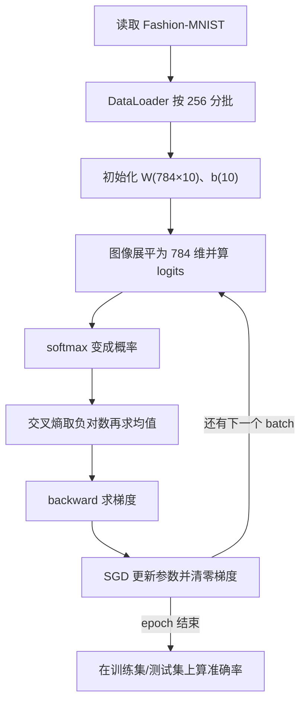

> 环境：Python 3.9 + `torch 2.8.0` + `torchvision 0.23.0` + `matplotlib`（仅可视化用到）
> 数据：Fashion-MNIST（首次运行会自动下载约 30 MB 到 `./data`）
> 参考主线：《动手学深度学习》(d2l) 第 3.4 节「softmax 回归」、3.5 节「图像分类数据集」、3.6 节「softmax 回归的从零开始实现」、3.7 节「softmax 回归的简洁实现」

| 章 | 内容 |
| --- | --- |
| 一、softmax 回归简介 | 分类问题、独热编码、logits、softmax、交叉熵、梯度、数值稳定性、准确率、数据集 |
| 二、从零实现 | 读数据、初始化参数、手写 softmax / 模型 / 交叉熵 / 准确率、训练、结果解读 |
| 三、用 PyTorch 接口实现 | `Flatten` + `Linear`、`CrossEntropyLoss`、`optim.SGD`、训练循环 |
| 四、对比与小结 | 两套实现对比、调参实验、常见坑 |

文中代码按顺序复制即可运行，除了自动下载的数据集外不需要任何外部文件。

---

# 一、softmax 回归简介

## 1.1 从回归到分类

线性回归解决的是「预测一个连续数值」的问题，比如房价。但更多时候我们要回答的是「这是哪一类」：这张图是鞋子还是包？

| | 线性回归 | softmax 回归 |
| --- | --- | --- |
| 任务 | 回归 | 分类 |
| 输出 | 一个实数 $\hat{y} \in \mathbb{R}$ | 每个类别的概率，$K$ 个数 |
| 标签 | 连续值 | 离散类别（0 ~ $K-1$） |
| 损失 | 平方损失 | 交叉熵 |

名字里的「回归」（regression）是历史遗留：它源自线性回归模型的结构，实际上解决的是**分类**问题。

分类的难点在于：**类别是离散的、无序的**。把「猫、狗、鸟」编码成 1、2、3 会引入虚假的大小关系（鸟 > 狗？），模型会把 3 当成「比 1 大 3 倍」来处理。所以要换一种编码方式。

## 1.2 独热编码

设共有 $K$ 个类别，把第 $j$ 类表示成一个长度为 $K$ 的向量：第 $j$ 位是 1、其余全是 0。

例如 $K = 3$ 时：类别 0 → $(1,0,0)$，类别 1 → $(0,1,0)$，类别 2 → $(0,0,1)$。

这叫**独热编码（one-hot encoding）**，好处是各类**等距**、没有大小关系。

但存储上，$K$ 个 0 加 1 个 1 太浪费。所以实际代码里标签仍然用**整数索引** 0 ~ $K-1$ 存放，需要的时候再隐式地按 one-hot 处理（后面会看到，交叉熵损失就是用索引直接取的，不需要真的展开成 one-hot）。

## 1.3 网络结构与 logits

softmax 回归的网络只有一层：把输入展平成一个向量 $\mathbf{x} \in \mathbb{R}^{d}$，对每个类别各算一个得分。

$$
\mathbf{o} = \mathbf{W}\mathbf{x} + \mathbf{b}
$$

其中 $\mathbf{W} \in \mathbb{R}^{K \times d}$、$\mathbf{b} \in \mathbb{R}^{K}$，输出 $\mathbf{o} \in \mathbb{R}^{K}$ 称为 **logits（未归一化得分）**，第 $j$ 个分量 $o_j$ 表示「输入属于第 $j$ 类」的证据强度。

写成批量形式（$n$ 个样本）就是

$$
\mathbf{O} = \mathbf{X}\mathbf{W}^\top + \mathbf{b}, \qquad \mathbf{X} \in \mathbb{R}^{n \times d}
$$

几何直觉：$\mathbf{W}$ 的每一行可以看成一个类别的**模板向量**，$o_j = \mathbf{w}_j^\top \mathbf{x} + b_j$ 就是输入与「第 $j$ 类模板」的内积——越像，得分越高。所以 softmax 回归是一个**线性分类器**，它的决策边界是超平面。

## 1.4 softmax 运算

logits 是任意实数，可能为负、也不和为 1，不能直接当概率用。softmax 把它们变成合法的概率分布：

$$
\hat{y}_j = \mathrm{softmax}(\mathbf{o})_j = \frac{\exp(o_j)}{\sum_{k=1}^{K}\exp(o_k)}
$$

它有三个性质：

1. **非负且和为 1**：$\hat{y}_j > 0$，$\sum_j \hat{y}_j = 1$，可以当概率解释；
2. **保持大小顺序**：$o_j$ 越大，$\hat{y}_j$ 越大，预测的类别就是 $\arg\max_j \hat{y}_j = \arg\max_j o_j$；
3. **平移不变性**：$\mathrm{softmax}(\mathbf{o} + c) = \mathrm{softmax}(\mathbf{o})$，常数可以随便加。这条性质正是数值稳定化技巧的依据（见 1.7）。

为什么叫「soft」max？因为真正的 max 是「赢家通吃」（最大项为 1、其余为 0），而 softmax 是一个**平滑版**：差距大时接近 one-hot，差距小时接近均匀分布。温度参数 $\tau$ 可以让它更「软」或更「硬」：$\mathrm{softmax}(\mathbf{o}/\tau)$，$\tau \to 0$ 时退化为 argmax。

直观例子（$K=3$，logits 为 $(1, 2, 3)$）：

```text
exp: (2.718, 7.389, 20.085)   和为 30.192
softmax: (0.090, 0.245, 0.665)  和为 1，越大的项占比越高
```

## 1.5 交叉熵损失

有了概率，怎么衡量「预测概率分布」和「真实标签」的差距？用**交叉熵**：

$$
H(\mathbf{y}, \hat{\mathbf{y}}) = -\sum_{j=1}^{K} y_j \log \hat{y}_j
$$

由于真实标签是 one-hot（只有 $y$ 位是 1），求和里只剩一项：

$$
H(\mathbf{y}, \hat{\mathbf{y}}) = -\log \hat{y}_{y}
$$

也就是 **「给正确类别预测的概率，取负对数」**。看几个值就明白：

| 正确类别的预测概率 $\hat{y}_y$ | 损失 $-\log \hat{y}_y$ |
| --- | --- |
| 1.0（完全确信且正确） | 0 |
| 0.9 | 0.105 |
| 0.5 | 0.693 |
| 0.1（等于瞎猜） | 2.303（$=\ln 10$） |
| 0.01 | 4.605 |

10 分类且模型毫无头绪时，每类概率 0.1，损失就是 $\ln 10 \approx 2.30$——**这个数可以当基准线**：训练初期损失在 2.3 附近说明模型确实什么也没学到（本例实测初始化后损失为 2.29）。

因为有 $n$ 个样本，整个数据集上的损失取平均：

$$
L = \frac{1}{n}\sum_{i=1}^{n} -\log \hat{y}^{(i)}_{y^{(i)}}
$$

信息论视角：交叉熵 = 真实分布的熵 + 两者的 KL 散度。one-hot 标签的熵为 0，所以最小化交叉熵就等于让预测分布尽量贴近真实分布。

## 1.6 梯度：为什么用交叉熵而不是均方误差

对分类问题，理论上也可以用 MSE（把 one-hot 当回归目标）。但两者对 logits 的梯度性质差很多。

**交叉熵 + softmax** 有一个非常漂亮的结果：

$$
\frac{\partial L}{\partial o_j} = \hat{y}_j - y_j
$$

即「预测概率减真实标签」，形式极其简单。可以实测验证：对一批随机 logits 反传，梯度与 $\hat{y} - \mathbf{y}$ 的最大偏差在 $10^{-9}$ 量级。

**MSE + softmax** 的梯度会多出一个因子：

$$
\frac{\partial L}{\partial o_j} \propto (\hat{y}_j - y_j)\,\hat{y}_j(1 - \hat{y}_j)
$$

问题就出在 $\hat{y}_j(1-\hat{y}_j)$：当模型**错得很离谱**时（比如正确类概率 $\hat{y}_y \approx 0.001$），这个因子接近 0，梯度也接近 0——**越错越学不动**。而交叉熵没有这个因子，错得越多梯度越大，学得越快。

这就是分类任务标准配置是「softmax + 交叉熵」的原因。此外交叉熵的梯度不会饱和，配合 softmax 还避免了单独求导时的数值问题（框架内部用 `log_softmax` 把两步合在一起算）。

## 1.7 数值稳定性

softmax 里有 $\exp$，容易溢出。若某个 $o_j = 1000$：

```python
import torch

x = torch.tensor([[1000.0, 1000.0, 1000.0]])
print(torch.exp(x))        # tensor([[inf, inf, inf]])
print(torch.exp(x) / torch.exp(x).sum(1, keepdim=True))   # tensor([[nan, nan, nan]])
```

$\exp(1000)$ 在 float32 下是 `inf`，`inf / inf` 就是 `nan`，训练直接崩。

解决办法利用平移不变性：**每行先减去该行的最大值**再算，

$$
\mathrm{softmax}(\mathbf{o})_j = \frac{\exp(o_j - \max_k o_k)}{\sum_k \exp(o_k - \max_k o_k)}
$$

减完之后最大指数是 $\exp(0) = 1$，其余都 $\le 1$，不可能溢出；减去的是同一个常数，结果与原来完全相等。

```python
def softmax_stable(o):
    o = o - o.max(dim=1, keepdim=True).values   # 先减最大值
    e = torch.exp(o)
    return e / e.sum(dim=1, keepdim=True)
```

本例代码里的 softmax 没有做这一步，因为权重初始化很小（标准差 0.01），logits 只有 $\pm 1$ 的量级，不会溢出。但换成真实模型、训练几轮后 logits 可能变得很大，就必须做这个处理。PyTorch 的 `nn.CrossEntropyLoss` 内部已经替你处理好了。

## 1.8 评估指标：准确率

损失用来**训练**（它可导），准确率用来**评估**（它直观）：

$$
\text{accuracy} = \frac{1}{n}\sum_{i=1}^{n} \mathbb{1}\left[\arg\max_j \hat{y}^{(i)}_j = y^{(i)}\right]
$$

两者不能互相替代：

- 准确率只看「对不对」，不看「有多确信」，而且不可导，无法直接当损失；
- 损失反映置信度。同样 80% 准确率，一个模型错的时候给出 0.9 的概率、另一个只给 0.4，交叉熵会差很多。

## 1.9 数据集：Fashion-MNIST

用一个稍难一点的数据集代替手写数字 MNIST：

| 属性 | 值 |
| --- | --- |
| 训练 / 测试样本 | 60000 / 10000 |
| 图像尺寸 | $28\times28$ 灰度图（单通道） |
| 类别数 | 10（t-shirt、trouser、pullover、dress、coat、sandal、shirt、sneaker、bag、ankle boot） |
| 标签 | 整数 0 ~ 9 |
| 每类训练样本 | 6000（严格均衡） |

`torchvision.datasets.FashionMNIST` 直接可用，`transform=transforms.ToTensor()` 会把 PIL 图像转成 `float32` 张量，并把像素从 $[0, 255]$ **缩放到 $[0, 1]$**，形状变成 $(1, 28, 28)$。

输入模型的向量维度是 $28 \times 28 = 784$，所以权重是 $784 \times 10$，加上 10 个偏置，**总共只有 7850 个参数**。

---

# 二、从零实现 softmax 回归

## 2.1 整体流程

整条流水线如下：



和线性回归相比，只有三处不同：**模型多了 softmax**、**损失换成交叉熵**、**评估多了准确率**。训练骨架完全一样。

## 2.2 读取并查看数据集

```python
import torch
import torchvision
from torch.utils import data
from torchvision import transforms

trans = transforms.ToTensor()
train_ds = torchvision.datasets.FashionMNIST(
    root="data", train=True, transform=trans, download=True)
test_ds = torchvision.datasets.FashionMNIST(
    root="data", train=False, transform=trans, download=True)

print(len(train_ds), len(test_ds))        # 60000 10000
print(train_ds[0][0].shape, train_ds[0][1])   # torch.Size([1, 28, 28]) 9
```

- `root="data"`：数据存到当前目录的 `data/FashionMNIST/`，已存在就不会重复下载；
- `download=True`：不存在时自动下载（约 30 MB）；
- 返回 `(图像张量, 标签)`，标签是 `int64` 的类别索引；
- 图像是 $(1, 28, 28)$，多出来的那个 1 是通道维。

想看看数据长什么样（可以跳过，仅可视化）：

```python
import matplotlib.pyplot as plt

def get_fashion_mnist_labels(labels):
    """把数字标签翻译成文本。"""
    text_labels = ['t-shirt', 'trouser', 'pullover', 'dress', 'coat',
                   'sandal', 'shirt', 'sneaker', 'bag', 'ankle boot']
    return [text_labels[int(i)] for i in labels]

def show_images(imgs, num_rows, num_cols, titles=None, scale=1.5):
    """按网格显示一组图像。"""
    figsize = (num_cols * scale, num_rows * scale)
    _, axes = plt.subplots(num_rows, num_cols, figsize=figsize)
    axes = axes.flatten()
    for ax, img, title in zip(axes, imgs, titles or [""] * len(axes)):
        ax.imshow(img.squeeze(), cmap="gray")   # (1,28,28) → (28,28)
        ax.axis("off")
        if title:
            ax.set_title(title)
    plt.show()

x, y = next(iter(data.DataLoader(train_ds, batch_size=18)))
show_images(x, 2, 9, titles=get_fashion_mnist_labels(y))
```

`ToTensor` 之后的图像是 $[0,1]$ 的浮点数，可视化时直接 `imshow` 即可（灰度图要指定 `cmap="gray"`）。

## 2.3 初始化模型参数

```python
num_inputs = 784      # 28 * 28
num_outputs = 10      # 10 个类别

w = torch.normal(0, 0.01, size=(num_inputs, num_outputs), requires_grad=True)
b = torch.zeros(num_outputs, requires_grad=True)
```

- `w` 形状 $(784, 10)$：输入维在前、类别维在后，这样 $\mathbf{x}\mathbf{W}$ 得到 $(n, 10)$，与「每行一个样本的 10 个得分」对应；
- `b` 形状 $(10,)$：每个类别一个偏置，加到每一行上（广播）；
- 初始化用很小的正态分布（标准差 0.01），保证初始 logits 接近 0、softmax 输出接近均匀分布，也就是「一开始什么都猜不准」；
- 和线性回归一样，`requires_grad=True` 是求导的前提。

## 2.4 定义 softmax

```python
def softmax(x):
    """对每一行做 softmax，返回概率。"""
    x_exp = torch.exp(x)
    partition = x_exp.sum(1, keepdim=True)   # 每行的分母（配分函数）
    return x_exp / partition                 # 依赖广播：每一列都除以同一行的分母
```

- `sum(1, keepdim=True)` 沿第 1 维（类别维）求和，`keepdim=True` 保持形状 $(n, 1)$，这样才能和 $(n, K)$ 广播相除；
- 测试一下每行和为 1：

```python
x = torch.tensor([[1.0, 2.0, 3.0], [4.0, 5.0, 6.0]])
x_prob = softmax(x)
print(x_prob)
# tensor([[0.0900, 0.2447, 0.6652],
#         [0.0900, 0.2447, 0.6652]])
print(x_prob.sum(1))     # tensor([1., 1.])
```

注意两行结果一样：softmax 只看相对大小，$(4,5,6)$ 和 $(1,2,3)$ 的差值相同，概率就相同。

## 2.5 定义模型

```python
def net(x, param):
    """softmax 回归模型：展平 → 线性变换 → softmax。"""
    w, b = param
    return softmax(torch.matmul(x.reshape((-1, w.shape[0])), w) + b)
```

关键在 `x.reshape((-1, w.shape[0]))`：

- 进来的 `x` 是 $(256, 1, 28, 28)$、共 4 维；
- 矩阵乘法要求二维，所以把「样本数以外的所有维度」拉平：$-1$ 让 PyTorch 自动算出 $256$，`w.shape[0]` 是 $784$，于是变成 $(256, 784)$；
- 如果忘了 reshape，`matmul` 会直接报形状不匹配。

## 2.6 定义交叉熵损失

```python
def cross_entropy(y_hat, y):
    """交叉熵损失，逐样本计算。"""
    return -torch.log(y_hat[range(len(y_hat)), y])
```

这行代码用了**高级索引**，是本节最需要看懂的一句：

- `y_hat` 形状 $(n, 10)$，`y` 形状 $(n,)$，元素是 0~9 的类别索引；
- `y_hat[range(n), y]` 等价于「第 $i$ 行取第 $y_i$ 列」，一次性取出每个样本**正确类别的预测概率**，结果形状 $(n,)$；
- 例如 `y = [0, 2]`、`y_hat = [[0.1, 0.6, 0.3], [0.7, 0.2, 0.1]]`，取到的是 `[0.1, 0.1]`；
- 取负对数就是每个样本的损失，**没有做求和或平均**，平均交给调用方。

不需要手动做 one-hot：索引方式等价于 one-hot 点乘，而且更省内存。

## 2.7 定义准确率

```python
def accuracy(net, param, data_iter):
    """在给定数据集上计算分类准确率。"""
    accumlator = 0
    total_num = 0
    for x, y in data_iter:
        y_hat = net(x, param)
        # 多分类时取概率最大的类别
        if len(y_hat.shape) > 1 and y_hat.shape[1] > 1:
            y_hat = y_hat.argmax(axis=1)
        cmp = y_hat.type(y.dtype) == y     # 统一 dtype 再比较
        accumlator += float(cmp.type(y.dtype).sum())
        total_num += len(y)
    return accumlator / total_num if total_num > 0 else 0
```

几个细节：

- `argmax(axis=1)` 沿类别维取最大值的**索引**，得到 $(n,)$ 的预测类别；
- `y_hat.type(y.dtype)`：比较前统一类型，避免 `int32` 和 `int64` 比较的坑；
- `float(...)` 把张量转成 Python 浮点数再累加，避免反复建图；
- 分母用 `len(y)`（样本数）而不是元素个数；
- `if len(y_hat.shape) > 1 ...` 是为了兼容「模型直接输出标量」的二分类场景，多分类下必然成立。

注意：这个函数每次都在**完整的**训练集/测试集上跑一遍，所以每个 epoch 结束后会额外做两次全量前向，比较费时间。

## 2.8 训练

```python
batch_size = 256
train_iter = data.DataLoader(train_ds, batch_size, shuffle=True, num_workers=4)
test_iter = data.DataLoader(test_ds, batch_size, shuffle=False, num_workers=4)

# 训练前的准确率（相当于随机猜）
train_acc = accuracy(net, (w, b), train_iter)
test_acc = accuracy(net, (w, b), test_iter)
print(f'train acc {train_acc:f}, test acc {test_acc:f}')

epochs, lr = 10, 0.1
for epoch in range(epochs):
    for x, y in train_iter:
        y_hat = net(x, (w, b))
        l = cross_entropy(y_hat, y).mean()    # 一批的平均交叉熵
        l.backward()
        with torch.no_grad():
            w -= lr * w.grad
            b -= lr * b.grad
            w.grad.zero_()
            b.grad.zero_()

    # 每轮结束在全集上评估
    train_acc = accuracy(net, (w, b), train_iter)
    test_acc = accuracy(net, (w, b), test_iter)
    print(f'epoch {epoch + 1}, loss {l:f}, train acc {train_acc:f}, test acc {test_acc:f}')
```

和线性回归的差别：

| | 线性回归（从零） | softmax 回归（从零） |
| --- | --- | --- |
| 损失归约 | `l.sum()`，再在 sgd 里除以 batch | `l.mean()`，更新时**不再除** |
| 参数更新 | `param -= lr * param.grad / batch_size` | `w -= lr * w.grad` |
| 模型 | 线性 | 线性 + softmax |
| 评估 | 看损失和参数误差 | 看准确率 |

因为这里用 `.mean()` 已经把梯度按批大小平均过了，所以更新时不需要再除以 `batch_size`。**两种写法都可以，关键是损失和更新要配套，别重复平均或漏掉平均。**

另外 `num_workers=4` 让 DataLoader 开 4 个子进程预取数据，CPU 上能明显加快（Windows 下必须在 `if __name__ == "__main__":` 里启动，否则会递归创建进程）。

## 2.9 运行结果

本机 CPU（16 核）实测，整个脚本约 30 秒。以下是一次运行的输出（参数是随机初始化的，具体数值会有波动，但趋势一致）：

```text
60000 10000
torch.Size([1, 28, 28]) 9
train acc 0.151967, test acc 0.148100
epoch 1, loss 0.836611, train acc 0.785717, test acc 0.770700
epoch 2, loss 0.584002, train acc 0.826150, test acc 0.813500
epoch 3, loss 0.587101, train acc 0.816883, test acc 0.805000
epoch 4, loss 0.583844, train acc 0.834400, test acc 0.822400
epoch 5, loss 0.479632, train acc 0.834583, test acc 0.821600
epoch 6, loss 0.502301, train acc 0.840333, test acc 0.825200
epoch 7, loss 0.444606, train acc 0.844850, test acc 0.831100
epoch 8, loss 0.535009, train acc 0.843683, test acc 0.827800
epoch 9, loss 0.399681, train acc 0.848483, test acc 0.829800
epoch 10, loss 0.372074, train acc 0.847933, test acc 0.834800
```

解读：

1. **初始准确率 15% / 15%**，处在随机猜测（10%）的水平附近：参数随机初始化，各类得分有微弱且随机的偏好，所以会偏离 10%——实测不同随机初始化下在 5% ~ 15% 之间浮动，这并不代表学到了东西；
2. **第 1 轮就冲到 78%**：softmax 回归虽简单，但对这种「背景干净、类别鲜明」的数据集已经够用；
3. **10 轮后 83.5% 左右**，之后提升变慢，说明线性模型的能力上限差不多到了；
4. **打印的 loss 是最后一个 batch 的损失**，不是全轮平均，所以会上下抖动（0.37 ~ 0.84）。看趋势即可，想更稳可以改成累计整轮的平均损失；
5. **训练/测试准确率只差 1.3 个百分点**，没有明显过拟合，模型是**欠拟合**——参数太少（只有 7850 个），表达能力有限。想再往上就得换多层感知机或卷积网络。

## 2.10 常见坑

| 现象 | 原因 |
| --- | --- |
| 损失变成 `nan` | logits 太大导致 `exp` 溢出（本例不会，真实模型常见），需要减最大值 |
| 报形状错误 | 忘了把 $(n,1,28,28)$ reshape 成 $(n,784)$ |
| 准确率始终 ≈ 0.1 | 参数没更新（漏了 `backward` 或 `-=` 写成了 `=-`），或学习率太小 |
| 准确率恒为 0 | `argmax` 取错维度，或 dtype 不一致导致比较全为 False |
| 损失不降反升 | 忘了 `grad.zero_()`，梯度不断累加 |
| `y_hat[range(n), y]` 报索引错误 | `y` 不是整数索引（比如误传了 one-hot），或 dtype 是 float |
| 训练比预期慢很多 | 每个 epoch 都在全量数据上算两次准确率；另外 `num_workers=0` 时数据加载是瓶颈 |
| 内存缓慢增长 | 评估时没加 `torch.no_grad()`，一直在建计算图 |

最后一条值得单独说：`accuracy` 里的前向计算其实不需要梯度，用 `with torch.no_grad():` 包起来能省下不少内存。本例数据小不明显，但换成大模型就是必需的。

---

# 三、用 PyTorch 接口实现

## 3.1 与手写版的对应关系

| 环节 | 从零实现 | PyTorch 接口 |
| --- | --- | --- |
| 展平 + 线性层 | `x.reshape((-1, 784))` + `x @ w + b` | `nn.Flatten()` + `nn.Linear(784, 10)` |
| softmax | 手写 `softmax(x)` | 包含在 `nn.CrossEntropyLoss` 里 |
| 交叉熵 | 手写 `-log(y_hat[range(n), y])` | `nn.CrossEntropyLoss()` |
| 参数管理 | 手动创建 `w`、`b` | `net.parameters()` |
| 参数初始化 | `torch.normal` / `zeros` | `nn.init.normal_(param, 0, 0.01)` |
| 优化器 | 手写 `w -= lr * w.grad` | `torch.optim.SGD(net.parameters(), lr)` |
| 数据迭代 | `DataLoader`（这里也是用接口） | 同左 |

## 3.2 完整代码

```python
import torch
import torchvision
from torch.utils import data
from torchvision import transforms


def accuracy(net, data_iter):
    """在给定数据集上计算分类准确率。"""
    accumlator = 0
    total_num = 0
    for x, y in data_iter:
        y_hat = net(x)
        if len(y_hat.shape) > 1 and y_hat.shape[1] > 1:
            y_hat = y_hat.argmax(axis=1)
        cmp = y_hat.type(y.dtype) == y
        accumlator += float(cmp.type(y.dtype).sum())
        total_num += len(y)
    return accumlator / total_num if total_num > 0 else 0


trans = transforms.ToTensor()
train_ds = torchvision.datasets.FashionMNIST(
    root="data", train=True, transform=trans, download=True)
test_ds = torchvision.datasets.FashionMNIST(
    root="data", train=False, transform=trans, download=True)

batch_size = 256
train_iter = data.DataLoader(train_ds, batch_size, shuffle=True, num_workers=4)
test_iter = data.DataLoader(test_ds, batch_size, shuffle=False, num_workers=4)

# 1. 模型：展平 + 线性层（注意没有 softmax）
net = torch.nn.Sequential(torch.nn.Flatten(), torch.nn.Linear(784, 10))
for param in net.parameters():
    torch.nn.init.normal_(param, mean=0, std=0.01)

# 2. 损失：交叉熵（内部自带 softmax）
loss = torch.nn.CrossEntropyLoss(reduction='none')

train_acc = accuracy(net, train_iter)
test_acc = accuracy(net, test_iter)
print(f'train acc {train_acc:f}, test acc {test_acc:f}')

# 3. 训练
trainer = torch.optim.SGD(net.parameters(), lr=0.1)
epochs = 10
for epoch in range(epochs):
    for x, y in train_iter:
        trainer.zero_grad()
        y_hat = net(x)
        # 注意：nn.CrossEntropyLoss 已经包含 softmax，输入必须是 logits
        l = loss(y_hat, y).mean()
        l.backward()
        trainer.step()

    train_acc = accuracy(net, train_iter)
    test_acc = accuracy(net, test_iter)
    print(f'epoch {epoch + 1}, loss {l:f}, train acc {train_acc:f}, test acc {test_acc:f}')
```

## 3.3 逐段解释

### 3.3.1 `nn.Flatten` + `nn.Linear`

```python
net = torch.nn.Sequential(torch.nn.Flatten(), torch.nn.Linear(784, 10))
```

- `nn.Flatten()` 把 $(n, 1, 28, 28)$ 压成 $(n, 784)$，等价于手写版的 `x.reshape((-1, 784))`；
- `nn.Linear(784, 10)` 内部有一个形状 $(10, 784)$ 的 `weight` 和一个形状 $(10,)$ 的 `bias`，计算 $\mathbf{x}\mathbf{W}^\top + \mathbf{b}$；
- **注意这里没有 softmax 层**。这不是漏了，而是因为交叉熵损失内部要做 softmax，两者必须合起来算才数值稳定（下一节解释）。

### 3.3.2 参数初始化

```python
for param in net.parameters():
    torch.nn.init.normal_(param, mean=0, std=0.01)
```

`net.parameters()` 会遍历所有权重和偏置，这里对**权重和偏置都**用了正态初始化（手写版把偏置设成了 0）。差异不影响训练，偏置很快会学出来。

`nn.init` 里的一系列函数都带下划线（`normal_`、`zeros_`、`xavier_uniform_`），表示**原地修改**。如果不想用原地写法，也可以 `with torch.no_grad(): param.normal_(0, 0.01)`。

### 3.3.3 `nn.CrossEntropyLoss`：最容易踩的坑

```python
loss = torch.nn.CrossEntropyLoss(reduction='none')
...
l = loss(y_hat, y).mean()
```

它等价于 `log_softmax` + `nll_loss` 两步合体：

$$
\text{CrossEntropyLoss}(\mathbf{o}, y) = -\log\frac{\exp(o_y)}{\sum_j \exp(o_j)}
$$

**输入必须是 logits（原始得分），不能是 softmax 之后的概率。** 原因：

1. 它内部会自己做 softmax，你传概率等于做了两遍，结果无意义；
2. 它内部用 `log_softmax` 一次算完，避免了「先 exp 再 log」的精度损失和溢出；
3. 传概率**不会报错**，只会静默给出错误的损失值——这是最危险的地方。

实测（3 分类、正确类 logit 为 10 的极端情况）：

```text
传 logits（正确）：9.08e-05
传概率（错误）：  0.5515
```

`reduction='none'` 表示不归约、返回每个样本的损失 $(n,)$，后面再 `.mean()` 就得到批平均，与默认的 `reduction='mean'` 完全等价。代码里这么写是为了和 d2l 的写法保持一致，实际用默认值就行。

另外，`CrossEntropyLoss` 的第二个参数是**类别索引**（`int64`），不是 one-hot 向量。

### 3.3.4 优化器与训练循环

```python
trainer = torch.optim.SGD(net.parameters(), lr=0.1)

for x, y in train_iter:
    trainer.zero_grad()
    y_hat = net(x)
    l = loss(y_hat, y).mean()
    l.backward()
    trainer.step()
```

四步顺序：**清零 → 前向 → 损失 → 反向 → 更新**（清零放在 `backward()` 之前的任意位置都行，习惯上写在最前面）。这和线性回归那一篇完全一致——**换任务、换模型，这个骨架不变**。

## 3.4 运行结果

以下是一次运行的输出（数值同样会随初始化波动）：

```text
train acc 0.082250, test acc 0.083500
epoch 1, loss 0.551329, train acc 0.795850, test acc 0.784800
epoch 2, loss 0.768553, train acc 0.822817, test acc 0.809900
epoch 3, loss 0.549375, train acc 0.823500, test acc 0.814400
epoch 4, loss 0.524118, train acc 0.835317, test acc 0.820400
epoch 5, loss 0.472221, train acc 0.832733, test acc 0.817600
epoch 6, loss 0.391974, train acc 0.841983, test acc 0.828000
epoch 7, loss 0.461419, train acc 0.835533, test acc 0.821700
epoch 8, loss 0.379093, train acc 0.843817, test acc 0.827500
epoch 9, loss 0.440947, train acc 0.835417, test acc 0.818000
epoch 10, loss 0.457851, train acc 0.847767, test acc 0.832100
```

和手写版收敛到同一个水平（83% 左右），差异来自随机初始化和批次顺序，**两套实现的数学是等价的**。

---

# 四、对比与小结

## 4.1 两套实现怎么选

| 维度 | 从零实现 | 接口实现 |
| --- | --- | --- |
| 代码量 | 多，需要手写 softmax / 交叉熵 / SGD | 少，三层搞定模型和损失 |
| 对概念的理解 | 每个公式都得自己写一遍 | 容易「会用但不懂」 |
| 数值稳定性 | 需要自己处理溢出 | 框架内部已优化 |
| 可扩展性 | 换模型要改多处 | 换 `nn.Linear` 为多层即可 |
| 效率 | 手写 softmax 多存一份中间结果 | 融合计算，更快更省内存 |
| 出错概率 | 高（都是自己拼的） | 低（但要注意输入是 logits） |

建议：**先手写一遍把公式落地，再全部换成接口**。手写那版的价值在于，当接口版结果不对时，你知道该怀疑哪里。

## 4.2 调参实验

用接口版做单轮实验（10 轮太慢，这里只看 1 个 epoch 后的测试准确率）：

| 学习率 | 1 轮后测试准确率 | 说明 |
| --- | --- | --- |
| 0.001 | 0.592 | 太慢，一轮远没收敛 |
| 0.1 | 0.78 | 默认值，合适 |
| 1.0 | 0.789 | 也能收敛，但曲线更抖 |
| 10.0 | 0.727，最后一批 loss 23.3 | 步长过大，损失剧烈震荡 |

其他可试的方向：

- **batch_size**：从 256 调到 64，每一步噪声更大但更新更频繁，通常收敛更快、最终略差；调到 1024 则更平滑但每轮更新次数少。
- **epochs**：10 轮到 20 轮，准确率还能涨 1~2 个百分点，然后基本饱和——线性模型的天花板就在 84% 附近。
- **初始化标准差**：从 0.01 改成 0.1，初始 logits 变大，前期收敛可能更快，也可能更不稳。
- **优化器**：把 SGD 换成 `torch.optim.Adam`，通常前几轮收敛更快，但线性任务上最终差别不大。

## 4.3 小结

- softmax 回归把「分类」写成「先算 $K$ 个得分，再归一化成概率」，模型仍然是线性的：$\mathbf{o} = \mathbf{W}\mathbf{x} + \mathbf{b}$；
- softmax 负责把任意得分变成概率分布，具有非负、和为 1、保持大小顺序、平移不变四个性质；
- 交叉熵损失在 one-hot 标签下就是 $-\log \hat{y}_y$，配 softmax 时梯度恰好是 $\hat{y} - y$，比 MSE 更好训练；
- 实际实现要小心两件事：**指数溢出**（减最大值）和 **`CrossEntropyLoss` 的输入必须是 logits**；
- 训练骨架（清零 → 前向 → 损失 → 反向 → 更新）和线性回归一模一样，变的只是模型和损失；
- 只有 7850 个参数的线性模型在 Fashion-MNIST 上能到 83% 左右，训练/测试差距很小，属于**欠拟合**而非过拟合——下一步自然是加隐藏层和非线性激活，也就是多层感知机（MLP）。

> 配套阅读：[PyTorch深度学习-线性回归](/posts/deeplearn_linear_regression/) 笔记里有从零实现 SGD、`DataLoader` 用法、学习率与 batch 的完整讨论，两篇的骨架是对应的。
