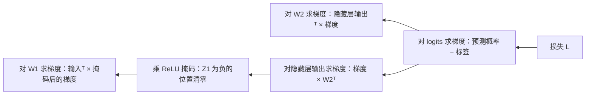
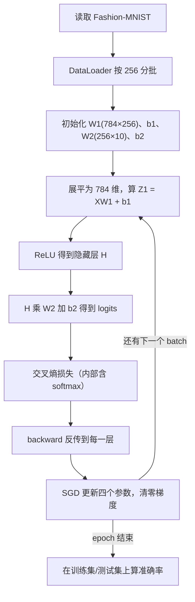

> 环境：Python 3.9 + `torch 2.8.0` + `torchvision 0.23.0`，CPU 即可，单次完整训练约 40 秒
> 数据：Fashion-MNIST（首次运行会自动下载约 30 MB 到 `./data`）
> 参考主线：《动手学深度学习》(d2l) 4.1 节「多层感知机」、4.2 节「多层感知机的从零开始实现」、4.3 节「多层感知机的简洁实现」

| 章 | 内容 |
| --- | --- |
| 一、多层感知机简介 | 线性模型的局限、隐藏层、为什么必须有激活函数、常见激活函数、ReLU 的梯度与死亡神经元、万能近似定理、参数形状与初始化 |
| 二、代码实现 | 读数据、初始化参数、手写 ReLU 与模型、交叉熵、准确率、训练循环、运行结果、三组对照实验、`nn.Sequential` 改写、常见坑 |
| 三、小结与下一步 | 核心结论、在全连接网络上还能做什么、为什么下一步是卷积 |

文中代码都完整给出，按顺序复制即可运行，除了自动下载的数据集外不需要任何外部文件。

---

# 一、多层感知机简介

## 1.1 线性模型的局限

softmax 回归（单层线性变换 + softmax 输出）本质上就是**一个线性分类器**：

$$
\mathbf{o} = \mathbf{W}\mathbf{x} + \mathbf{b}, \qquad \hat{\mathbf{y}} = \mathrm{softmax}(\mathbf{o})
$$

它的决策边界是超平面。换个说法：它只能回答「输入落在某个半空间的哪一侧」，无法表达「两个条件同时成立」这类**组合关系**。

最经典的例子是异或（XOR）。四个点 $(0,0)$、$(1,1)$ 标 0，$(0,1)$、$(1,0)$ 标 1。假设存在线性分类器 $f(\mathbf{x}) = w_1x_1 + w_2x_2 + b$ 能分开它们，那么：

```text
f(0,0) = b < 0        → b < 0
f(1,0) = w1 + b > 0   → w1 > −b > 0
f(0,1) = w2 + b > 0   → w2 > 0
f(1,1) = w1 + w2 + b < 0
```

把第 2、3 式相加得 $w_1 + w_2 + 2b > 0$，把第 1、4 式相加得 $w_1 + w_2 + 2b < 0$，两者矛盾。所以**不存在**这样的线性分类器。

在真实任务里，这种「非线性组合」随处可见：判断一张图是不是「有袖子的上衣」，需要同时满足「有袖子」和「是上衣」；判断一句话的情感，需要把否定词和形容词组合起来。单层线性模型对这些无能为力。

解决办法很直接：**在中间插一层，先做一次线性变换，再用一个非线性函数把结果掰弯，最后再做一次线性变换。**

## 1.2 加一个隐藏层

多层感知机（multilayer perceptron, MLP）就是在输入和输出之间插入若干个**隐藏层**，每个隐藏层由「仿射变换 + 逐元素非线性激活」组成。单隐藏层的形式是：

$$
\mathbf{h} = \phi(\mathbf{X}\mathbf{W}_1 + \mathbf{b}_1), \qquad
\mathbf{o} = \mathbf{h}\mathbf{W}_2 + \mathbf{b}_2, \qquad
\hat{\mathbf{y}} = \mathrm{softmax}(\mathbf{o})
$$

其中 $\phi$ 是**逐元素**作用于每个分量的激活函数，$\mathbf{h}$ 就是隐藏层的输出（也叫隐藏表示、特征）。

批量输入 $\mathbf{X} \in \mathbb{R}^{n \times d}$ 时，各张量的形状如下（本笔记代码的取值 $d=784$、$h=256$、$q=10$）：

| 变量 | 形状 | 含义 |
| --- | --- | --- |
| $\mathbf{X}$ | $(n, 784)$ | 一批 $n$ 张图，每张展平成 784 维 |
| $\mathbf{W}_1$ | $(784, 256)$ | 输入层 → 隐藏层 |
| $\mathbf{b}_1$ | $(256,)$ | 隐藏层偏置，按行广播 |
| $\mathbf{H}$ | $(n, 256)$ | 隐藏层输出 |
| $\mathbf{W}_2$ | $(256, 10)$ | 隐藏层 → 输出层 |
| $\mathbf{b}_2$ | $(10,)$ | 输出层偏置 |
| $\mathbf{O}$ | $(n, 10)$ | logits，未归一化得分 |

注意这里的权重是**输入维在前、输出维在后**，所以写成 $\mathbf{X}\mathbf{W}_1$；`nn.Linear` 内部存的是转置过的 $\mathbf{W}^\top$，写出来是 $\mathbf{X}\mathbf{W}^\top + \mathbf{b}$。两者只是约定不同，别混着用。

下图是这一层网络的前向数据流：


从函数复合的角度看，MLP 就是一个**分段线性函数**：ReLU 把空间切成很多小块，每块内部是线性的，拼起来就能拟合任意弯曲的曲面。层数越多，能切出的「折痕」越多，形状越复杂。

> 术语说明：「多层感知机」这个名字有历史包袱。最初的感知机（perceptron）是**单层**的线性分类器，本身解决不了 XOR，这也是 20 世纪 70 年代神经网络第一次遇冷的原因之一。现在的 MLP 加上了隐藏层和非线性，严格说是「多层前馈网络」（feedforward network），但名字沿用了下来。它还有几个同义词：全连接网络（fully connected network）、密集网络（dense network）。

## 1.3 为什么必须有激活函数

这是初学者最容易忽略的一点：**如果 $\phi$ 是恒等映射，那么叠多少层都等于一层。**

$$
\mathbf{H} = \mathbf{X}\mathbf{W}_1 + \mathbf{b}_1
$$

$$
\mathbf{O} = \mathbf{H}\mathbf{W}_2 + \mathbf{b}_2
= (\mathbf{X}\mathbf{W}_1 + \mathbf{b}_1)\mathbf{W}_2 + \mathbf{b}_2
= \mathbf{X}\underbrace{(\mathbf{W}_1\mathbf{W}_2)}_{\mathbf{W}'} + \underbrace{(\mathbf{b}_1\mathbf{W}_2 + \mathbf{b}_2)}_{\mathbf{b}'}
$$

结果是**同一个线性模型**，只是权重换成了 $\mathbf{W}' = \mathbf{W}_1\mathbf{W}_2$。参数变多了，表达能力一点没变，还白白增加了计算量和过拟合风险。

数值验证（随机初始化，比较「两层无激活」和「等价单层」）：

```python
import torch

torch.manual_seed(0)
W1, b1 = torch.randn(4, 8), torch.randn(8)
W2, b2 = torch.randn(8, 3), torch.randn(3)
x = torch.randn(2, 4)

direct = x @ (W1 @ W2) + (b1 @ W2 + b2)   # 合并成一层
two = (x @ W1 + b1) @ W2 + b2             # 老老实实算两层
print(float((direct - two).abs().max()))  # 9.5e-07，只差浮点误差
```

所以：**非线性激活函数是深度网络能够「深」起来的唯一理由。** 顺带解释了两个常见的困惑：

- 为什么隐藏层后面一定要跟激活？因为不跟就等于没加这一层。
- 为什么输出层通常不加激活？因为输出层要和损失函数配合（比如 softmax 被并进交叉熵里），加了反而是画蛇添足。

## 1.4 常见激活函数

设输入为 $x$，下面几个是最常用的：

| 名称 | 公式 | 输出范围 | 导数 | 主要问题 |
| --- | --- | --- | --- | --- |
| Sigmoid | $\sigma(x)=\dfrac{1}{1+e^{-x}}$ | $(0,1)$ | $\sigma(x)\bigl(1-\sigma(x)\bigr)\le 0.25$ | 两端饱和、梯度消失、输出非零均值 |
| Tanh | $\tanh(x)=\dfrac{e^{x}-e^{-x}}{e^{x}+e^{-x}}$ | $(-1,1)$ | $1-\tanh^2(x)\le 1$ | 仍然两端饱和 |
| ReLU | $\max(0,x)$ | $[0,+\infty)$ | $1$（$x>0$）或 $0$（$x<0$） | 死亡 ReLU、输出非零均值 |
| Leaky ReLU | $\max(\alpha x, x)$，$\alpha$ 常取 $0.01$ | $(-\infty,+\infty)$ | $1$ 或 $\alpha$ | 多一个超参数 |
| GELU | $x\cdot\Phi(x)$，$\Phi$ 是标准正态的分布函数 | 约 $(-0.17,+\infty)$ | 平滑曲线 | 计算稍贵（Transformer 里常用） |

几条激活函数的典型取值，方便感受差别：

```text
 x      sigmoid    tanh      ReLU
−2.0     0.119    −0.964     0
−1.0     0.269    −0.762     0
 0.0     0.500     0.000     0
 1.0     0.731     0.762     1
 2.0     0.881     0.964     2
```

**Sigmoid** 是早期的主角，形状像一个被压扁的 S，把任意实数压进 $(0,1)$，可以解释成「概率」。但它的导数最大只有 $0.25$：每穿过一层就要乘一个 $\le 0.25$ 的因子，五层之后梯度就衰减到 $0.001$ 量级，前面的层几乎学不动，这就是**梯度消失**。再加上 $\sigma(x) > 0$ 恒成立，隐藏层的输出全为正，梯度更新方向会被「锁」在同一象限，收敛变慢。

**Tanh** 是 sigmoid 的平移缩放版：$\tanh(x) = 2\sigma(2x) - 1$。输出关于原点对称（零均值），这一点比 sigmoid 友好，实测效果也通常更好，但饱和问题依旧存在。

**ReLU（rectified linear unit，修正线性单元）** 是目前最常用的默认选择：

$$
\mathrm{ReLU}(x) = \max(0, x)
$$

它的好处：

1. **正区间梯度恒为 1**，不衰减，深层网络也能传下去；
2. **计算极便宜**：只要一次比较，没有指数运算；
3. **稀疏性**：负的输入直接变 0，相当于对隐藏单元做了一次动态筛选；
4. 形状是分段线性，配合线性层可以精确表示「折线型」的复杂函数。

它的缺点也很明确：负区间梯度恒为 0，一旦某个单元的输入长期为负，它的权重就再也收不到梯度更新，**永久失活**，这叫**死亡 ReLU**。1.5 节会有实测数据。

**Leaky ReLU** 给负半轴留一条小缝 $\alpha x$，保证梯度不会完全断掉，是应对死亡 ReLU 的一种方案。

**GELU** 用正态分布函数做门控，可以看成 ReLU 的平滑版，在 Transformer 系列模型里几乎是标配。

选择建议：

- 隐藏层默认 **ReLU**，省事且通常不差；
- 想要平滑、可二次求导，或者模型对负值敏感（比如某些生成模型），试 **Tanh / GELU**；
- 只有在需要「输出确实是概率」的场合才在**输出层**用 sigmoid / softmax，隐藏层很少用 sigmoid。

## 1.5 ReLU 的梯度与死亡神经元

ReLU 在 $x \neq 0$ 处的导数非常简单：

$$
\frac{\mathrm{d}}{\mathrm{d}x}\mathrm{ReLU}(x) =
\begin{cases}
1, & x > 0 \\
0, & x < 0
\end{cases}
$$

在 $x=0$ 处不可导，框架里通常直接取 0（次梯度）。实测：

```python
import torch

x = torch.tensor([-2.0, -0.5, 0.0, 0.5, 2.0], requires_grad=True)
torch.relu(x).sum().backward()
print(x.grad)   # tensor([0., 0., 0., 1., 1.])
```

负的位置梯度是 0——这意味着**这部分输入对参数完全没有贡献**。如果某个隐藏单元对所有样本的输入都是负的，它的参数就永远停在原地。

用代码量化一下：用单隐藏层（256 个单元）在 Fashion-MNIST 上训练 1 个 epoch，统计「对一批样本全部输出 0」的隐藏单元占比：

| 学习率 | 全零隐藏单元占比 |
| --- | --- |
| 0.1 | 0.8% |
| 0.5 | 14.1% |
| 1.0 | 93.0% |

学习率 0.1 时基本健康，只有零星几个单元死掉；调到 1.0 时九成以上的单元都死了，模型等于只剩下一层线性变换，这正好解释了 2.5 节里学习率 1.0 时准确率掉到 34% 的现象。

实践中的对策：

- **学习率别太大**，这是最有效的预防手段；
- 用更小的初始化标准差，让初始激活值别整体偏负；
- 换 Leaky ReLU / GELU，负半轴有梯度就不会彻底死掉；
- 加 BatchNorm 让每层输入分布稳定（本笔记不涉及）。

## 1.6 表达能力：万能近似定理

一个自然的问题是：单隐藏层够用吗？**万能近似定理**（universal approximation theorem）回答：只要隐藏单元足够多、激活函数是非线性的（比如 ReLU、sigmoid），单隐藏层的 MLP 就能以任意精度逼近紧集上的任意连续函数。

听起来很美好，但要注意定理的三个局限：

1. **只说存在性，不说能不能学到**：定理保证了「存在一组参数」，但梯度下降能否找到、需要多少数据，它不管；
2. **宽度可能爆炸**：为了逼近某些函数，需要的隐藏单元数可能随输入维度指数增长；
3. **不保证泛化**：拟合了训练集上的函数，不代表在新数据上表现好。

实际经验是：**深度比宽度更划算**。同样多参数，叠几层比铺一层宽的表达效率更高（可以复用中间特征，类似「先学边缘，再学形状，再学物体」）。这也是深度学习从「一个很宽的单隐层」走向「很多层的深网络」的原因。

## 1.7 参数形状与初始化

本例的参数一共四个，参数量计算如下：

| 参数 | 形状 | 数量 |
| --- | --- | --- |
| $\mathbf{W}_1$ | $(784, 256)$ | 200,704 |
| $\mathbf{b}_1$ | $(256,)$ | 256 |
| $\mathbf{W}_2$ | $(256, 10)$ | 2,560 |
| $\mathbf{b}_2$ | $(10,)$ | 10 |
| 合计 | | **203,530** |

对比单层 softmax 回归的 7,850 个参数，多了约 26 倍——这是「多一层」最直观的代价。

初始化的原则是**不要太大也不要太小**：

- 太大 → 激活值爆炸、logits 极端，softmax 饱和、损失变成 `nan`；
- 太小 → 每层输出被压扁，多层之后就接近于常数，梯度也趋近 0。

本例沿用最常见的做法：权重按 $N(0, 0.01^2)$ 采样，偏置清零。这个值在 256 维的隐藏层上只是「能用」，更讲究的做法是按每层的输入输出维度缩放，比如：

- **Xavier 初始化**：$W \sim U\left(-\sqrt{6/(n_{in}+n_{out})}, \sqrt{6/(n_{in}+n_{out})}\right)$，配合 tanh；
- **He 初始化**：$W \sim N(0, 2/n_{in})$，配合 ReLU，因为 ReLU 会把一半激活值砍成 0，方差需要补回来。

用 `nn.init` 一行就能换：

```python
import torch.nn as nn

for m in net.modules():
    if isinstance(m, nn.Linear):
        nn.init.kaiming_normal_(m.weight, nonlinearity="relu")   # He 初始化
        nn.init.zeros_(m.bias)
```

本笔记的例子不换也能训到 85% 左右，但换成网络更深的模型时，初始化方式会显著影响能不能训起来。

## 1.8 损失函数与梯度

输出层输出的是 logits $\mathbf{O}$，所以损失仍然是**交叉熵**，与 softmax 回归完全一样：

$$
L = \frac{1}{n}\sum_{i=1}^{n}\left(-\log\frac{\exp(o^{(i)}_{y^{(i)}})}{\sum_{j}\exp(o^{(i)}_{j})}\right)
$$

关键在于梯度要**穿过隐藏层往回传**。记 $\mathbf{G} = \hat{\mathbf{Y}} - \mathbf{Y}$（预测概率减 one-hot 标签），则：

$$
\frac{\partial L}{\partial \mathbf{W}_2} = \mathbf{H}^\top \mathbf{G}, \qquad
\frac{\partial L}{\partial \mathbf{H}} = \mathbf{G}\mathbf{W}_2^\top
$$

到了隐藏层，还要乘上 ReLU 的「掩码」——只有激活值大于 0 的位置才把梯度放行：

$$
\frac{\partial L}{\partial \mathbf{Z}_1} = \frac{\partial L}{\partial \mathbf{H}} \odot \mathbb{1}\left[\mathbf{Z}_1 > 0\right], \qquad
\frac{\partial L}{\partial \mathbf{W}_1} = \mathbf{X}^\top \frac{\partial L}{\partial \mathbf{Z}_1}
$$

其中 $\mathbf{Z}_1 = \mathbf{X}\mathbf{W}_1 + \mathbf{b}_1$，$\odot$ 是逐元素乘。整条反向传播路径：



这条链子有个容易忽视的后果：**前面层的梯度是后面层梯度的乘积**。层数一多，如果每层都把梯度打个折（比如 sigmoid 的 0.25），传到第一层时就所剩无几——这正是 1.4 节说 ReLU 更好的原因，它的折扣系数是 1 或 0，不会层层衰减。

---

# 二、代码实现

## 2.1 整体流程



和 softmax 回归相比只多了两件事：**模型多了一个隐藏层和 ReLU**，**参数从两个变成四个**。训练骨架、损失、评估方式全都不变。

## 2.2 完整代码

完整代码如下（为了看清每一步在算什么，这一版刻意不用 `nn.Linear`，手动持有四个参数张量）：

```python
#--coding:utf-8--
# 多层感知机，使用pytorch实现

import torch
import torchvision
from torch.utils import data
from torchvision import transforms

def accuracy(net, parameters, iter):
    """计算预测正确的概率"""
    accumlator = 0
    total_num = 0
    for x, y in iter:
        y_hat = net(x, parameters)
        if len(y_hat.shape) > 1 and y_hat.shape[1] > 1:
            y_hat = y_hat.argmax(axis=1)
        cmp = y_hat.type(y.dtype) == y
        accumlator += float(cmp.type(y.dtype).sum())
        total_num += len(y)
    return accumlator / total_num if total_num > 0 else 0

def relu(x):
    """ReLU激活函数"""
    return torch.max(input=x, other=torch.tensor(0.0))

def net(x, parameters):
    """多层感知机模型"""
    w1, b1, w2, b2 = parameters
    num_inputs = w1.shape[0]
    x = x.reshape((-1, num_inputs))
    h1 = relu(torch.matmul(x, w1) + b1)
    return torch.matmul(h1, w2) + b2

def main():

    # 读取数据集
    trans = transforms.ToTensor()
    mnist_train = torchvision.datasets.FashionMNIST(
        root="data", train=True, transform=trans, download=True)
    mnist_test = torchvision.datasets.FashionMNIST(
        root="data", train=False, transform=trans, download=True)

    # 初始化数据迭代器
    batch_size = 256
    train_iter = data.DataLoader(mnist_train, batch_size, shuffle=True, num_workers=4)
    test_iter = data.DataLoader(mnist_test, batch_size, shuffle=False, num_workers=4)

    # 初始化模型参数
    num_inputs = 784
    num_hiddens = 256
    num_outputs = 10
    w1 = torch.normal(0, 0.01, size=(num_inputs, num_hiddens), requires_grad=True)
    b1 = torch.zeros(num_hiddens, requires_grad=True)
    w2 = torch.normal(0, 0.01, size=(num_hiddens, num_outputs), requires_grad=True)
    b2 = torch.zeros(num_outputs, requires_grad=True)
    params = [w1, b1, w2, b2]

    # 初始化损失函数
    loss = torch.nn.CrossEntropyLoss()

    # 开始训练
    trainer = torch.optim.SGD(params, lr=0.1)
    epochs = 10
    for epoch in range(epochs):
        for x, y in train_iter:
            trainer.zero_grad()
            y_hat = net(x, params)
            l = loss(y_hat, y).mean()
            l.backward()
            trainer.step()
        train_acc = accuracy(net, params, train_iter)
        test_acc = accuracy(net, params, test_iter)
        print(f'epoch {epoch + 1}, loss {l:f}, train acc {train_acc:f}, test acc {test_acc:f}')

if __name__ == "__main__":
    main()
```

## 2.3 逐段解释

### 2.3.1 读数据与分批

```python
trans = transforms.ToTensor()
mnist_train = torchvision.datasets.FashionMNIST(
    root="data", train=True, transform=trans, download=True)

batch_size = 256
train_iter = data.DataLoader(mnist_train, batch_size, shuffle=True, num_workers=4)
```

数据加载这部分和任何一次图像分类训练都一样，只提三个要点：

- 每张图是 $(1, 28, 28)$ 的张量，像素被 `ToTensor` 缩放到 $[0, 1]$；
- 标签是 0~9 的整数索引，不是 one-hot，因为 `CrossEntropyLoss` 要的就是索引；
- `num_workers=4` 用 4 个子进程预取数据，CPU 训练时能省不少等待时间（Windows 下必须放在 `if __name__ == "__main__":` 里）。

### 2.3.2 初始化参数

```python
num_inputs, num_hiddens, num_outputs = 784, 256, 10
w1 = torch.normal(0, 0.01, size=(num_inputs, num_hiddens), requires_grad=True)
b1 = torch.zeros(num_hiddens, requires_grad=True)
w2 = torch.normal(0, 0.01, size=(num_hiddens, num_outputs), requires_grad=True)
b2 = torch.zeros(num_outputs, requires_grad=True)
params = [w1, b1, w2, b2]
```

- `784 → 256 → 10` 是最小可用规模：784 是图像像素数，10 是类别数，256 是中间宽度（凭经验取 2 的幂，方便硬件对齐）；
- `w1` 的形状是 $(784, 256)$，**输入维在前**，所以计算写成 `x @ w1` 而不是 `w1 @ x`，这一点和 `nn.Linear` 的存储约定相反；
- 全部 `requires_grad=True`，否则 `backward` 到这些张量时梯度不会保存，优化器拿不到东西可更新；
- `params` 用列表装起来，后面直接丢给 `SGD`，省得一个个传。

### 2.3.3 手写 ReLU

```python
def relu(x):
    """ReLU激活函数"""
    return torch.max(input=x, other=torch.tensor(0.0))
```

`torch.max(input, other)` 是**逐元素取两者较大值**：`other` 是一个标量张量，靠广播与 `x` 的每个元素比较，结果等价于 $\max(0, x)$。

有两点值得注意：

1. **不要写成 `torch.max(x, 0)`**。当 `dim` 参数被省略时，第二个位置参数在某些重载里会被当成维度解释，容易报错或得到意外结果；写成 `other=` 显式指定最稳。
2. **`other` 必须是对应的零张量**（`torch.tensor(0.0)`），不能是 Python 的 `0`。

功能上它和内置的 `torch.relu` 完全一致，但内置版是 C++ 融合算子，更快也省中间变量。手写版的价值在于让你看清 ReLU 到底做了什么：

```python
import torch
print(relu(torch.tensor([[-1.0, 2.0], [3.0, -4.0]])))
# tensor([[0., 2.],
#         [3., 0.]])
```

### 2.3.4 模型：两行就是全部

```python
def net(x, parameters):
    """多层感知机模型"""
    w1, b1, w2, b2 = parameters
    num_inputs = w1.shape[0]
    x = x.reshape((-1, num_inputs))
    h1 = relu(torch.matmul(x, w1) + b1)
    return torch.matmul(h1, w2) + b2
```

四行代码对应四个公式步骤：

| 代码 | 数学 | 形状变化 |
| --- | --- | --- |
| `x.reshape((-1, w1.shape[0]))` | 展平 | $(n,1,28,28) \to (n,784)$ |
| `torch.matmul(x, w1) + b1` | $\mathbf{Z}_1 = \mathbf{X}\mathbf{W}_1 + \mathbf{b}_1$ | $(n,784)\cdot(784,256) \to (n,256)$ |
| `relu(...)` | $\mathbf{H} = \max(0, \mathbf{Z}_1)$ | $(n,256)$ 不变 |
| `torch.matmul(h1, w2) + b2` | $\mathbf{O} = \mathbf{H}\mathbf{W}_2 + \mathbf{b}_2$ | $(n,256)\cdot(256,10) \to (n,10)$ |

几个细节：

- `num_inputs` 直接从 `w1.shape[0]` 读，而不是硬编码 784，这样换数据集时不用改模型；
- `reshape((-1, ...))` 里的 $-1$ 让 PyTorch 自己推断批大小，比手写 `x.shape[0]` 简洁；
- **输出是 logits，没有 softmax**。softmax 在 `CrossEntropyLoss` 内部完成，手动加一遍会得到错误的损失（这一点很容易踩坑）；
- 参数用元组/列表传进来，是为了让模型保持「无状态」：同一个函数既能用于训练也能用于评估，不用把参数挂成全局变量。

### 2.3.5 损失与 `.mean()` 的冗余

```python
loss = torch.nn.CrossEntropyLoss()
...
l = loss(y_hat, y).mean()
```

`nn.CrossEntropyLoss()` 默认 `reduction='mean'`，返回的已经是**标量**（一批的平均损失），再调 `.mean()` 是对标量求均值，等于什么都没做。不报错，也无害，但属于可以删掉的冗余。

如果想让写法更明确，可以直接：

```python
l = loss(y_hat, y)   # 已经是批平均
```

有的写法会用 `reduction='none'` 拿到逐样本损失，再自己 `.mean()`。两种写法等价，关键是**损失和参数更新要配套**：损失已经平均过，`SGD` 更新时就不再除以 `batch_size`。

### 2.3.6 准确率

```python
def accuracy(net, parameters, iter):
    """计算预测正确的概率"""
    accumlator = 0
    total_num = 0
    for x, y in iter:
        y_hat = net(x, parameters)
        if len(y_hat.shape) > 1 and y_hat.shape[1] > 1:
            y_hat = y_hat.argmax(axis=1)
        cmp = y_hat.type(y.dtype) == y
        accumlator += float(cmp.type(y.dtype).sum())
        total_num += len(y)
    return accumlator / total_num if total_num > 0 else 0
```

逻辑和 softmax 回归完全一样：`argmax` 取预测类别 → 与标签比较 → 累加正确数 → 除以总数。三个小提示：

- **没有加 `torch.no_grad()`**。评估不需要梯度，包起来能省内存和计算；本例数据小看不出差别，换成大模型就是必需的。
- 每个 epoch 结束后会在**完整的 6 万张训练图**上跑一遍前向，这部分时间往往比一个 epoch 的训练还多。
- 变量名 `iter` 遮蔽了 Python 内置的 `iter()`，属于历史遗留（d2l 原书如此），自己能改就改成 `data_iter`。

### 2.3.7 训练循环

```python
trainer = torch.optim.SGD(params, lr=0.1)
epochs = 10
for epoch in range(epochs):
    for x, y in train_iter:
        trainer.zero_grad()
        y_hat = net(x, params)
        l = loss(y_hat, y).mean()
        l.backward()
        trainer.step()
    train_acc = accuracy(net, params, train_iter)
    test_acc = accuracy(net, params, test_iter)
    print(f'epoch {epoch + 1}, loss {l:f}, train acc {train_acc:f}, test acc {test_acc:f}')
```

五步顺序和之前一样：**清零 → 前向 → 损失 → 反向 → 更新**。`l.backward()` 会自动沿着计算图一路反传到 `w1` 和 `b1`，不需要手动写链式法则——这就是 1.8 节那几张公式在框架里的样子。

`lr=0.1` 是全连接网络的常用起点。太小学得慢，太大容易把 ReLU 单元整片打死（1.5 节实测），2.5.3 节有对照数据。

## 2.4 运行结果

本机 CPU（16 核）实测，完整跑一遍 10 个 epoch 约 40 秒：

```text
epoch 1, loss 0.530918, train acc 0.759167, test acc 0.746300
epoch 2, loss 0.406514, train acc 0.797167, test acc 0.784900
epoch 3, loss 0.508985, train acc 0.824250, test acc 0.812000
epoch 4, loss 0.351154, train acc 0.839400, test acc 0.827000
epoch 5, loss 0.337414, train acc 0.827300, test acc 0.811700
epoch 6, loss 0.347883, train acc 0.855967, test acc 0.841100
epoch 7, loss 0.458573, train acc 0.846950, test acc 0.829600
epoch 8, loss 0.423625, train acc 0.855017, test acc 0.842900
epoch 9, loss 0.281168, train acc 0.853233, test acc 0.837400
epoch 10, loss 0.240130, train acc 0.870267, test acc 0.852900
```

解读：

1. **第 1 轮 74.6%**，比 softmax 回归的第 1 轮（约 77%）还略低一点——正常。MLP 参数多、初始随机性大，前期反而需要更多轮次来「找到方向」；
2. **第 10 轮 85.3%**，比线性模型的 83.5% 高了约 1.8 个百分点。提升不算夸张，原因见 2.5 节；
3. **打印的 loss 是最后一个 batch 的值**，会在 0.24 ~ 0.53 之间抖动，看趋势即可，不要当成整轮的平均损失；
4. **训练 87.0% / 测试 85.3%**，差 1.7 个百分点，属于正常泛化差距，没有明显过拟合；
5. 曲线不是单调上升（第 5、7 轮都回落了），这是 SGD + 小批次的正常震荡，最终仍收敛到 85% 附近。

## 2.5 对照实验

下面三组实验用 `nn.Sequential` 写法（见 2.6 节），固定随机种子、跑 10 个 epoch，只改一个变量。**单次运行有约 ±1 个百分点的波动，重点看趋势，不要抠小数点。**

### 2.5.1 激活函数的影响

| 隐藏层激活 | 训练准确率 | 测试准确率 |
| --- | --- | --- |
| 无（两层线性） | 0.8563 | 0.8383 |
| **ReLU** | **0.8681** | **0.8526** |
| Tanh | 0.8636 | 0.8478 |
| Sigmoid | 0.8261 | 0.8143 |

三点结论：

- **无激活 = 线性模型**，测试 83.8%，和单层 softmax 回归的上限（83.5%）几乎重合，完美印证了 1.3 节的推导：不接非线性，256 个隐藏单元白加了；
- **ReLU 最好**，Tanh 紧随其后，说明这批数据上「梯度不饱和」的收益确实存在；
- **Sigmoid 明显最差**（81.4%），因为两层 sigmoid 的梯度衰减叠加在一起，收敛慢且有饱和。

注意激活函数带来的提升只有 1.4 个百分点左右。这不是激活函数没用，而是**这个任务本身太简单**：Fashion-MNIST 是 28×28 的低分辨率灰度图，类别之间主要靠整体轮廓区分，用线性模型就能拿到 83%。换成 CIFAR-10 那种彩色实景图，非线性带来的差距会大得多。

### 2.5.2 隐藏层宽度

| 隐藏单元数 | 参数量 | 训练准确率 | 测试准确率 |
| --- | --- | --- | --- |
| 16 | 12,730 | 0.8587 | 0.8436 |
| 64 | 50,890 | 0.8542 | 0.8402 |
| 256 | 203,530 | 0.8681 | 0.8526 |
| 1024 | 814,090 | 0.8574 | 0.8389 |

有意思的是曲线并不单调：16 个单元就能到 84.4%，1024 个单元反而降到 83.9%。原因有三：

1. 任务简单，**几十个隐藏单元就够表达**所需的分段线性边界，再多是浪费；
2. 宽度大意味着参数多，在 6 万张图上更容易**过拟合**（1024 宽时训练 85.7%、测试 83.9%，差距 1.8 个点，比 256 宽时略大）；
3. 参数多之后同样的学习率显得偏大，收敛反而更不稳。

这组数据很好地说明了一个经验：**模型容量要和任务难度匹配**。与其盲目加宽，不如先想清楚「任务到底需要多复杂的函数」。

### 2.5.3 学习率与死亡 ReLU

固定隐藏层 256、ReLU，训练 3 个 epoch：

| 学习率 | 训练准确率 | 测试准确率 | 现象 |
| --- | --- | --- | --- |
| 0.01 | 0.6566 | 0.6441 | 太慢，3 轮远没收敛 |
| 0.1 | 0.7951 | 0.7864 | 稳定 |
| **0.5** | **0.8283** | **0.8212** | 前期收敛最快，曲线略抖 |
| 1.0 | 0.3418 | 0.3452 | **崩塌**，大量 ReLU 单元死亡 |
| 2.0 | 0.1291 | 0.1279 | 彻底崩到随机猜的水平 |

学习率 1.0 时准确率骤降到 34%，看起来像「梯度爆炸」，实际主因是**死亡 ReLU**：一次过大的更新把大量隐藏单元的偏置和权重推到「对所有输入都输出负值」的区域，这些单元永久失活，模型退化成残存的少数单元 + 线性输出层。1.5 节实测该学习率下 93% 的隐藏单元全零，正好对上。

这也解释了为什么实践中常用「小学习率 + 学习率衰减」，而不是一上来就用大步长。

## 2.6 用 `nn.Sequential` 改写

手写版适合理解，日常写代码还是用接口更省事：

```python
import torch
import torchvision
from torch.utils import data
from torchvision import transforms


def accuracy(net, data_iter):
    """在给定数据集上计算分类准确率。"""
    correct, total = 0, 0
    with torch.no_grad():                      # 评估不需要建计算图
        for x, y in data_iter:
            correct += float((net(x).argmax(axis=1) == y).sum())
            total += len(y)
    return correct / total if total > 0 else 0


trans = transforms.ToTensor()
train_ds = torchvision.datasets.FashionMNIST(
    root="data", train=True, transform=trans, download=True)
test_ds = torchvision.datasets.FashionMNIST(
    root="data", train=False, transform=trans, download=True)

batch_size = 256
train_iter = data.DataLoader(train_ds, batch_size, shuffle=True, num_workers=4)
test_iter = data.DataLoader(test_ds, batch_size, shuffle=False, num_workers=4)

# 1. 模型：展平 → 隐藏层 → ReLU → 输出层（注意最后没有 softmax）
net = torch.nn.Sequential(
    torch.nn.Flatten(),
    torch.nn.Linear(784, 256),
    torch.nn.ReLU(),
    torch.nn.Linear(256, 10),
)
for p in net.parameters():
    torch.nn.init.normal_(p, mean=0, std=0.01)

# 2. 损失：交叉熵（内部自带 softmax）
loss = torch.nn.CrossEntropyLoss()

# 3. 训练
trainer = torch.optim.SGD(net.parameters(), lr=0.1)
epochs = 10
for epoch in range(epochs):
    net.train()                                # 切到训练模式
    for x, y in train_iter:
        trainer.zero_grad()
        l = loss(net(x), y)
        l.backward()
        trainer.step()

    net.eval()                                 # 切到评估模式
    train_acc = accuracy(net, train_iter)
    test_acc = accuracy(net, test_iter)
    print(f'epoch {epoch + 1}, loss {l:f}, train acc {train_acc:f}, test acc {test_acc:f}')
```

与手写版的对应关系：

| 环节 | 手写版 | 接口版 |
| --- | --- | --- |
| 展平 | `x.reshape((-1, 784))` | `nn.Flatten()` |
| 隐藏层 | `x @ w1 + b1` | `nn.Linear(784, 256)` |
| 激活 | `relu(...)` | `nn.ReLU()` |
| 输出层 | `h1 @ w2 + b2` | `nn.Linear(256, 10)` |
| 参数管理 | 手动维护 `params` 列表 | `net.parameters()` |
| 权重形状 | $(784, 256)$ | $(256, 784)$（转置存储） |
| 损失 | `nn.CrossEntropyLoss()` | 同左 |

`net.train()` / `net.eval()` 在这个模型里没有实质区别（没有 Dropout / BatchNorm 这类行为依赖模式的层），但养成习惯很重要——下一篇讲 dropout 时就靠它切换。

## 2.7 常见坑

| 现象 | 原因 |
| --- | --- |
| 准确率只有 83% 左右，怎么调都不动 | 忘了接激活函数，整个网络退化成线性模型 |
| 损失变 `nan` | 学习率过大或初始化过大，隐藏层激活值爆炸 |
| 准确率在 30% 附近卡住 | 死亡 ReLU（学习率过大 / 初始化偏负），全零单元占比过高 |
| 报形状错误 | 权重按 $(输出, 输入)$ 存却写成 `x @ w`，或者忘了展平 |
| 损失完全不降 | 参数没加 `requires_grad=True`，或忘了加进 `params` 列表 |
| 训练准确率涨、测试不涨反降 | 隐藏层太宽 + 训练数据有限，过拟合，需要权重衰减或 Dropout |
| 训练慢得离谱 | 评估时没加 `torch.no_grad()`；`num_workers` 太大反而抢 CPU |
| `torch.max(x, 0)` 行为异常 | 第二个参数被当成 `dim`，应写 `torch.max(x, other=torch.tensor(0.0))` 或 `torch.relu(x)` |

第一条是这一篇最该记住的：**没有激活函数的多层感知机，等于一个带了很多冗余参数的线性模型。**

---

# 三、小结与下一步

## 3.1 核心结论

- 多层感知机 = 输入层 + 若干「仿射变换 + 非线性激活」的隐藏层 + 输出层，本质是**分段线性函数的复合**；
- **非线性激活函数不可省略**：没有它，任意多层都等价于一层线性变换，实测「两层无激活」与「合并后的单层」误差只有 $10^{-6}$；
- 隐藏层默认用 **ReLU**：正区间梯度恒为 1，计算便宜，还能带来稀疏激活；代价是死亡 ReLU，学习率过大时会成片失效（实测 `lr=1.0` 时 93% 的单元死亡）；
- 万能近似定理保证「够宽的单隐层能逼近任意连续函数」，但它不管可学性和泛化，实践中**加深度比加宽度更划算**；
- 参数量从线性模型的 7,850 涨到 203,530，Fashion-MNIST 上测试准确率从 83.5% 提到 85.3%——提升有限是因为任务本身就接近线性可分；
- 训练骨架（清零 → 前向 → 损失 → 反向 → 更新）在所有这类任务里都一样，变的只是模型和损失。

## 3.2 还能做什么

如果想在这个例子的基础上继续做实验，可以试试：

1. **加权重衰减**：给损失加 $\lambda\|\mathbf{W}\|^2/2$，抑制参数过大，缓解过拟合；
2. **加 Dropout**：训练时随机丢弃一部分隐藏单元，强制网络不依赖个别神经元，是正则化全连接层最有效的手段；
3. **换初始化**：把 `N(0, 0.01)` 换成 He / Xavier 初始化，看深层网络是否更容易训起来；
4. **换优化器**：`Adam` 在同样学习率下通常前期收敛更快；
5. **调网络结构**：两层或三层隐藏层，观察「加深」是否比「加宽」更有效。

## 3.3 为什么下一步是卷积

多层感知机的隐藏层是**全连接**的：每个隐藏单元都和全部 784 个像素相连。这带来两个问题：

- **参数量爆炸**：第一层就占了 20 万参数的大头，图像稍微大一点（比如 $256\times256$ 彩色图）就完全无法承受；
- **丢掉空间结构**：把图像展平成向量后，相邻像素的关系、平移不变性全都没了。同一个「猫耳朵」图案出现在左上角还是右下角，对全连接层来说是两组完全不同的输入。

卷积神经网络（CNN）正是为了解决这两点：用**局部连接 + 权值共享**压缩参数，用**卷积核滑动**保留空间结构和平移等变性。所以 MLP 是理解深度的起点，但要处理图像，还得再往前走一步。

> 延伸阅读：[PyTorch深度学习-softmax回归](/posts/deeplearn_softmax_regression/) 里有数据加载、交叉熵、准确率的完整讨论；[PyTorch深度学习-线性回归](/posts/deeplearn_linear_regression/) 里有从零实现 SGD 和学习率调参的细节。两者和本篇的训练骨架是一致的，可以对照着看。
