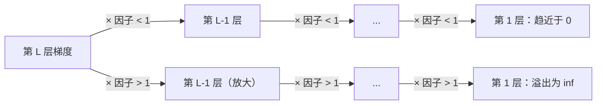
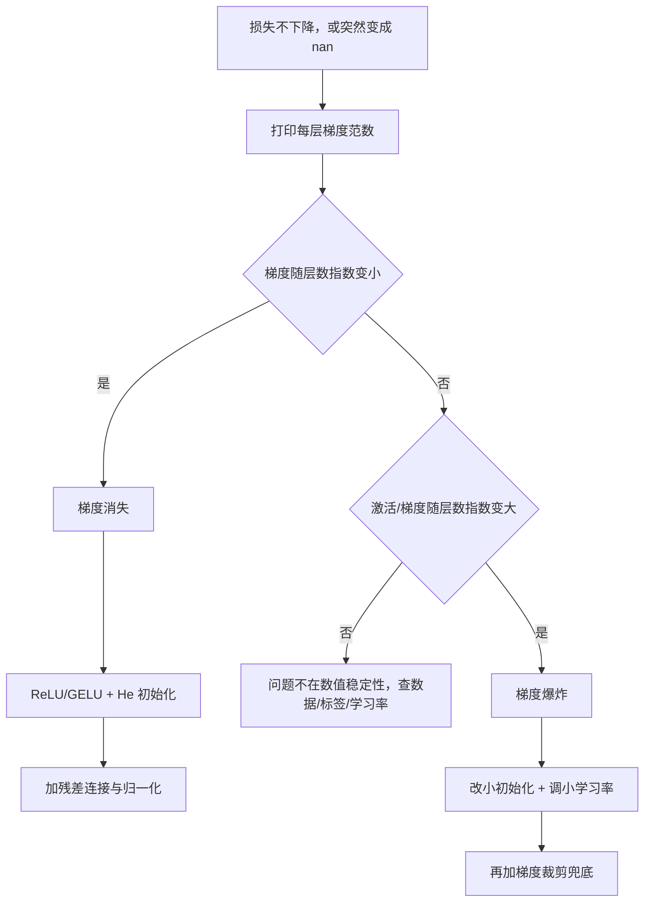

> 环境：Python 3.9 + `torch 2.8.0` + `torchvision 0.23.0`
> 参考主线：《动手学深度学习》(d2l) 第 4.8 节「数值稳定性和模型初始化」
> 前置阅读：同目录《深度学习-多层感知机》《深度学习-权重衰减》《深度学习-Dropout》
> 数据：最后一组训练实验用 Fashion-MNIST，首次运行会自动下载约 30 MB 到 `./data`

| 章 | 内容 |
| --- | --- |
| 一、梯度消失与梯度爆炸 | 梯度连乘、梯度消失、梯度爆炸、浮点数的边界、训练中的表现、ReLU 为什么缓解 |
| 二、如何避免 | Xavier / He 初始化、激活函数、归一化、残差连接、梯度裁剪、学习率与 warmup、混合精度、监控 |
| 三、代码实现 | 50 层网络诊断、矩阵连乘、初始化训练对比、RNN 梯度裁剪、接口速查、常见坑 |
| 四、小结 | 诊断流程与速查表 |

---

# 一、梯度消失与梯度爆炸

## 1.1 深层网络的梯度是一个连乘

设一个 $L$ 层网络，第 $l$ 层的变换为 $f_l$，参数为 $\mathbf{W}^{(l)}$，隐藏状态为 $\mathbf{h}^{(l)}$，并令 $\mathbf{h}^{(0)} = \mathbf{x}$：

$$
\mathbf{h}^{(l)} = f_l\left(\mathbf{W}^{(l)}\mathbf{h}^{(l-1)}\right), \qquad
\mathbf{o} = f_L \circ \cdots \circ f_1(\mathbf{x})
$$

根据链式法则，损失 $\mathcal{L}$ 对第 $l$ 层参数的梯度可以写成

$$
\frac{\partial \mathcal{L}}{\partial \mathbf{W}^{(l)}}
= \underbrace{\frac{\partial \mathcal{L}}{\partial \mathbf{h}^{(L)}}}_{\text{输出端}}
\cdot \underbrace{\frac{\partial \mathbf{h}^{(L)}}{\partial \mathbf{h}^{(L-1)}} \cdots \frac{\partial \mathbf{h}^{(l+1)}}{\partial \mathbf{h}^{(l)}}}_{L-l \text{ 个雅可比矩阵的连乘}}
\cdot \frac{\partial \mathbf{h}^{(l)}}{\partial \mathbf{W}^{(l)}}
$$

对全连接层加逐元素激活，中间的每个因子是

$$
\frac{\partial \mathbf{h}^{(k)}}{\partial \mathbf{h}^{(k-1)}}
= \mathrm{diag}\left(f_k'\left(\mathbf{z}^{(k)}\right)\right)\mathbf{W}^{(k)}
$$

其中 $\mathbf{z}^{(k)}$ 是激活前的值。取范数可以得到一个上界：

$$
\left\Vert \frac{\partial \mathbf{h}^{(L)}}{\partial \mathbf{h}^{(l)}} \right\Vert
\le \prod_{k=l+1}^{L} \left\Vert \mathbf{W}^{(k)} \right\Vert \cdot \max\left|f_k'\right|
$$

这个式子说明了一切：**梯度是 $L-l$ 个因子的乘积，只要每个因子平均略小于 1，乘积就会指数衰减；略大于 1，就会指数增长。**

- 每层因子约 $0.5$，50 层后是 $0.5^{50} \approx 8.9\times10^{-16}$；
- 每层因子约 $2$，50 层后是 $2^{50} \approx 1.1\times10^{15}$。

而浮点数能表示的范围是有限的，最终不是「梯度很小」，就是「梯度溢出」。



## 1.2 梯度消失

**梯度消失（vanishing gradient）**：反向传播时梯度逐层变小，靠近输入的层几乎收不到有效的更新信号。

后果很直接：

- 网络只有最后几层在学，前面的层基本保持初始化时的样子；
- 训练损失下降极其缓慢，或者卡在一个很高的平台上；
- 增加层数不但没有提升，反而更差——「深」没有带来任何好处。

**sigmoid 是典型案例。** 它的导数有一个很漂亮的形式：

$$
\sigma'(x) = \sigma(x)\left(1 - \sigma(x)\right) \le \frac{1}{4}
$$

最大值 $0.25$ 在 $x=0$ 处取到，输入稍微偏离 0 就迅速趋近 0。如果每一层都乘上一个不超过 $0.25$ 的因子：

```text
L= 10: 0.25^10 = 9.5e-07
L= 20: 0.25^20 = 9.1e-13
L= 50: 0.25^50 = 7.9e-31
L=100: 0.25^100 = 6.2e-61
```

50 层的网络，梯度只有输出端的 $10^{-31}$；到 100 层，float32 已经无法表示（最小正规数约 $1.18\times10^{-38}$），直接下溢成 0。**这不是「梯度很小」，而是「梯度彻底消失」。**

## 1.3 梯度爆炸

**梯度爆炸（exploding gradient）**：梯度逐层变大，更新步长失控。

它通常来自两种情况：

1. **初始化太大**：权重方差远大于 $1/n_{\text{in}}$，每层的放大系数大于 1；
2. **连乘的层数太多**：即使每层只放大 1.2 倍，50 层也是 $1.2^{50} \approx 9100$ 倍。

一个极简的实验就能看到：取一个 $4\times4$ 的随机矩阵，不断右乘新的随机矩阵——

```text
乘  10 次: ||M|| = 4.2e+03
乘  40 次: ||M|| = 1.2e+11
乘 100 次: ||M|| = inf
```

矩阵的谱范数略大于 1，100 次之后 float32 直接溢出。深度网络的雅可比连乘是同样的道理。

梯度爆炸的后果比消失更「响」：

- 参数一步更新跨过几个数量级，之前的训练全部作废；
- 损失突然变成 `nan` 或 `inf`；
- 权重范数、梯度范数出现尖峰；
- 在循环网络里尤其常见，因为沿时间步反向传播相当于连乘几百次。

## 1.4 浮点数的边界

梯度消失/爆炸之所以是「数值」问题，是因为它最终撞上了浮点数的表示范围：

| 类型 | 最大正规数 | 最小正规数 | 最小次正规数 | 机器精度 |
| --- | --- | --- | --- | --- |
| float32 | $3.40\times10^{38}$ | $1.18\times10^{-38}$ | $1.4\times10^{-45}$ | $1.19\times10^{-7}$ |
| float16 | $65504$ | $6.10\times10^{-5}$ | $6.0\times10^{-8}$ | $9.77\times10^{-4}$ |

三种「死法」：

1. **上溢**：超过最大值 → `inf`，再参与运算就变成 `nan`，权重被永久污染；
2. **下溢**：低于最小正规数 → 变成 0，梯度彻底丢失，且**无法恢复**（0 乘任何数还是 0）；
3. **精度损失**：数值本身没溢出，但加减时大数吃小数，梯度方向被舍入误差扭曲。

> float16 的动态范围比 float32 小得多，所以混合精度训练必须配合 **loss scaling**：把损失放大 $2^k$ 倍，让梯度落在 fp16 能表示的范围里，更新前再缩回去。

## 1.5 两类问题在训练中的表现

| 现象 | 更可能是 | 怎么确认 |
| --- | --- | --- |
| 损失长期停在 $\ln 10 \approx 2.303$ 附近（10 分类） | 梯度消失，模型完全没学 | 打印每层梯度范数，看是否逐层骤降 |
| 只有最后几层在变，前面的层几乎不动 | 梯度消失 | 比较各层参数的更新量 |
| 损失突然变成 `nan` / `inf` | 梯度爆炸 | 检查梯度范数是否出现 $10^6$ 以上的尖峰 |
| 损失剧烈震荡、权重范数暴涨 | 梯度爆炸 | 记录每步的 $\Vert\mathbf{g}\Vert$ 与 $\Vert\theta\Vert$ |
| 增加层数后效果反而变差 | 多半是消失 | 换 ReLU + 合适初始化再试 |

一个便宜的诊断手段是**遍历所有参数，打印梯度范数**：

```python
import torch
from torch import nn

net = nn.Sequential(nn.Linear(10, 32), nn.ReLU(), nn.Linear(32, 1))
net(torch.randn(4, 10)).sum().backward()

for name, p in net.named_parameters():
    if p.grad is not None:
        print(name, round(p.grad.norm().item(), 6))
```

如果范数从后往前每层掉一个数量级，就是消失；每层涨一个数量级，就是爆炸。

## 1.6 为什么 ReLU 缓解了梯度消失

ReLU 的导数是

$$
\mathrm{ReLU}'(x) =
\begin{cases}
1, & x > 0 \\
0, & x \le 0
\end{cases}
$$

**正区间导数恒为 1**，不会像 sigmoid 那样每层都乘一个小于 0.25 的因子。只要激活值不全为负，梯度就能原样传回去，连乘的衰减问题大大缓解。

代价是负区间梯度为 0：如果某个神经元的输入长期为负，它就再也收不到梯度，彻底「死掉」（dying ReLU）。常见对策：

- 用带泄漏的版本（LeakyReLU、PReLU）；
- 用平滑版本（GELU、SiLU），Transformer 里常用 GELU；
- 配合合适的初始化（He）与归一化，避免大量神经元落在负区间。

ReLU 解决了「每层乘 0.25」的问题，但没有解决「每层乘权重范数」的问题——如果初始化太大，ReLU 网络一样会爆炸。所以**激活函数和初始化必须一起看**。

---

# 二、如何避免

## 2.1 初始化：让每层的方差保持不变

理想情况下，我们希望前向传播时每层激活的方差大致相同，反向传播时每层梯度的方差也大致相同。先只看一层线性变换：

$$
o_i = \sum_{j=1}^{n_{\text{in}}} w_{ij} x_j
$$

假设 $w_{ij}$ 独立、均值为 0、方差为 $\sigma^2$，输入 $x_j$ 独立、均值为 0、方差为 $\gamma^2$，则

$$
\mathrm{Var}[o_i] = \sum_{j=1}^{n_{\text{in}}} \mathrm{Var}[w_{ij}]\mathrm{Var}[x_j]
= n_{\text{in}}\,\sigma^2\gamma^2
$$

**要让输出方差等于输入方差，就要 $n_{\text{in}}\sigma^2 = 1$，即 $\sigma^2 = 1/n_{\text{in}}$。**

但反向传播还有对称的要求：梯度从输出往输入传，经过的是 $\mathbf{W}^\top$，条件变成 $n_{\text{out}}\sigma^2 = 1$。两个要求通常不能同时满足，于是取折中：

$$
\boxed{\ \sigma^2 = \frac{2}{n_{\text{in}} + n_{\text{out}}}\ }
$$

这就是 **Xavier 初始化**（也叫 Glorot 初始化），适合 tanh、sigmoid 这类「两端饱和、中间线性」的激活函数。用正态分布实现时：

$$
w \sim \mathcal{N}\left(0,\ \frac{2}{n_{\text{in}} + n_{\text{out}}}\right)
$$

**He 初始化**（Kaiming 初始化）针对 ReLU：ReLU 会把一半的输入置零，相当于有效输入数减半，所以方差要翻倍：

$$
\sigma^2 = \frac{2}{n_{\text{in}}}
$$

几点补充：

- **偏置初始化为 0** 即可，它对尺度影响很小；
- **不能全部初始化为同一个常数**，否则同一层的神经元永远算出相同的值、收到相同的梯度，对称性破不掉，网络等价于只有一个神经元；
- PyTorch 的 `nn.Linear` 默认用 $U(-\sqrt{1/n_{\text{in}}}, \sqrt{1/n_{\text{in}}})$，对浅层够用，深层建议显式指定。

## 2.2 选择更合适的激活函数

| 激活函数 | 导数范围 | 适用场景 | 注意 |
| --- | --- | --- | --- |
| sigmoid | $(0, 0.25]$ | 二分类输出、门控 | 深层隐藏层不要用 |
| tanh | $(0, 1]$ | 浅层、RNN | 仍会饱和 |
| ReLU | $\{0, 1\}$ | 默认选择 | 可能 dying ReLU |
| LeakyReLU | $\{0.01, 1\}$ | ReLU 的替代 | 负区间保留小梯度 |
| GELU / SiLU | 平滑、近似 ReLU | Transformer、现代 CNN | 计算稍贵 |

原则：**隐藏层优先用 ReLU 家族或 GELU；sigmoid 留给输出层和门控结构。**

## 2.3 归一化层

BatchNorm 把每个特征在一个 batch 内标准化，再学一个仿射变换：

$$
\hat{x} = \frac{x - \mu_{\mathcal{B}}}{\sqrt{\sigma_{\mathcal{B}}^2 + \epsilon}}, \qquad
y = \gamma\hat{x} + \beta
$$

作用：

- 每层的输入被拉回均值 0、方差 1 附近，**雅可比矩阵的条件数变好**，梯度不会因为尺度漂移而爆炸或消失；
- 对初始化不那么敏感，可以用更大的学习率；
- 有一点正则效果（batch 统计带噪声）。

注意：BN 在训练时用当前 batch 的统计量，评估时用训练阶段累计的滑动均值/方差，所以 `net.train()` / `net.eval()` 同样不能忘。

Transformer 里更常用 LayerNorm（对单个样本的所有特征归一化），RNN 里也有专门的变体。后来还有 RMSNorm（去掉减均值）等简化版本。

## 2.4 残差连接

残差块把「学习一个完整的变换」改成「学习一个增量」：

$$
\mathbf{y} = \mathbf{x} + F(\mathbf{x})
$$

求导：

$$
\frac{\partial \mathbf{y}}{\partial \mathbf{x}} = \mathbf{I} + \frac{\partial F}{\partial \mathbf{x}}
$$

**那个 $\mathbf{I}$ 是关键**：无论 $F$ 的雅可比多小，梯度里始终有一条「恒等通路」，可以直接传回去。100 层的残差网络，梯度也不会指数消失。这也是 ResNet 能把网络做到上百层的原因。

反过来说，如果某一层梯度爆炸，残差里的 $\mathbf{I}$ 也救不了——爆炸还得靠初始化、归一化和裁剪。

## 2.5 梯度裁剪

梯度爆炸最直接的处理办法：**在更新之前，把梯度限制在一个范围内**。

按范数裁剪（最常用）：

$$
\mathbf{g} \leftarrow \mathbf{g} \cdot \min\left(1, \frac{\theta}{\Vert\mathbf{g}\Vert}\right)
$$

其中 $\theta$ 是阈值（常用 0.5 ~ 5）。它**只改变长度、不改变方向**：梯度范数小于阈值时原样保留，超过时等比缩小。

按值裁剪：

$$
g_i \leftarrow \mathrm{clip}(g_i,\ -c,\ c)
$$

逐元素截断，可能会改变方向，用得少一些。

关键点：

- 位置在 `loss.backward()` 之后、`optimizer.step()` 之前；
- 对**爆炸**有效，对**消失**无效（0 怎么裁还是 0）；
- 它救不了前向传播已经溢出的模型——如果激活值在第 20 层就是 `inf`，裁剪梯度也没用；
- 循环网络（RNN/LSTM）几乎标配，因为沿时间步的连乘最容易爆。

## 2.6 学习率与 warmup

梯度爆炸不一定是梯度的锅，也可能是**学习率太大**：即使梯度正常，一步更新 $\eta\Vert\mathbf{g}\Vert$ 也可能把参数推到很远的地方。

对策：

- 扫描一个合理的学习率（从 $10^{-3}$ 往小调）；
- **warmup**：前几百步让学习率从 0 线性升到目标值，避开训练初期参数还很随机、梯度方向不稳的阶段；
- 梯度累积：显存不够时用多个小 batch 累积梯度，等价于大 batch，但要注意累积后的梯度范数也会变大；
- 自适应优化器（Adam、RMSProp）会按二阶矩归一化梯度，对尺度不那么敏感，但**不能完全免疫**极端梯度，遇到 `inf` 一样会坏。

## 2.7 混合精度与 loss scaling

用 fp16/bf16 训练能省显存、加速，但 fp16 的动态范围很窄（最大 65504），梯度很容易下溢成 0。标准做法是 **loss scaling**：

1. 前向算出 loss 后乘以一个缩放因子 $S$（如 $2^{16}$）；
2. 反向得到放大 $S$ 倍的梯度，落在 fp16 能表示的区间；
3. 更新前把梯度除以 $S$；
4. 如果检测到 `inf`/`nan`，跳过这一步并减小 $S$。

bf16 的指数范围和 fp32 一样，通常不需要 loss scaling，正在成为主流。

## 2.8 监控与诊断

数值问题最怕「悄悄发生」，所以要主动监控：

| 手段 | 看什么 | 开销 |
| --- | --- | --- |
| 打印每层梯度范数 | 是否逐层指数变化 | 低 |
| 记录 $\Vert\mathbf{g}\Vert$、$\Vert\theta\Vert$ 曲线 | 是否出现尖峰 | 低 |
| 激活值直方图 | 是否饱和、是否大量为 0 | 中 |
| `torch.autograd.set_detect_anomaly(True)` | 定位产生 nan 的具体算子 | 很高，只在调试时开 |
| 梯度检查（数值梯度对比） | 自定义算子是否正确 | 中 |

## 2.9 方法汇总

| 手段 | 主要解决 | 代价 | 备注 |
| --- | --- | --- | --- |
| Xavier / He 初始化 | 消失 + 爆炸 | 零 | 最先该做的 |
| ReLU / GELU | 消失 | 零 | 隐藏层默认 |
| BatchNorm / LayerNorm | 两者都缓解 | 少量计算、依赖 batch | 深度网络标配 |
| 残差连接 | 消失 | 少量显存 | 深层网络必备 |
| 梯度裁剪 | 爆炸 | 一次范数计算 | RNN 标配 |
| 调小学习率 / warmup | 爆炸 | 收敛变慢 | 先排查 |
| 混合精度 + loss scaling | 下溢 | 实现复杂 | 大模型训练 |
| 监控梯度 | 早发现 | 少量 IO | 调试期常开 |

---

# 三、代码实现

## 3.1 复现：50 层网络里激活与梯度怎么变

思路：堆 50 个 `Linear(256, 256)`，每层后接激活函数，前向时记录每层激活的 RMS，反向时记录每层激活梯度的 RMS。为了让结果可读，全部取 $\log_{10}$。

```python
import math

import torch
from torch import nn

DEPTH, WIDTH, BATCH = 50, 256, 128


def init_weight(linear, mode):
    if mode == "normal1":
        nn.init.normal_(linear.weight, 0.0, 1.0)
    elif mode == "normal001":
        nn.init.normal_(linear.weight, 0.0, 0.01)
    elif mode == "xavier":
        nn.init.xavier_normal_(linear.weight)
    elif mode == "he":
        nn.init.kaiming_normal_(linear.weight, mode="fan_in", nonlinearity="relu")
    nn.init.zeros_(linear.bias)


def build(act, init):
    linears = []
    for _ in range(DEPTH):
        linear = nn.Linear(WIDTH, WIDTH)
        init_weight(linear, init)
        linears.append(linear)
    fn = {"sigmoid": torch.sigmoid, "tanh": torch.tanh, "relu": torch.relu}[act]
    return linears, fn


def rms(t):
    return float(t.detach().pow(2).mean().sqrt())


def log10_str(value):
    if value != value:              # nan
        return "nan"
    if value == float("inf"):
        return "inf"
    if value == 0.0:                # 下溢
        return "-inf"
    return f"{math.log10(value):+.1f}"


def diagnose(act, init, tag):
    linears, fn = build(act, init)
    x = torch.randn(BATCH, WIDTH)
    target = torch.randn(BATCH, WIDTH)
    h = x
    hidden = []
    for linear in linears:
        h = fn(linear(h))
        h.retain_grad()             # 保留激活的梯度，后面要看
        hidden.append(h)
    loss = ((h - target) ** 2).mean()
    loss.backward()

    picks = [0, 9, 19, 29, 39, 49]
    act_logs = [log10_str(rms(hidden[i])) for i in picks]
    grad_logs = [log10_str(rms(hidden[i].grad)) for i in picks]
    print(f"\n[{tag}]")
    print("  层号:            " + "".join(f"{i + 1:>7d}" for i in picks))
    print("  log10(激活RMS):  " + "".join(f"{v:>7}" for v in act_logs))
    print("  log10(梯度RMS):  " + "".join(f"{v:>7}" for v in grad_logs))


torch.manual_seed(0)
for act, init, tag in [
    ("sigmoid", "normal1", "sigmoid + N(0,1)"),
    ("sigmoid", "normal001", "sigmoid + N(0,0.01)"),
    ("sigmoid", "xavier", "sigmoid + Xavier"),
    ("tanh", "xavier", "tanh + Xavier"),
    ("relu", "normal1", "relu + N(0,1)"),
    ("relu", "normal001", "relu + N(0,0.01)"),
    ("relu", "he", "relu + He"),
]:
    diagnose(act, init, tag)
```

输出：

```text
[sigmoid + N(0,1)]
  层号:                  1     10     20     30     40     50
  log10(激活RMS):     -0.2   -0.2   -0.2   -0.2   -0.2   -0.2
  log10(梯度RMS):     +0.5   -0.4   -1.3   -2.2   -3.2   -4.1

[sigmoid + N(0,0.01)]
  层号:                  1     10     20     30     40     50
  log10(激活RMS):     -0.3   -0.3   -0.3   -0.3   -0.3   -0.3
  log10(梯度RMS):     -inf   -inf   -inf   -inf  -18.2   -4.2

[sigmoid + Xavier]
  层号:                  1     10     20     30     40     50
  log10(激活RMS):     -0.3   -0.3   -0.3   -0.3   -0.3   -0.3
  log10(梯度RMS):     -inf   -inf   -inf  -16.7  -10.4   -4.2

[tanh + Xavier]
  层号:                  1     10     20     30     40     50
  log10(激活RMS):     -0.2   -0.6   -0.8   -0.9   -1.0   -1.0
  log10(梯度RMS):     -5.0   -4.6   -4.4   -4.3   -4.2   -4.2

[relu + N(0,1)]
  层号:                  1     10     20     30     40     50
  log10(激活RMS):     +1.0  +10.5    inf    inf    nan    nan
  log10(梯度RMS):      nan    nan    nan    nan    nan    nan

[relu + N(0,0.01)]
  层号:                  1     10     20     30     40     50
  log10(激活RMS):     -0.9   -9.4  -18.9   -inf   -inf   -inf
  log10(梯度RMS):     -inf   -inf   -inf   -inf   -inf   -4.2

[relu + He]
  层号:                  1     10     20     30     40     50
  log10(激活RMS):     -0.0   +0.1   -0.0   -0.2   -0.3   -0.5
  log10(梯度RMS):     -4.1   -4.2   -4.2   -4.1   -4.1   -4.2
```

怎么读这张表：

- **`-inf` 表示梯度已经下溢成 0**，不是「非常小」，而是「彻底没有」。sigmoid 配小初始化、sigmoid 配 Xavier，都在第 20 层之前就归零；理论上 $0.25^{20} \approx 9\times10^{-13}$，再乘以权重的连乘就掉到 float32 的下界之外了。
- **`relu + N(0,0.01)`** 展示了另一种消失：激活值每 10 层掉 9 个数量级，第 30 层直接归零。这说明**ReLU 本身不保证不消失，初始化太小一样会死**。
- **`relu + N(0,1)`** 是爆炸：第 10 层激活已经到了 $10^{10.5}$，第 20 层溢出成 `inf`，损失变成 `nan`。
- **`tanh + Xavier`** 和 **`relu + He`** 是健康状态：激活 RMS 在 1 附近缓慢变化，梯度 RMS 在层间基本不变。这就是「方差保持」初始化想要的效果。
- **`sigmoid + N(0,1)`** 很特殊：激活被压成 0/1（RMS 恒为 0.63），梯度从第 50 层的 $8\times10^{-5}$ 一路放大到第 1 层的 $3.2$——反向爆炸，但方向是「越靠近输入越大」。这种饱和状态同样不健康。

## 3.2 矩阵连乘：100 次就溢出

```python
torch.manual_seed(0)

for scale in (1.0, 0.1):
    M = torch.randn(4, 4) * scale
    for i in range(1, 101):
        M = M @ (torch.randn(4, 4) * scale)
        if i in (10, 40, 100):
            print(f"scale={scale}, 乘 {i:3d} 次: ||M|| = {M.norm().item():.3e}")
```

输出：

```text
scale=1.0, 乘  10 次: ||M|| = 4.219e+03
scale=1.0, 乘  40 次: ||M|| = 1.223e+11
scale=1.0, 乘 100 次: ||M|| = inf
scale=0.1, 乘  10 次: ||M|| = 4.002e-08
scale=0.1, 乘  40 次: ||M|| = 0.000e+00
scale=0.1, 乘 100 次: ||M|| = 0.000e+00
```

同一个机制，两个方向：放大 100 次变成 `inf`，缩小 40 次变成 0。**矩阵连乘没有「差不多」，只有指数级的放大或衰减。**

## 3.3 初始化与激活函数的训练对比

前面的诊断看的是单次前向/反向。现在真正训练一下：10 层、宽 128 的 MLP，在 Fashion-MNIST 的前 5000 张图上训练 5 轮，学习率 0.05，只改初始化与激活函数。

```python
import random

import torch
import torchvision
from torch import nn
from torch.utils import data
from torchvision import transforms

DEPTH, WIDTH, BATCH = 10, 128, 256


class DeepMLP(nn.Module):
    def __init__(self, num_inputs=784, num_outputs=10,
                 depth=DEPTH, width=WIDTH, act="relu", init="he"):
        super(DeepMLP, self).__init__()
        self.num_inputs = num_inputs
        self.act = act
        self.linears = nn.ModuleList()
        d = num_inputs
        for _ in range(depth):
            linear = nn.Linear(d, width)
            if init == "normal1":
                nn.init.normal_(linear.weight, 0.0, 1.0)
            elif init == "normal001":
                nn.init.normal_(linear.weight, 0.0, 0.01)
            elif init == "xavier":
                nn.init.xavier_normal_(linear.weight)
            elif init == "he":
                nn.init.kaiming_normal_(linear.weight, mode="fan_in",
                                        nonlinearity="relu")
            nn.init.zeros_(linear.bias)
            self.linears.append(linear)
            d = width
        self.out = nn.Linear(width, num_outputs)

    def forward(self, x):
        x = x.reshape((-1, self.num_inputs))
        for linear in self.linears:
            x = linear(x)
            if self.act == "relu":
                x = torch.relu(x)
            elif self.act == "sigmoid":
                x = torch.sigmoid(x)
            elif self.act == "tanh":
                x = torch.tanh(x)
        return self.out(x)


def accuracy(net, data_iter):
    net.eval()
    correct, total = 0, 0
    with torch.no_grad():
        for x, y in data_iter:
            correct += int((net(x).argmax(dim=1) == y).sum())
            total += len(y)
    return correct / total


def run(act, init, lr=0.05, epochs=5, n_subset=5000, tag=""):
    torch.manual_seed(0)
    random.seed(0)
    trans = transforms.ToTensor()
    train_full = torchvision.datasets.FashionMNIST(
        root="data", train=True, transform=trans, download=True)
    test_set = torchvision.datasets.FashionMNIST(
        root="data", train=False, transform=trans, download=True)
    train_set = data.Subset(train_full, list(range(n_subset)))
    train_iter = data.DataLoader(
        train_set, BATCH, shuffle=True, num_workers=4,
        generator=torch.Generator().manual_seed(0))
    test_iter = data.DataLoader(test_set, BATCH, shuffle=False, num_workers=4)

    net = DeepMLP(act=act, init=init)
    loss_fn = nn.CrossEntropyLoss()
    optimizer = torch.optim.SGD(net.parameters(), lr=lr)

    for epoch in range(1, epochs + 1):
        net.train()
        for x, y in train_iter:
            l = loss_fn(net(x), y)
            optimizer.zero_grad()
            l.backward()
            optimizer.step()
        if not torch.isfinite(l):
            print(f"[{tag}] 第 {epoch} 轮 loss 变成 {l.item()}，训练发散")
            return
        print(f"[{tag}] epoch {epoch}: loss {float(l):.4f}, "
              f"train {accuracy(net, train_iter):.4f}, "
              f"test {accuracy(net, test_iter):.4f}")


for act, init, tag in [
    ("sigmoid", "normal1", "sigmoid + N(0,1)"),
    ("sigmoid", "xavier", "sigmoid + Xavier"),
    ("tanh", "normal1", "tanh + N(0,1)"),
    ("tanh", "xavier", "tanh + Xavier"),
    ("relu", "normal1", "relu + N(0,1)"),
    ("relu", "normal001", "relu + N(0,0.01)"),
    ("relu", "he", "relu + He"),
]:
    run(act, init, tag=tag)
```

5 轮后的结果：

| 配置 | 最终 train acc | 最终 test acc | 说明 |
| --- | --- | --- | --- |
| sigmoid + $N(0,1)$ | 0.2612 | 0.2506 | 激活饱和，勉强动了一点 |
| sigmoid + Xavier | 0.1024 | 0.1000 | 完全没有学（导数上界 0.25 的连乘） |
| tanh + $N(0,1)$ | 0.1518 | 0.1510 | 初始化太大，几乎学不动 |
| tanh + Xavier | 0.7198 | **0.7045** | 同一结构，换初始化后正常 |
| relu + $N(0,1)$ | — | — | 第 1 轮就 `nan`，训练发散 |
| relu + $N(0,0.01)$ | 0.0980 | 0.1000 | 激活逐层归零，完全不动 |
| relu + He | 0.6132 | **0.6005** | 正常收敛 |

同一张表能读出三件事：

1. **初始化决定能不能训练**。都是 10 层 tanh，$N(0,1)$ 只有 15%，Xavier 到了 70%；都是 ReLU，$N(0,0.01)$ 卡在 10%，He 到了 60%。
2. **激活函数同样关键**。即使换成 Xavier，10 层 sigmoid 仍然停在 10%——$0.25^{10}\approx10^{-6}$ 的梯度乘上 0.05 的学习率，5 轮根本走不动。把学习率提到 0.5 也只是从 10% 到 10%，问题不在学习率。
3. **初始化太大直接炸**。ReLU + $N(0,1)$ 的激活在第 10 层已经是 $10^{10}$ 量级，一个 batch 就把权重推到 `nan`。

> 注意：5 轮、5000 张图是一个很小的设置，绝对准确率不重要，重要的**组间差距**——它直接对应前面的数值分析。

## 3.4 梯度裁剪：一个会发散的循环网络

用一个极简的循环网络（RNN）演示裁剪。它的状态更新是

$$
\mathbf{h}_t = \tanh\left(\mathbf{W}_x\mathbf{x}_t + \mathbf{W}_h\mathbf{h}_{t-1}\right)
$$

沿时间反向传播要连乘 120 个雅可比矩阵，相当于一个 120 层、且层层共享权重的网络。故意把循环权重初始化得偏大，让梯度爆炸，然后对比「裁剪」与「不裁剪」。

```python
import math

import torch
from torch import nn


class RNN(nn.Module):
    def __init__(self, hidden=32):
        super(RNN, self).__init__()
        self.wx = nn.Linear(1, hidden)
        self.wh = nn.Linear(hidden, hidden, bias=False)
        self.out = nn.Linear(hidden, 1)
        # 故意放大循环权重：谱半径 > 1，梯度会沿时间步连乘放大
        nn.init.normal_(self.wh.weight, 0, 2.5 / math.sqrt(hidden))

    def forward(self, x):                       # x: (批, 时间步, 1)
        h = torch.zeros(x.shape[0], self.wh.in_features)
        for t in range(x.shape[1]):
            h = torch.tanh(self.wx(x[:, t]) + self.wh(h))
        return self.out(h)


torch.manual_seed(0)
T, B = 120, 32
x = torch.randn(B, T, 1)
y = x.mean(dim=1)                               # 目标是序列的均值
loss_fn = nn.MSELoss()


def run(clip_value, steps=400, lr=0.1):
    torch.manual_seed(1)
    net = RNN()
    optimizer = torch.optim.SGD(net.parameters(), lr=lr)
    for step in range(1, steps + 1):
        optimizer.zero_grad()
        l = loss_fn(net(x), y)
        l.backward()
        grad_norm = math.sqrt(sum(float(p.grad.pow(2).sum())
                                  for p in net.parameters()
                                  if p.grad is not None))
        if clip_value is not None:
            torch.nn.utils.clip_grad_norm_(net.parameters(), max_norm=clip_value)
        optimizer.step()
        if not torch.isfinite(l):
            return f"第 {step} 步 loss 变成 {l.item()}"
        if step in (1, 10, 50, 100, 200, 400):
            print(f"  step {step:3d}: loss {l.item():.4f}, "
                  f"grad_norm {grad_norm:.2e}")
    return f"第 400 步 loss {l.item():.4f}"


print("不加裁剪：")
print(" 结果：", run(None))
print("每步裁剪到范数 1.0：")
print(" 结果：", run(1.0))
```

输出：

```text
不加裁剪：
  step   1: loss 0.1192, grad_norm 1.34e+07
  step  10: loss 1623.8726, grad_norm 3.02e+02
  step  50: loss 621039831373333946957824.0000, grad_norm 5.91e+12
 结果： 第 76 步 loss 变成 inf
每步裁剪到范数 1.0：
  step   1: loss 0.1192, grad_norm 1.34e+07
  step  10: loss 0.1629, grad_norm 2.17e+07
  step  50: loss 0.1340, grad_norm 8.09e+06
  step 100: loss 0.1402, grad_norm 3.64e+00
  step 200: loss 0.1261, grad_norm 3.33e+00
  step 400: loss 0.0797, grad_norm 2.38e+06
 结果： 第 400 步 loss 0.0797
```

解读：

- 初始梯度范数就有 $1.34\times10^{7}$，而正常网络通常是 $10^0$ 量级；
- 不裁剪时，一次更新把参数推到很远的地方，损失从 0.12 涨到 1624，再到 $6\times10^{23}$，第 76 步变成 `inf`；
- 裁剪后每一步的更新量被限制在 $\text{lr}\times1.0=0.1$ 的尺度内，损失稳定在 0.1 附近并缓慢下降；
- 注意第 400 步的梯度范数又回到了 $2.4\times10^6$——**裁剪不是让梯度变小，而是让它在每一步只走固定长度**。只要方向大致正确，大步子被截断并不影响收敛，只是慢一些。

## 3.5 接口速查

```python
import torch
from torch import nn

linear = nn.Linear(256, 128)
nn.init.xavier_normal_(linear.weight)                        # Glorot，tanh/sigmoid
print("Xavier std:", round(linear.weight.std().item(), 4))   # 约 0.072，理论 sqrt(2/384)

nn.init.kaiming_normal_(linear.weight, nonlinearity="relu")  # He，ReLU
print("He std:", round(linear.weight.std().item(), 4))       # 约 0.088，理论 sqrt(2/256)

nn.init.zeros_(linear.bias)
```

实测初始化后的权重标准差：Xavier 约 0.072（理论 $\sqrt{2/384}=0.0722$），He 约 0.088（理论 $\sqrt{2/256}=0.0884$）——都只差随机采样误差。

```python
# 梯度裁剪：反向之后、更新之前
torch.nn.utils.clip_grad_norm_(net.parameters(), max_norm=1.0)   # 按范数
torch.nn.utils.clip_grad_value_(net.parameters(), clip_value=0.5)  # 按值

# 归一化层
bn = nn.BatchNorm1d(128)
ln = nn.LayerNorm(128)

# 更稳定的激活
act1 = nn.ReLU()
act2 = nn.GELU()
act3 = nn.LeakyReLU(0.01)
```

## 3.6 常见坑

| 现象 | 原因 | 解决 |
| --- | --- | --- |
| 加了层反而更差 | 梯度消失，浅层没学到 | 换 ReLU + He，加残差/归一化 |
| 训练一开始就 `nan` | 初始化太大，前向激活溢出 | 换成 Xavier/He，减小初始化 |
| 训练中期突然 `nan` | 学习率太大或某个 batch 梯度爆炸 | 调小 lr，加梯度裁剪 |
| 每层梯度都是 0 | 初始化太小，激活下溢 | 检查初始化尺度，换 He/Xavier |
| 裁剪后训练变慢 | 阈值太小，有效步长被压扁 | 把 `max_norm` 调大（1~5） |
| 裁剪后仍然 `nan` | 前向已经溢出，裁剪只作用于反向 | 先修初始化/激活，裁剪救不了前向 |
| BatchNorm 后效果变差 | 评估时忘了 `net.eval()` | 训练/评估模式成对切换 |
| 混合精度训练溢出 | fp16 动态范围不足 | 开 loss scaling 或改用 bf16 |

---

# 四、小结

## 4.1 诊断流程



## 4.2 核心结论

- 深度网络的梯度是 $L-l$ 个雅可比矩阵的连乘，**每层因子略小于 1 就指数消失，略大于 1 就指数爆炸**；
- sigmoid 的导数上界是 0.25，$0.25^{50}\approx8\times10^{-31}$，50 层就足以让梯度在 float32 里下溢成 0；
- 梯度爆炸同样常见：本例中 ReLU + $N(0,1)$ 在第 20 层就让激活变成 `inf`，一个 batch 后损失变 `nan`；
- 浮点数的动态范围是硬约束：float32 最大 $3.4\times10^{38}$、最小正规数 $1.18\times10^{-38}$，越界就是 `inf` 或 0；
- **初始化是最先该做的**：Xavier 取 $\sigma^2=2/(n_{\text{in}}+n_{\text{out}})$，适合 tanh/sigmoid；He 取 $\sigma^2=2/n_{\text{in}}$，适合 ReLU；
- 激活函数与初始化要配套：本例 tanh 换 Xavier 从 15% 提到 70%，ReLU 换 He 从 10% 提到 60%，而 sigmoid 换什么初始化都训练不动；
- 归一化、残差连接从结构上保证梯度尺度稳定，是深层网络的标配；
- 梯度裁剪只对爆炸有效，位置在 `backward()` 之后、`step()` 之前，阈值常用 0.5 ~ 5；
- 学习率、warmup、混合精度的 loss scaling 都会影响数值稳定性，训练不稳时按「初始化 → 激活 → lr → 裁剪」的顺序排查。

数值稳定性是「深度」的入场券：一个 10 层的网络能不能训练，往往不取决于模型设计得多巧妙，而取决于第一层的权重是 $0.01$ 还是 $1$。下一篇可以接着看**参数初始化与激活函数的更多细节**，或者直接进入卷积神经网络。
