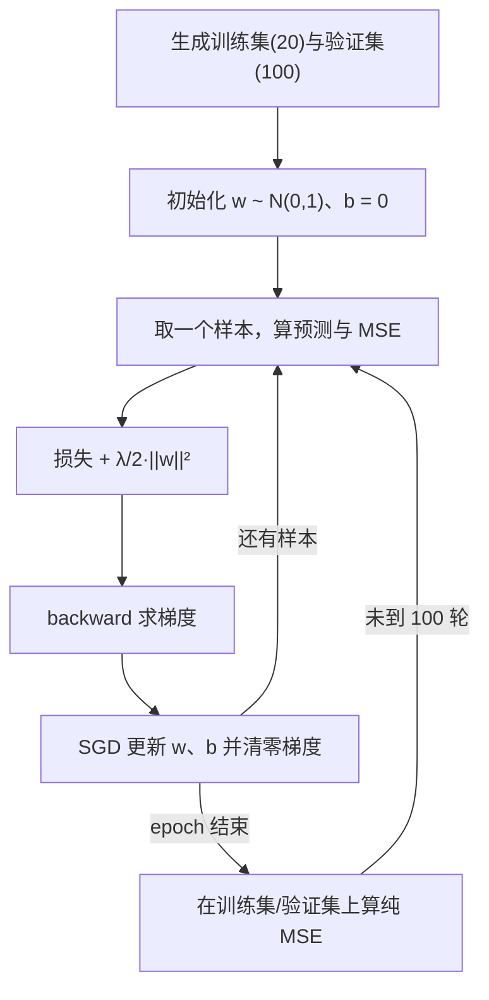

> 环境：Python 3.9 + `torch 2.8.0` + `matplotlib`（仅画图用到）
> 参考主线：《动手学深度学习》(d2l) 第 4.5 节「权重衰减」
> 前置阅读：同目录《深度学习-线性回归》，本文沿用其中的模型、损失和训练循环骨架

| 章 | 内容 |
| --- | --- |
| 一、权重衰减简介 | 过拟合、高维小样本实验、L2 正则化、为什么叫衰减、为什么有效、与岭回归的关系、λ 怎么选、L1 对比 |
| 二、代码实现 | 构造数据、L2 惩罚、训练循环、λ=3 与 λ=0 的对照、损失曲线、λ 扫描、优化器接口 |
| 三、进阶与小结 | 解的范数由初始化决定（隐式正则）、与其他正则化手段的关系、小结 |

---

# 一、权重衰减简介

## 1.1 过拟合：训练损失低不代表模型好

上一篇 softmax 回归里出现过「训练准确率 85%、测试 84%」这种健康的情况。但另一种情况更常见也更危险：**模型把训练集背下来了**。

- **训练误差**：模型在训练集上的表现；
- **泛化误差**：模型在没见过的数据上的表现。

我们真正想要的是后者，但只能直接观测前者。当模型容量远大于数据量时，训练误差可以压到 0，泛化误差却可能非常大，这叫**过拟合（overfitting）**。

举一个直观的例子：给你 20 个点，让你拟合一条曲线。用一条直线可能拟合不完美，但换成 200 次多项式，可以让曲线穿过每一个点、训练误差精确为 0——然而在点与点之间，曲线会剧烈震荡，对新样本的预测离谱得可怕。**参数越多、越自由，越容易过拟合。**

## 1.2 本例的设置：20 个样本、200 维特征

为了把过拟合「做到极致」，我们用一个人为构造的高维线性回归：

| 项目 | 取值 |
| --- | --- |
| 特征维度 $d$ | 200 |
| 训练样本数 $n$ | 20 |
| 验证样本数 | 100（独立生成） |
| 真实权重 $\mathbf{w}$ | 每个分量都是 0.01，共 200 个 |
| 真实偏置 $b$ | 0.05 |
| 观测噪声 | 标准差 0.01 的正态噪声 |

数据生成方式就是

$$
y = \mathbf{w}^\top \mathbf{x} + b + \epsilon, \qquad \epsilon \sim \mathcal{N}(0, 0.01^2)
$$

**参数有 201 个，样本只有 20 个。** 这是一个严重欠定的方程组：让训练损失为 0 的解有无穷多个，模型完全可以选择一组「畸形」的权重把训练集完美拟合，同时在新数据上一塌糊涂。

顺便算一下这个任务的误差下界：由于 $\mathbf{w}$ 有 200 个 0.01 的分量、$\mathbf{x}$ 服从标准正态，

$$
\mathrm{Var}(y) = \sum_{j=1}^{200} 0.01^2 \cdot 1 + 0.01^2 \approx 0.0201
$$

也就是说，**什么规律都不学、只预测均值，验证损失的期望大约是 0.02**。20 个样本根本估不出 200 个权重，能做到 0.02 就已经到极限了——记住这个数，后面会用到。

## 1.3 L2 正则化

既然过拟合来自「参数太自由」，一个自然的想法是**限制参数的大小**。做法是在损失函数上加一项惩罚：

$$
L(\mathbf{w}, b) = \frac{1}{n}\sum_{i=1}^{n}\frac{1}{2}\left(\hat{y}^{(i)} - y^{(i)}\right)^2 + \frac{\lambda}{2}\|\mathbf{w}\|^2
$$

其中

$$
\|\mathbf{w}\|^2 = \sum_{j=1}^{d} w_j^2
$$

是权重的 L2 范数平方，$\lambda \ge 0$ 是**正则化系数**（超参数）。

- 第一项要求「拟合得好」，第二项要求「权重小」，两者互相拉扯；
- $\lambda$ 越大，越偏向小权重；$\lambda = 0$ 就退化成普通的最小二乘；
- 惩罚项只加在**训练**的损失里，评估时必须去掉，只看纯预测误差。

注意惩罚项里**没有偏置 $b$**。偏置只是一个平移量，不影响函数形状、也不会导致过拟合，而且数量很少，通常不惩罚它。代码里也只对 $\mathbf{w}$ 加了惩罚。

## 1.4 为什么叫「权重衰减」

对加了惩罚的损失求梯度：

$$
\nabla_{\mathbf{w}} L = \nabla_{\mathbf{w}} L_{\text{data}} + \lambda \mathbf{w}
$$

代入梯度下降的更新式：

$$
\mathbf{w} \leftarrow \mathbf{w} - \eta\left(\nabla_{\mathbf{w}} L_{\text{data}} + \lambda\mathbf{w}\right)
= (1 - \eta\lambda)\,\mathbf{w} - \eta \nabla_{\mathbf{w}} L_{\text{data}}
$$

看第一项：每一步更新前，权重都先被乘上一个略小于 1 的因子 $(1 - \eta\lambda)$，**按比例缩小一点**——这就是「权重衰减（weight decay）」这个名字的由来。

所以「L2 正则化」和「权重衰减」在标准 SGD 下是同一个东西的两种说法：前者从损失函数的角度描述，后者从参数更新式的角度描述。

有一个实践细节：这个「衰减」的强度是 $\eta\lambda$，**和学习率绑在一起**。学习率大，衰减也强；如果换了优化器（比如 Adam 会把梯度按二阶矩归一化），L2 惩罚和「真正按比例缩小」就不再等价了——这正是后来提出 AdamW（解耦权重衰减）的原因。

## 1.5 为什么小权重能缓解过拟合

三个角度，可以任选一个说服自己：

**函数平滑度**：模型输出对输入的敏感程度正比于权重的尺度。$\mathbf{w}$ 很大时，输入稍微一变，预测值就剧烈变化——这正好对应「曲线剧烈震荡」的过拟合形态。把权重压小，函数就变平滑，对训练集没覆盖到的地方也更稳。

**假设空间**：L2 正则相当于给参数加了一个球形约束 $\|\mathbf{w}\| \le C$（$C$ 由 $\lambda$ 决定）。可选的模型变少，能「碰巧拟合噪声」的机会也就变少。

**贝叶斯视角**：加 $\frac{\lambda}{2}\|\mathbf{w}\|^2$ 等价于假设权重服从零均值的高斯先验 $\mathbf{w} \sim \mathcal{N}(0, 1/\lambda)$，惩罚项就是负对数先验。$\lambda$ 越大，先验越强、越不相信大权重。

还要清楚一点：**权重衰减不改变模型的表达能力**（线性层加了 L2 还是线性层），它只是改变「在众多可行解里选哪一个」，**不能解决欠拟合**。如果模型本来就学不动，加大 $\lambda$ 只会更糟。

## 1.6 与岭回归的关系

线性回归 + L2 惩罚有闭式解，这就是统计学里的**岭回归（ridge regression）**。

以平方误差（不除以 $n$）为目标时：

$$
\mathbf{w}^* = \left(\mathbf{X}^\top\mathbf{X} + \lambda \mathbf{I}\right)^{-1}\mathbf{X}^\top\mathbf{y}
$$

和普通最小二乘相比，多了一个 $\lambda\mathbf{I}$。它的作用是：

1. **保证可逆**：$\mathbf{X}^\top\mathbf{X}$ 在特征共线或样本少于特征时是奇异的，加上正定的 $\lambda\mathbf{I}$ 后一定可逆；
2. **压缩解的范数**：$\lambda$ 越大，解越靠近 0。

如果损失按样本数取了平均（本文代码就是这样），惩罚系数要相应换算，解变成

$$
\mathbf{w}^* = \left(\mathbf{X}^\top\mathbf{X} + \frac{n\lambda}{2}\mathbf{I}\right)^{-1}\mathbf{X}^\top\mathbf{y}
$$

这个式子在本例里很有用：20 个样本、200 维，正好用得上。用 $\lambda=3$ 代入算出来的解，验证损失约 0.018，和后面 SGD 训练出来的 0.015 处于同一水平——**说明权重衰减确实把优化目标引向了正确的方向**，而不是碰运气。

## 1.7 λ 怎么选

$\lambda$ 是超参数，不能靠梯度学，只能用**验证集**调：

- $\lambda = 0$：没有正则，过拟合；
- $\lambda$ 太小：正则效果不足，验证损失仍然很高；
- $\lambda$ 适中：验证损失最低；
- $\lambda$ 太大：权重被压得接近 0，模型退化成「只输出偏置」，训练损失开始上升，这叫欠拟合。

调法是扫一串候选值（0、0.1、1、3、10、100…），选验证损失最小的那个。注意**不能用训练损失选**，训练损失几乎总是 $\lambda$ 越小越好。

一个容易被忽略的细节：$\lambda$ 的合适量级取决于**损失的定义方式**。平方误差有没有除以 $n$、有没有除以 2、batch 大小是多少，都会改变数据项和惩罚项的相对大小。所以别人代码里的 `weight_decay=1e-4` 不能照搬，必须结合自己的损失定义重新调。

## 1.8 L1 与 L2 的对比

除了 L2，另一种常见选择是 L1 正则：

$$
L(\mathbf{w}, b) + \lambda \|\mathbf{w}\|_1, \qquad \|\mathbf{w}\|_1 = \sum_j |w_j|
$$

两者对比：

| | L2（权重衰减） | L1 |
| --- | --- | --- |
| 惩罚项 | $\frac{\lambda}{2}\sum_j w_j^2$ | $\lambda\sum_j \lvert w_j \rvert$ |
| 梯度 | $\lambda w_j$，随权重变小而变小 | $\lambda\,\mathrm{sign}(w_j)$，恒定大小 |
| 效果 | 权重整体变小、分布更均匀 | 把不重要的权重压到恰好 0（稀疏） |
| 常见用途 | 通用正则化、抑制过拟合 | 特征选择、压缩模型 |

L1 的梯度是常数，会把小权重一路推到 0；L2 的梯度随权重成比例减小，所以只会「变小」不会「变没」。实践中权重衰减（L2）更常用，L1 常见于需要稀疏性的场景（如 LASSO）。

---

# 二、代码实现

## 2.1 整体流程



和之前的线性回归相比，唯一的结构性改动是 **损失函数里多了一项惩罚**，其余全部不变。

## 2.2 构造数据集

```python
import torch
import random
from torch import nn


def synthetic_data(w, b, num_examples):
    """生成 y = Xw + b + 噪声。"""
    x = torch.normal(0, 1, (num_examples, len(w)))
    y = torch.matmul(x, w) + b
    y += torch.normal(0, 0.01, y.shape)   # 噪声标准差 0.01
    return x, y.reshape((-1, 1))


def data_iter(batch_size, features, labels):
    """按小批量读取数据，每个 epoch 调用一次，顺序随机。"""
    num_examples = len(features)
    indices = list(range(num_examples))
    random.shuffle(indices)
    for i in range(0, num_examples, batch_size):
        batch_indices = torch.tensor(
            indices[i:min(i + batch_size, num_examples)])
        yield features[batch_indices], labels[batch_indices]


n_train, n_valid = 20, 100
num_inputs = 200
true_w = torch.ones((num_inputs, 1)) * 0.01
true_b = 0.05

train_data = synthetic_data(true_w, true_b, n_train)
valid_data = synthetic_data(true_w, true_b, n_valid)

print(train_data[0].shape, train_data[1].shape)   # (20, 200) (20, 1)
print(valid_data[0].shape, valid_data[1].shape)   # (100, 200) (100, 1)
```

要点：

- **训练集和验证集分别生成**（相当于从同一个分布里各采一批新数据），验证集的作用是模拟「没见过的数据」，用它判断过拟合；
- 真实权重每个分量都是 0.01，$b = 0.05$，噪声只有 0.01，所以数据本身几乎是无噪声的线性关系，模型有能力把训练误差压到 0；
- `data_iter` 和线性回归那一篇完全一样：打乱、切批、`yield`。

## 2.3 定义 L2 惩罚

```python
def l2_penalty(w):
    """L2 范数的平方，再除以 2。"""
    return torch.sum(w.pow(2)) / 2
```

除以 2 是为了求导后系数变 1，和损失函数里的 1/2 是同一个理由。它不改变最优解，只是让 $\lambda$ 的含义更直观。

## 2.4 训练循环：把惩罚加进去

```python
def linreg(x, w, b):
    """线性回归模型。"""
    return torch.matmul(x, w) + b


# 初始化参数（注意：这里初始化得很大，是为了让初始损失很明显）
w = torch.normal(0, 1, size=(num_inputs, 1), requires_grad=True)
b = torch.zeros(1, requires_grad=True)

loss = nn.MSELoss()
num_epochs, lr = 100, 0.003
lambd = 3          # 正则化系数；改成 0 就是不使用权重衰减

for epoch in range(num_epochs):
    for x, y in data_iter(1, *train_data):
        # 关键：数据损失 + 权重惩罚
        l = loss(linreg(x, w, b), y) + lambd * l2_penalty(w)
        l.backward()
        with torch.no_grad():
            w -= lr * w.grad
            b -= lr * b.grad
            w.grad.zero_()
            b.grad.zero_()

    # 评估时不加惩罚项，只看纯预测误差
    with torch.no_grad():
        train_l = loss(linreg(train_data[0], w, b), train_data[1])
        valid_l = loss(linreg(valid_data[0], w, b), valid_data[1])
        print(f'epoch {epoch + 1}, '
              f'train loss {float(train_l):f}, '
              f'valid loss {float(valid_l):f}')
```

几个值得说明的点：

1. **`data_iter(1, *train_data)`**：`*train_data` 把 `(features, labels)` 这个元组解包成两个参数，等价于 `data_iter(1, train_data[0], train_data[1])`。batch size 为 1，所以每个 epoch 有 20 次参数更新（纯 SGD）。
2. **惩罚加在 `l` 里，不在评估里**：训练时把 $\frac{\lambda}{2}\|\mathbf{w}\|^2$ 计入损失，`backward()` 才能把 $\lambda\mathbf{w}$ 这一项算进梯度；评估时只算 MSE，这样 train/valid loss 才是可比的预测误差。
3. **初始化 $\mathbf{w} \sim \mathcal{N}(0, 1)$**，而真值只有 0.01。初始权重比真值大 100 倍，所以第 1 轮损失很大（几十到上百），随着训练衰减下去。这里故意这么做，是为了让「权重被衰减」的过程看得更明显。
4. **学习率只有 0.003**：初始权重很大，学习率大了会直接发散。$\eta\lambda = 0.003 \times 3 = 0.009$，即每步把权重缩小约 1%。
5. **`w -= lr * w.grad`**：梯度里已经包含了 $\lambda\mathbf{w}$，所以不需要在更新式里再单独写衰减项。

## 2.5 运行结果：λ = 3

```text
epoch 1, train loss 15.238253, valid loss 83.373260
epoch 2, train loss 1.002093, valid loss 57.234432
epoch 3, train loss 0.091750, valid loss 40.023369
...
epoch 10, train loss 0.000305, valid loss 3.142643
...
epoch 50, train loss 0.000174, valid loss 0.016143
...
epoch 100, train loss 0.000205, valid loss 0.014899
```

- 前几轮损失巨大，是因为初始权重比真值大两个数量级；
- 到第 10 轮，训练损失已经到 $3\times10^{-4}$，验证损失还在 3.14——**训练集快背下来了，但还没学会规律**；
- 第 50 轮验证损失降到 0.016，之后基本不再下降；
- 最终 train 0.0002 / valid 0.015，验证损失已经接近理论下界 0.02（甚至略低，因为这次随机采到的验证集恰好容易一点）。

## 2.6 对照实验：λ = 0

把 `lambd` 改成 0（等价于去掉惩罚项），其余不变：

```text
epoch 1, train loss 12.400865, valid loss 171.125076
epoch 2, train loss 1.495735, valid loss 164.524261
epoch 3, train loss 0.228659, valid loss 166.160019
...
epoch 10, train loss 0.000001, valid loss 165.747009
...
epoch 100, train loss 0.000000, valid loss 165.747192
```

对比一目了然：

| | λ = 3 | λ = 0 |
| --- | --- | --- |
| 最终训练损失 | 0.000205 | 0.000000 |
| 最终验证损失 | **0.014899** | **165.747192** |
| 是否过拟合 | 否 | 严重过拟合 |

λ=0 时训练损失精确到 0（20 个方程、201 个未知数，当然有解），但验证损失是 165——**比「直接预测均值」（0.02）差了四个数量级**。这就是过拟合：模型完全贴合这 20 个样本，代价是在新数据上错得离谱。

## 2.7 画出损失曲线

把两种 λ 的训练/验证损失画在一张图上，对比最直观（纵轴用对数刻度）：

```python
import matplotlib.pyplot as plt


def train(lambd):
    """训练一次，返回每轮的训练损失和验证损失。"""
    w = torch.normal(0, 1, size=(num_inputs, 1), requires_grad=True)
    b = torch.zeros(1, requires_grad=True)
    train_ls, valid_ls = [], []
    for epoch in range(num_epochs):
        for x, y in data_iter(1, *train_data):
            l = loss(linreg(x, w, b), y) + lambd * l2_penalty(w)
            l.backward()
            with torch.no_grad():
                w -= lr * w.grad
                b -= lr * b.grad
                w.grad.zero_()
                b.grad.zero_()
        with torch.no_grad():
            train_ls.append(loss(linreg(train_data[0], w, b), train_data[1]).item())
            valid_ls.append(loss(linreg(valid_data[0], w, b), valid_data[1]).item())
    return train_ls, valid_ls


plt.figure(figsize=(8, 4))
for lambd in (0, 3):
    tr, va = train(lambd)
    plt.semilogy(range(1, num_epochs + 1), tr, label=f'train, λ={lambd}')
    plt.semilogy(range(1, num_epochs + 1), va, '--', label=f'valid, λ={lambd}')
plt.xlabel('epoch')
plt.ylabel('loss (log scale)')
plt.legend()
plt.grid(True, ls=':', alpha=0.4)
plt.tight_layout()
plt.show()          # 无图形界面时改成 plt.savefig("wd_curve.png")
```

画出来的曲线有四个特征：

- **λ=0 的训练损失**一路掉到 $10^{-11}$ 量级（机器精度），几乎是一条贴着底部的线；
- **λ=0 的验证损失**从 170 左右开始，很快就**躺平在 160 附近**，之后 90 轮一动不动——不是在学习，是在原地过拟合；
- **λ=3 的训练损失**先快速下降，然后稳定在 $10^{-4}$ 附近，不再继续变低（因为惩罚项不允许权重无穷小地拟合噪声）；
- **λ=3 的验证损失**一路下降到 0.02 附近，和训练损失之间只差一个数量级，是健康的状态。

注意 $\lambda=3$ 的训练损失**故意没有降到 0**：这正是正则化在起作用——它拒绝用「巨大的权重」去换「完美的训练损失」。

## 2.8 扫描 λ

固定随机种子，把 $\lambda$ 从 0 扫到 300，观察最终结果：

| $\lambda$ | 训练损失 | 验证损失 | $\|\mathbf{w}\|$ |
| --- | --- | --- | --- |
| 0 | 0.000000 | 197.79 | 13.63 |
| 0.1 | 0.000001 | 59.23 | 7.48 |
| 1 | 0.000050 | 0.02131 | 0.064 |
| 3 | 0.000344 | 0.02115 | 0.052 |
| 10 | 0.002514 | 0.02117 | 0.046 |
| 30 | 0.010686 | 0.02264 | 0.033 |
| 100 | 0.027229 | 0.02505 | 0.018 |
| 300 | 0.031556 | 0.02571 | 0.017 |

（真实权重范数 $\|\mathbf{w}\| = 0.01\times\sqrt{200} \approx 0.141$）

读法：

- $\lambda$ 从 0 变到 1，验证损失从 197 跳水到 0.02，**范数从 13.6 降到 0.064**——正则化把「畸形的大权重」压回了正常范围；
- $\lambda \in [1, 10]$ 是最佳区间，验证损失稳定在 0.021，已经接近前面算的误差下界 0.0201；
- $\lambda \ge 100$ 后训练损失明显上升（0.027），权重被压得比真值还小，验证损失略微回升——**欠拟合的苗头**；
- 注意验证损失在整个区间里都很平（0.021 → 0.026），这是因为 20 个样本本来就估不出 200 维权重，最好的模型也只是「接近预测均值」。**权重衰减的价值在于避免灾难性的过拟合（197 → 0.02），而不是把权重学得和真值一样。**

## 2.9 用优化器接口实现

前面是手动把惩罚项加进损失、再手写 SGD。PyTorch 的优化器提供了 `weight_decay` 参数，可以直接实现同样的事：

```python
net = nn.Sequential(nn.Linear(num_inputs, 1))
nn.init.normal_(net[0].weight, mean=0, std=1)
nn.init.zeros_(net[0].bias)

loss = nn.MSELoss()
trainer = torch.optim.SGD(net.parameters(), lr=0.003, weight_decay=3)  # 关键参数

num_epochs = 100
for epoch in range(num_epochs):
    for x, y in data_iter(1, *train_data):
        trainer.zero_grad()
        l = loss(net(x), y)          # 损失里不再手动加惩罚
        l.backward()
        trainer.step()

    with torch.no_grad():
        train_l = loss(net(train_data[0]), train_data[1])
        valid_l = loss(net(valid_data[0]), valid_data[1])
        print(f'epoch {epoch + 1}, train loss {float(train_l):f}, '
              f'valid loss {float(valid_l):f}')
```

几点说明：

- `weight_decay=λ` 的效果是**在梯度上再加 $\lambda\mathbf{w}$**，对应惩罚项 $\frac{\lambda}{2}\|\mathbf{w}\|^2$，和手写版完全等价。实测 $\lambda=3$ 时，手写版得到 $\|\mathbf{w}\|=0.052$、验证损失 0.021；接口版得到 $\|\mathbf{w}\|=0.058$、验证损失 0.019，差异来自随机初始化和实现细节；
- **`weight_decay` 会作用于传给优化器的所有参数**，包括偏置。如果想只衰减权重，需要分组：

```python
optimizer = torch.optim.SGD([
    {"params": net[0].weight, "weight_decay": 3},
    {"params": net[0].bias, "weight_decay": 0},
], lr=0.003)
```

- 换用 `Adam` 时，`weight_decay` 是「耦合」在梯度里的，和标准 SGD 的衰减不等价；想要真正的解耦衰减，用 `torch.optim.AdamW`。

## 2.10 常见坑

| 现象 | 原因 |
| --- | --- |
| 训练损失 0、验证损失巨大 | 忘了加惩罚项（`lambd=0`），或惩罚只写进了打印、没进 `backward()` |
| 训练一开始损失就是几百 | 权重初始化太大，加上学习率不小，前几步严重震荡；可减小初始化或学习率 |
| 损失变成 `nan` | 学习率过大，或 $\eta\lambda > 1$ 导致权重被「反向放大」 |
| 加了正则还是过拟合 | $\lambda$ 太小；或样本太少，正则也救不回来，需要更多数据/更强约束 |
| 验证损失不降反升 | $\lambda$ 太大，模型被压成「只输出偏置」（欠拟合） |
| 手写版和 `weight_decay` 结果对不上 | 损失里惩罚的系数差一个 1/2，或 `weight_decay` 作用到了偏置上 |
| 用训练损失选 $\lambda$ | 训练损失永远偏向更小的 $\lambda$，必须用验证集 |

---

# 三、进阶与小结

## 3.1 解的范数取决于初始化：隐式正则

这里有个很容易被忽略的事实：**即使 $\lambda = 0$，优化算法也不是随便挑一个解**。

20 个样本、200 维，让训练损失为 0 的解有无穷多个。梯度下降最后落到哪一个，取决于**初始化和优化路径**。固定数据、只改初始权重的标准差（$\lambda=0$，训练 100 轮），实测：

| 初始化标准差 | 最终 $\|\mathbf{w}\|$ | 训练损失 | 验证损失 |
| --- | --- | --- | --- |
| 0（全零） | 0.060 | $4\times10^{-15}$ | **0.019** |
| 0.1 | 0.536 | $1\times10^{-14}$ | 0.283 |
| 1.0 | 5.315 | $2\times10^{-12}$ | 28.50 |

同样都能把训练损失压到 0，范数却差了近百倍，泛化能力也从 0.019 一路崩到 28.5。

原因：对欠定最小二乘问题，梯度下降会收敛到「初始点在解空间上的投影」，**初始化越靠近 0，解越接近最小范数解**。而最小范数解用岭回归（$\lambda \to 0$）算出来是 $\|\mathbf{w}\| \approx 0.039$、验证损失 0.018——和「零初始化 + 无正则」的结果几乎一样。

这带来两个实用结论：

1. **小初始化本身就是一种正则**，它和你选的优化器一起决定了最终解的范数；
2. 大初始化 + 无正则 + 足够多的迭代 = 灾难。权重衰减的作用就是把这条路径「掰回来」，让解稳定地落在小范数区域。

顺带一提，「训练到验证损失开始上升就停」的**早停（early stopping）**也是同一个道理：它在解还没跑到大范数区域时就把训练掐断，效果上等价于一种隐式正则。

## 3.2 与其他正则化手段的关系

| 手段 | 思路 | 特点 |
| --- | --- | --- |
| 权重衰减（L2） | 惩罚大权重 | 实现简单、几乎无额外开销 |
| L1 正则 | 惩罚绝对值和 | 产生稀疏权重，可做特征选择 |
| Dropout | 训练时随机丢弃神经元 | 类似集成学习，常用于深层网络 |
| 数据增强 | 扩充训练集 | 最根本的办法，但需要领域知识 |
| 早停 | 验证损失回升就停止 | 免费，几乎总要开 |
| 减小模型 | 降低容量 | 和正则化互相替代 |

这些手段并不互斥。实践中的顺序通常是：**先把数据增广和模型容量调好，再开权重衰减和 dropout，最后用早停兜底**。

## 3.3 小结

- 过拟合的本质是「模型容量 >> 数据信息量」，表现为训练误差极低、泛化误差很高；
- 权重衰减就是在损失上加 $\frac{\lambda}{2}\|\mathbf{w}\|^2$，梯度多出 $\lambda\mathbf{w}$，更新式变成 $\mathbf{w} \leftarrow (1-\eta\lambda)\mathbf{w} - \eta\nabla L$，所以叫「衰减」；
- 它等价于岭回归，能用闭式解 $\left(\mathbf{X}^\top\mathbf{X} + \alpha\mathbf{I}\right)^{-1}\mathbf{X}^\top\mathbf{y}$ 验证；
- $\lambda$ 必须用验证集选：太小没用，太大欠拟合；本例的最佳区间是 1 ~ 10，验证损失从 197 降到 0.021；
- 训练时加惩罚、评估时去掉惩罚，两边要分清；
- PyTorch 里用 `optim.SGD(..., weight_decay=λ)` 即可，但要注意它会作用到偏置上，且与手写惩罚的系数要换算；
- 解的范数不只由 $\lambda$ 决定，还由初始化和优化路径决定——小初始化、早停都有隐式正则的效果。

下一篇自然是 **Dropout**：它从「随机丢弃神经元」的角度抑制过拟合，和权重衰减互补，通常一起用。
