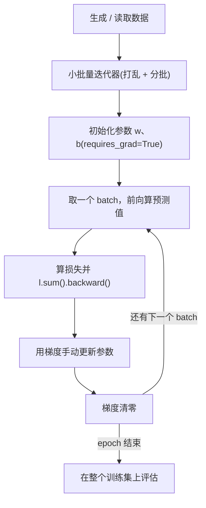

> 环境：Python 3.9 + `torch 2.8.0` + `matplotlib`（仅可视化用到）
> 参考主线：《动手学深度学习》(d2l) 第 3.2 节「线性回归的从零开始实现」与 3.3 节「线性回归的简洁实现」

| 章 | 内容 |
| --- | --- |
| 一、线性回归简介 | 模型、损失函数、解析解、梯度下降、三个超参数 |
| 二、从零实现 | 手写数据集、数据迭代器、模型、损失、SGD、训练循环 |
| 三、用 PyTorch 接口实现 | `DataLoader`、`nn.Linear`、`nn.MSELoss`、`optim.SGD` |
| 四、对比与小结 | 两套实现的对应关系、调参实验、常见坑 |

---

# 一、线性回归简介

## 1.1 从房价预测说起

假设我们要预测房价。最朴素的假设是：**房价主要由少数几个因素线性决定**，比如面积、房龄。面积越大价格越高，房龄越大价格越低，而且「每多 1 平米涨多少钱」大致是个固定值。

把这种直觉写成公式：设样本有 $d$ 个特征 $\mathbf{x} = (x_1, x_2, \dots, x_d)^\top$，预测值

$$
\hat{y} = w_1 x_1 + w_2 x_2 + \dots + w_d x_d + b = \mathbf{w}^\top \mathbf{x} + b
$$

其中 $\mathbf{w} \in \mathbb{R}^d$ 是**权重**（每个特征的影响力），$b \in \mathbb{R}$ 是**偏置**（所有特征为 0 时的基准值）。$\mathbf{w}$ 和 $b$ 合称**模型参数**，训练的目标就是把它们找出来。

如果把 $n$ 个样本堆成矩阵 $\mathbf{X} \in \mathbb{R}^{n \times d}$，标签堆成向量 $\mathbf{y} \in \mathbb{R}^n$，整个数据集上的预测就是

$$
\hat{\mathbf{y}} = \mathbf{X}\mathbf{w} + b
$$

线性回归虽然简单，但它是理解一切深度学习模型的起点：后面的全连接层、甚至 Transformer 里的线性变换，本质都是这个式子，只是外面又套了非线性函数、层数变多了。

## 1.2 损失函数：怎么衡量「预测得好不好」

有了模型，还需要一个数字来评价某组参数的好坏。最自然的想法是看预测值和真实值差多少，并且**把正负误差都算成惩罚**，于是取平方：

$$
\ell(\hat{y}, y) = \frac{1}{2}\left(\hat{y} - y\right)^2
$$

对整个训练集取平均，就得到**均方误差（MSE）损失**：

$$
L(\mathbf{w}, b) = \frac{1}{2n}\sum_{i=1}^{n}\left(\hat{y}^{(i)} - y^{(i)}\right)^2
= \frac{1}{2n}\sum_{i=1}^{n}\left(\mathbf{w}^\top \mathbf{x}^{(i)} + b - y^{(i)}\right)^2
$$

几个细节：

- **为什么除以 2**：求导时平方会掉下来一个 2，正好和分母的 2 约掉，公式更干净。它不改变最优解的位置，只是把损失值缩小了一半。
- **为什么用平方而不是绝对值**：平方处处可导、优化性质好；而且在「噪声服从高斯分布」的假设下，最小化平方损失等价于**极大似然估计**。代价是对离群点敏感，数据脏的时候可以考虑 L1 损失或 Huber 损失。
- 损失函数只依赖模型参数，训练集是固定的。所以 $L$ 是关于 $(\mathbf{w}, b)$ 的函数，训练就是求它的最小值点。

## 1.3 解析解：能不能一步算出来

线性回归是少数有闭式解的模型。把偏置吸收进权重（在 $\mathbf{X}$ 末尾加一列全 1），损失对 $\mathbf{w}$ 求导并令其为 0，可得

$$
\mathbf{w}^{*} = \left(\mathbf{X}^\top \mathbf{X}\right)^{-1}\mathbf{X}^\top \mathbf{y}
$$

用 1000 个样本、真实参数 $\mathbf{w} = (2, -3.4)$、$b = 4.2$ 的数据实测，这个公式给出 $(1.9999,\ -3.3997,\ 4.1997)$，几乎就是真值。

那为什么深度学习不用它？因为：

1. $\mathbf{X}^\top\mathbf{X}$ 求逆的复杂度是 $O(d^3)$，特征维度一高就不可行；
2. 矩阵可能奇异（特征共线）或数值不稳定；
3. 更重要的是，**绝大多数模型（多层神经网络）根本没有解析解**，必须靠迭代优化。

所以实践中统一用梯度下降，线性回归正好是最适合拿来入门的例子。

## 1.4 梯度下降与小批量

对损失求偏导，得到

$$
\frac{\partial L}{\partial \mathbf{w}} = \frac{1}{n}\sum_{i=1}^{n}\left(\hat{y}^{(i)} - y^{(i)}\right)\mathbf{x}^{(i)},
\qquad
\frac{\partial L}{\partial b} = \frac{1}{n}\sum_{i=1}^{n}\left(\hat{y}^{(i)} - y^{(i)}\right)
$$

然后沿负梯度方向更新参数：

$$
\mathbf{w} \leftarrow \mathbf{w} - \eta\,\frac{\partial L}{\partial \mathbf{w}},
\qquad
b \leftarrow b - \eta\,\frac{\partial L}{\partial b}
$$

其中 $\eta$ 是**学习率**，控制每一步走多远。

问题在于：上面的梯度要对**全部 $n$ 个样本**求和。数据量大时（百万级），每走一步都要遍历整个数据集，太慢。

于是有了**小批量随机梯度下降（mini-batch SGD）**：每次只随机抽一小批样本 $\mathcal{B}$（大小记为 $|\mathcal{B}|$），用这一批的平均梯度近似全量梯度：

$$
\mathbf{w} \leftarrow \mathbf{w} - \eta\,\frac{1}{|\mathcal{B}|}\sum_{i \in \mathcal{B}}\left(\hat{y}^{(i)} - y^{(i)}\right)\mathbf{x}^{(i)}
$$

三个好处：

- 每步计算量小，迭代快；
- 随机采样带来的噪声反而有助于跳出不好的区域；
- 梯度是「近似」的，但期望上等于真实梯度，所以长期能收敛到同一处。

「随机」体现在两点：**样本顺序被打乱**、**每批只用了部分样本**。这也是后面代码里 `random.shuffle` 和 `DataLoader(shuffle=True)` 的由来。

## 1.5 三个超参数与训练术语

训练前要定三个不由梯度学习、而由人设定的**超参数**：

| 名称 | 含义 | 本例取值 |
| --- | --- | --- |
| 批量大小 `batch_size` | 每次更新参数用多少个样本 | 10 |
| 学习率 `lr` | 每次参数更新的步长 | 0.03 |
| 迭代轮数 `num_epochs` | 把整个数据集过多少遍 | 3 |

几个术语要分清：

- **一次迭代（iteration / step）**：处理一个 batch、更新一次参数。1000 个样本、batch 为 10，则每轮有 100 次迭代。
- **一个 epoch**：把训练集完整过一遍，即 100 次迭代。
- **收敛**：损失不再明显下降。线性回归这种凸问题，学习率合适时损失会单调下降并稳定在一个由噪声决定的水平上（本例噪声标准差 0.01，损失下界约 $0.01^2/2 = 5\times10^{-5}$，实测最后正是 $5.1\times10^{-5}$，说明参数已经学到了真值）。

## 1.6 泛化与过拟合（一句话预告）

上面讨论的都是**训练误差**。模型真正要的是在没见过的数据上表现好，即**泛化误差**。如果模型太复杂，它可能把训练集里的噪声也背下来，训练误差很低但泛化误差很差，这叫**过拟合**。常见的对策是加正则项（如 L2 权重衰减 $\frac{\lambda}{2}\|\mathbf{w}\|^2$）、增加数据、简化模型。线性回归的参数少，通常不容易过拟合，但正则化的思想会一直贯穿后面的章节。

---

# 二、从零实现线性回归

这一章不用任何高级封装，只用张量运算 + 自动求导，把训练流程的每个零件都手写一遍。**看懂这一章，就理解了所有深度学习训练循环的骨架。**

## 2.1 整体流程

整条流水线如下：



## 2.2 生成合成数据集

真实数据不好找，我们直接按已知规律造一份：先随机生成特征，再按 $y = \mathbf{X}\mathbf{w} + b$ 算出标签，最后加一点噪声模拟观测误差。

```python
import torch

def synthetic_data(w, b, num_examples):
    """生成 y = Xw + b + 噪声。"""
    # 特征：1000 个样本，每个样本 len(w) 个特征，服从标准正态分布
    x = torch.normal(0, 1, (num_examples, len(w)))
    # 标签：矩阵乘法 + 偏置
    y = torch.matmul(x, w) + b
    # 加噪声，标准差 0.01，模拟真实观测误差
    y += torch.normal(0, 0.01, y.shape)
    # 形状从 (num_examples,) 改成 (num_examples, 1) 的列向量
    return x, y.reshape((-1, 1))

true_w = torch.tensor([2.0, -3.4])
true_b = 4.2
features, labels = synthetic_data(true_w, true_b, 1000)

print(features.shape)   # torch.Size([1000, 2])
print(labels.shape)     # torch.Size([1000, 1])
```

要点：

- `torch.normal(0, 1, (n, d))` 的第一个参数是均值、第二个是标准差（**不是**方差）；
- `torch.matmul(x, w)` 里 `x` 是 $(n, d)$、`w` 是 $(d,)$，结果是 $(n,)$；加标量 `b` 会广播到每个元素；
- `y.reshape((-1, 1))` 中的 `-1` 表示「这一维自己算」，结果是把 $(n,)$ 变成 $(n, 1)$。**保持标签是列向量**，是为了和模型的输出 $\hat{\mathbf{y}}$ 形状一致，避免后面广播出错。

因为特征是二维的，可以画图直观感受一下第一个特征和标签的关系（可以跳过）：

```python
import matplotlib.pyplot as plt

plt.scatter(features[:, 1].detach().numpy(),
            labels.detach().numpy(), 1)
plt.xlabel("feature 1")
plt.ylabel("label")
plt.show()      # 无图形界面时改成 plt.savefig("scatter.png")
```

`.detach().numpy()` 是因为 `features` 参与了计算图（虽然是常数，但 `requires_grad` 的传播规则要求先脱离图），转 NumPy 前必须先 `detach`。

## 2.3 小批量数据迭代器

训练时不能一次把 1000 个样本全喂进去，也不能一个个喂。我们需要一个能**反复产出小批量**的东西：打乱索引、每 `batch_size` 个切一刀、最后不足一批的就少给一点。

用**生成器（`yield`）**写最自然：

```python
import random

def data_iter(batch_size, features, labels):
    """按小批量读取数据，每个 epoch 调用一次，顺序随机。"""
    num_examples = len(features)
    indices = list(range(num_examples))
    random.shuffle(indices)              # 打乱样本读取顺序

    for i in range(0, num_examples, batch_size):
        # 最后一批可能不足 batch_size，用 min 兜住
        batch_indices = torch.tensor(
            indices[i:min(i + batch_size, num_examples)])
        # 花式索引：一次取出这一批的所有行
        yield features[batch_indices], labels[batch_indices]

for x, y in data_iter(10, features, labels):
    print(x.shape, y.shape)   # torch.Size([10, 2]) torch.Size([10, 1])
    break
```

要点：

- `random.shuffle` 是**原地**打乱列表，所以每个 epoch 的批次组成都不一样；
- `features[batch_indices]` 是 PyTorch 的**花式索引**：用整数张量当索引，按索引取行，返回一个新张量；
- `yield` 让函数变成生成器，`for` 循环每取一次才计算一批，不占额外内存；
- `min(i + batch_size, num_examples)` 处理最后一批不足的情况，否则会越界（PyTorch 切片越界其实不报错，但显式写清楚更稳）。

## 2.4 初始化模型参数

```python
w = torch.normal(0, 0.01, size=(2, 1), requires_grad=True)
b = torch.zeros(1, requires_grad=True)
```

- 形状：`w` 是 $(2, 1)$、`b` 是 $(1,)$，这样 `x @ w + b` 得到 $(n, 1)$，和标签形状对上；
- `requires_grad=True` 是**关键**：只有标记了的张量，`backward()` 才会把梯度写进它的 `.grad`；
- 为什么不用全 0 初始化：这里用很小的随机值，是为了避免所有特征「同步更新」的对称性问题。线性回归其实用 0 初始化也能收敛，但神经网络里必须打破对称，所以养成习惯；
- 初始值必须离真值有距离（本例真值 $w=(2,-3.4)$），否则看不出训练效果。

## 2.5 定义模型、损失函数、优化算法

**模型**就是一个函数，输入特征和参数，输出预测值：

```python
def linreg(x, w, b):
    """线性回归模型。"""
    return torch.matmul(x, w) + b
```

**损失函数**返回每个样本的损失，形状是 $(|\mathcal{B}|, 1)$，**不做求和也不做平均**：

```python
def squared_loss(y_hat, y):
    """平方损失，逐样本计算，未做归约。"""
    # y.reshape(y_hat.shape) 保证形状对齐
    return (y_hat - y.reshape(y_hat.shape)) ** 2 / 2
```

**优化算法**负责用梯度更新参数：

```python
def sgd(params, lr, batch_size):
    """小批量随机梯度下降。"""
    with torch.no_grad():                      # 更新参数时不需要建图
        for param in params:
            # 注意：这里除以 batch_size，把「求和」变成了「平均」
            param -= lr * param.grad / batch_size
            param.grad.zero_()                 # 用完立刻清零，防止累加
```

这三段代码里有几个设计是相互配合的，必须一起理解：

1. **为什么损失不除以 $n$？** 因为 `sgd` 里已经 `param.grad / batch_size` 了。两处合起来，等价于「对 batch 求平均损失」的梯度。分工是：损失函数只管逐样本算，优化器管平均和更新。
2. **为什么要 `l.sum().backward()`？** `backward()` 只接受标量。损失是 $(|\mathcal{B}|, 1)$，先 `.sum()` 聚合成标量。注意：求和后的梯度是**各样本梯度之和**，所以 `sgd` 里要再除以 `batch_size` 才是平均梯度。
3. **为什么 `sgd` 里要 `with torch.no_grad()`？** 参数更新是「就地改数值」，如果被记录进计算图，会污染后续的反向传播，还会白白占内存。
4. **`param -= ...` 是原地修改吗？** 在 `no_grad` 下，`-=` 会就地更新叶子张量，`id(param)` 不变，这正是我们想要的——**更新的是同一块内存里的参数**，而不是换一个新张量。
5. **`param.grad.zero_()` 为什么必须写？** PyTorch 的梯度是**累加**的。不清零的话，下一次 `backward()` 会把新梯度加到旧梯度上，更新步长越走越大，训练直接崩掉。

## 2.6 训练

把上面的零件拼起来：

```python
lr = 0.03
num_epochs = 3
batch_size = 10
net = linreg
loss = squared_loss

for epoch in range(num_epochs):
    for x, y in data_iter(batch_size, features, labels):
        l = loss(net(x, w, b), y)     # 前向：得到形状 (batch_size, 1) 的损失
        l.sum().backward()            # 反向：标量化后求梯度，写入 w.grad、b.grad
        sgd([w, b], lr, batch_size)   # 更新参数并清零梯度

    # 每个 epoch 结束，在整个训练集上评估一次
    with torch.no_grad():
        train_l = loss(net(features, w, b), labels)
        print(f'epoch {epoch + 1}, loss {float(train_l.mean()):f}')

print(f'w 的估计误差: {true_w - w.reshape(true_w.shape)}')
print(f'b 的估计误差: {true_b - b}')
```

评估时用 `with torch.no_grad()` 包起来：我们只关心数值，不需要建图算梯度，这样更快也更省内存。

## 2.7 运行结果

以下是一次运行的输出（初始化和批次顺序都带随机性，你的结果会有小幅波动，但数量级一致）：

```text
epoch 1, loss 0.036119
epoch 2, loss 0.000129
epoch 3, loss 0.000051
w 的估计误差: tensor([-9.7990e-05, -7.9060e-04], grad_fn=<SubBackward0>)
b 的估计误差: tensor([0.0002], grad_fn=<RsubBackward1>)
```

解读：

- 第 1 轮损失还比较大（0.036），第 2 轮就掉到 $1.3\times10^{-4}$，第 3 轮 $5.1\times10^{-5}$——正好是噪声方差的一半（$0.01^2/2$），说明**已经拟合到数据里能学的极限**，再训练也不会更低；
- 参数误差在 $10^{-4}$ 量级，说明学到的 $\mathbf{w}, b$ 基本就是真值；
- 只用了 3 个 epoch、300 次迭代，因为线性回归是凸问题，且数据完全由线性关系生成，收敛极快。真实任务往往要几十上百个 epoch。

## 2.8 常见坑

| 现象 | 原因 |
| --- | --- |
| 损失不降或变成 `nan` | 学习率太大（本例 `lr=5` 会直接 `nan`），或忘了 `param.grad.zero_()` |
| 损失降得极慢 | 学习率太小（本例 `lr=0.001` 跑 3 轮后损失仍在 9 左右） |
| 报 `RuntimeError: grad can be implicitly created only for scalar outputs` | 忘了 `.sum()`，直接对向量 `backward()` |
| 参数完全不更新 | 初始化时忘了 `requires_grad=True` |
| 损失比预期大很多 | 忘了在 `sgd` 里除以 `batch_size`，等价于把学习率放大了 10 倍 |
| 形状报错 | 标签没 reshape 成 $(n, 1)$，和预测的 $(n, 1)$ 广播错位 |

---

# 三、用 PyTorch 接口实现

上一章的每个零件，PyTorch 都提供了封装好的版本。换成接口实现后，代码更短、更通用（换成多层网络只需改一行），但**训练循环的骨架完全一样**。

## 3.1 与手写版的对应关系

| 环节 | 从零实现 | PyTorch 接口 |
| --- | --- | --- |
| 数据集容器 | 直接传两个张量 | `data.TensorDataset(features, labels)` |
| 小批量迭代 | 手写 `data_iter` + `random.shuffle` | `data.DataLoader(dataset, batch_size, shuffle=True)` |
| 模型 | `linreg(x, w, b)` 函数 | `nn.Sequential(nn.Linear(2, 1))` |
| 参数管理 | 手动创建 `w`、`b` 并设 `requires_grad` | `net.parameters()` 自动收集 |
| 损失函数 | 手写 `squared_loss` | `nn.MSELoss()` |
| 优化器 | 手写 `sgd` | `torch.optim.SGD(net.parameters(), lr)` |
| 梯度清零 | `param.grad.zero_()` | `trainer.zero_grad()` |
| 参数更新 | `param -= lr * grad / batch_size` | `trainer.step()` |

## 3.2 完整代码

```python
import torch
import torch.utils.data as data
from torch import nn

def synthetic_data(w, b, num_examples):
    """生成 y = Xw + b + 噪声。"""
    x = torch.normal(0, 1, (num_examples, len(w)))
    y = torch.matmul(x, w) + b
    y += torch.normal(0, 0.01, y.shape)
    return x, y.reshape((-1, 1))

true_w = torch.tensor([2.0, -3.4])
true_b = 4.2
features, labels = synthetic_data(true_w, true_b, 1000)

# 1. 数据集与迭代器
data_set = data.TensorDataset(features, labels)
data_iter = data.DataLoader(data_set, batch_size=10, shuffle=True)

# 2. 模型与参数初始化
net = nn.Sequential(nn.Linear(2, 1))
net[0].weight.data.normal_(0, 0.01)
net[0].bias.data.fill_(0)

# 3. 损失函数与优化器
loss = nn.MSELoss()
trainer = torch.optim.SGD(net.parameters(), lr=0.03)

# 4. 训练
num_epochs = 3
for epoch in range(num_epochs):
    for x, y in data_iter:
        l = loss(net(x), y)     # 前向 + 算损失
        trainer.zero_grad()     # 清空上一轮梯度
        l.backward()            # 反向求梯度
        trainer.step()          # 更新参数
    l = loss(net(features), labels)
    print(f'epoch {epoch + 1}, loss {l:f}')
```

## 3.3 逐段解释

### 3.3.1 `TensorDataset` + `DataLoader`

```python
data_set = data.TensorDataset(features, labels)
data_iter = data.DataLoader(data_set, batch_size=10, shuffle=True)
```

- `TensorDataset` 把多个张量按**第 0 维对齐**打包，`data_set[i]` 返回 `(features[i], labels[i])`；
- `DataLoader` 负责：按 `batch_size` 切批、`shuffle=True` 时每个 epoch 重新打乱、自动处理最后一批不足的情况、拼接成一个 batch 的张量；
- 它比手写版多了两个能力：`num_workers` 多进程预取、`drop_last` 丢弃最后一个不满的批次。

### 3.3.2 `nn.Linear` 与参数形状

```python
net = nn.Sequential(nn.Linear(2, 1))
```

`nn.Linear(2, 1)` 表示「输入 2 维、输出 1 维」，内部自动创建两个参数：

- `weight`：形状 $(1, 2)$，注意是**输出维在前、输入维在后**（即 $\mathbf{W} \in \mathbb{R}^{1\times 2}$）；
- `bias`：形状 $(1,)$。

它计算的是 $\mathbf{x}\mathbf{W}^\top + \mathbf{b}$，结果和手写版的 $\mathbf{x}\mathbf{w} + b$ 完全一致，只是把权重存成了矩阵形式。这样写是为了能一次输出多个值（比如 `nn.Linear(2, 3)` 输出 3 维），也为后面多层网络做准备。

`nn.Sequential` 是「按顺序串起来的容器」，这里只有一层，用 `net[0]` 就能取到那个 `nn.Linear`。

### 3.3.3 参数初始化

```python
net[0].weight.data.normal_(0, 0.01)
net[0].bias.data.fill_(0)
```

- `.data` 拿到的是「脱离计算图的同一份数据」，对它的原地操作（带下划线的 `normal_`、`fill_`）不会记录进计算图。等价写法是 `with torch.no_grad(): net[0].weight.normal_(0, 0.01)`；
- 初始化一定要在**创建优化器之前或训练开始之前**做，否则可能把刚学到的参数覆盖掉。

### 3.3.4 `nn.MSELoss` 与 `optim.SGD`

```python
loss = nn.MSELoss()
trainer = torch.optim.SGD(net.parameters(), lr=0.03)
```

- `nn.MSELoss()` 默认 `reduction='mean'`：**先对每个元素平方，再对整个 batch 取平均**，并且**不带那个 1/2**。所以它相当于手写版的 `2 * squared_loss(...).mean()`，返回 0 维标量，可以直接 `backward()`，不用再 `.sum()`；
- 因为 `MSELoss` 已经平均过了，优化器里就**不需要再除以 `batch_size`**，`trainer.step()` 内部做的就是 $\theta \leftarrow \theta - \eta \nabla_\theta L$；
- `net.parameters()` 会自动递归收集所有需要梯度的参数，所以换模型时这行不用改。

**一个容易忽略的差别**：手写版损失带 `1/2`，梯度是 $\frac{1}{|\mathcal{B}|}\sum(\hat{y}-y)\mathbf{x}$；`MSELoss` 没有 `1/2`，梯度是 $\frac{2}{|\mathcal{B}|}\sum(\hat{y}-y)\mathbf{x}$，**正好是两倍**。所以同样写 `lr=0.03`，接口实现的实际步长相当于手写版的 0.06。实测（同一份数据、相同随机种子）：

| 配置 | 第 1 轮结束时的损失 |
| --- | --- |
| 手写版 `lr=0.03` | 0.039 |
| 接口版 `lr=0.03` | 0.00012 |
| 手写版 `lr=0.06` | 0.00011 |
| 接口版 `lr=0.015` | 0.039 |

想让两者严格对齐，把接口实现的 `lr` 设成手写版的一半即可。这也说明：**比较不同实现的学习率时，必须先确认损失函数的缩放方式是否一致**。

`MSELoss` 的几种 reduction：

| 取值 | 行为 | 输出形状 |
| --- | --- | --- |
| `'mean'`（默认） | 所有元素求平均 | 标量 |
| `'sum'` | 所有元素求和 | 标量 |
| `'none'` | 不归约 | 与输入同形状 |

### 3.3.5 标准训练循环

```python
l = loss(net(x), y)     # 1. 前向 + 损失
trainer.zero_grad()     # 2. 清梯度
l.backward()            # 3. 反向求梯度
trainer.step()          # 4. 更新参数
```

这四行的顺序就是所有 PyTorch 训练代码的**标准模板**，请背下来：

- `zero_grad()` 放在 `backward()` 之前即可（放在上一步 `step()` 之后也等价），关键是**不能漏**；
- `backward()` 只对**标量**有效，所以 `loss` 必须是标量（`MSELoss` 默认已经保证了）；
- `step()` 只在 `backward()` 之后调用，此时 `.grad` 才有值。

## 3.4 运行结果

同样是一次运行的输出（数值会随机波动）：

```text
epoch 1, loss 0.000291
epoch 2, loss 0.000093
epoch 3, loss 0.000093
```

和手写版一样，几轮之内就收敛到 $10^{-4}$ 以下，最后停在 $9.3\times10^{-5}$ 附近（噪声决定的下界附近）。

第 1 轮就比手写版低一个数量级，并不是接口实现「更好」，而是上一节说的**损失缩放差异**：`MSELoss` 没有 `1/2`，同样的 `lr=0.03` 实际步长是手写版的两倍，所以收敛更快。把 `lr` 改成 0.015 后，两条曲线基本重合。

---

# 四、对比与小结

## 4.1 两套实现怎么选

| 维度 | 从零实现 | 接口实现 |
| --- | --- | --- |
| 代码量 | 多（约 60 行核心逻辑） | 少（约 30 行） |
| 可读性 | 每个细节都暴露，适合学习 | 隐藏细节，适合工程 |
| 可扩展性 | 换模型要改多处 | 换模型只改 `nn.Linear` 一行 |
| 性能 | 单进程、无预取 | 支持多进程、固定内存、GPU 加速 |
| 出错概率 | 高（清零、形状、除 batch 等） | 低 |

学习阶段建议**先手写一遍**，把梯度、清零、batch 平均这些概念走通；之后一律用接口实现，把精力放在模型结构上。

## 4.2 动手调参实验

改一个超参数、看结果变化，是理解它们最快的方式（以下结果均为实测）：

| 实验 | 观察 |
| --- | --- |
| `lr = 0.001` | 3 轮后损失仍在 9 左右，明显没收敛——步子太小 |
| `lr = 0.03` | 3 轮收敛到 $5\times10^{-5}$，合适 |
| `lr = 5` | 第 1 轮就 `nan`，发散——步子太大 |
| 注释掉 `param.grad.zero_()` | 损失先降后爆，因为梯度不断累加 |
| 注释掉 `l.sum()` 直接 `l.backward()` | 报错，非标量不能直接反传 |
| `batch_size = 1` | 每轮迭代 1000 次，噪声大、抖动明显 |
| `batch_size = 1000` | 每轮只更新 1 次，收敛慢但曲线平滑 |
| 接口版把 `lr` 改成 0.015 | 收敛速度与手写版 `lr=0.03` 基本一致（损失缩放差 2 倍） |

## 4.3 小结

- 线性回归的模型是 $\hat{y} = \mathbf{w}^\top\mathbf{x} + b$，损失是均方误差，训练是求损失最小的参数；
- 它有解析解 $\mathbf{w}^* = (\mathbf{X}^\top\mathbf{X})^{-1}\mathbf{X}^\top\mathbf{y}$，但实际用**小批量随机梯度下降**迭代求解，因为后者能推广到任意模型；
- 一次完整的训练 = **前向算损失 → 反向求梯度 → 更新参数 → 梯度清零**，循环若干 epoch；
- 从零实现和接口实现的差别只在「零件是手写的还是库函数」，**训练循环的骨架完全相同**；
- 两套实现在数学上等价，但损失函数的缩放不一样（手写版带 `1/2`、`MSELoss` 不带），所以相同学习率下接口版的实际步长是手写版的 2 倍，比较时要换算；
- 三个超参数（batch size、学习率、epoch 数）直接决定训练是否收敛、收敛多快，学习率尤其敏感。

下一步自然是把「一个线性层」换成「多个线性层 + 非线性激活」，也就是多层感知机（MLP）；训练循环一行都不用改，这正是这套骨架的价值。
